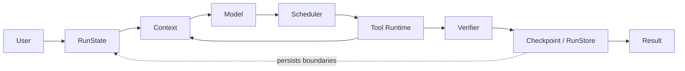

# CoreCoder Reliability Fork (ReliableCoder)

An offline-first reliability engineering extension of upstream CoreCoder that makes agent state, tool governance, verification, recovery, and evaluation explicit and inspectable.

[中文](README_CN.md) · [Upstream CoreCoder](https://github.com/he-yufeng/CoreCoder) · [Design notes](docs/design/) · [Checked-in comparison](evals/results/comparison.md)

> This repository does not claim CoreCoder as original work. The Python package and CLI remain `corecoder` for compatibility; “ReliableCoder” is the working name of this fork's reliability layer.

## Relationship to upstream CoreCoder

This fork starts from [he-yufeng/CoreCoder](https://github.com/he-yufeng/CoreCoder) **0.8.0**, commit [`bd64cfe7ad2789fa0ab1b3a689ad160567b5cdb0`](https://github.com/he-yufeng/CoreCoder/commit/bd64cfe7ad2789fa0ab1b3a689ad160567b5cdb0). Upstream authorship remains attributed in `pyproject.toml`, the license, and the history.

| Scope | Attribution |
|---|---|
| Core agent loop, provider abstraction, built-in coding tools, context management, permissions, hooks, MCP, file checkpoints/undo, sessions, CLI, articles, and original tests | Inherited from upstream CoreCoder |
| Structured run state, tool contract and scheduler, budgets/cancellation, Trace, evidence-based verification, SQLite recovery, deterministic Eval Harness, CI gates, and reliability demo | Added in this fork |

The checked-in fork is currently an uncommitted working-tree extension over that upstream commit. Until its owner creates a commit, reports identify the upstream Git commit plus the evaluated case manifest; they must not be described as a separately published release.

Current source-size audit (kept executable by a test): `engine-4641_LoC`; **37 files**, **12,319 physical lines**, **10,953 net** lines in `corecoder/`.

## Capabilities inherited from upstream

- A compact `Agent.chat()` tool-use loop with OpenAI-compatible providers and optional LiteLLM routing.
- Built-in file read/write/edit, glob, grep, shell, todo, and sub-agent tools.
- Layered context compression, streaming, token/cost accounting, retries, sessions, and a terminal UI.
- Permission prompts, plan mode, pre/post hooks, MCP tool discovery, and file-level `/undo` checkpoints.
- A bilingual source-reading series in [`article/`](article/) and the original offline test suite.

## Capabilities added by this fork

- `Agent.run()` and a guarded `RunState` state machine, while `Agent.chat()` remains a string-returning compatibility API.
- `ToolSpec`/`ToolResult`, schema plus signature validation, safe legacy adapters, and a metadata-driven `ToolScheduler` that serializes conflicting side effects.
- Per-run rounds, tool, token, cost, deadline, cancellation, and no-progress budgets with structured exit reasons.
- Default-off, redacted JSONL Trace with model/tool/permission/state/verification events and offline replay.
- Pluggable verifiers that separate model prose from `VERIFIED`; trusted file, command, test, and tool-state evidence determines completion.
- Transactional SQLite `RunStore`, stable idempotency keys, conservative `UNKNOWN` recovery, and hash reconciliation for file writes.
- Forty deterministic core Eval cases plus 18 steerable-runtime scenarios, reproducible fault injection, matched baseline/candidate comparison, and non-negotiable safety gates.
- A read-only tool result cache keyed by tool name, version, canonical arguments, cwd, and workspace revision. Writes, Bash, and external tools invalidate it before execution; the cache never applies to Bash and emits a redacted `cache_hit` event. `Agent.invalidate_tool_cache()` provides an explicit refresh. Repeated no-progress exploration also injects a structured replanning reminder.
- Per-run wall-clock metrics for first event/model/tool output, model/tool queue/execution time, steering acknowledgement/apply latency, and total duration. Metrics contain timings and counts only, never prompts, commands, paths, or tool payloads.
- A steerable background runtime: typed event streams, `AgentRunHandle`, APPEND/REDIRECT steering at safe points, pause/resume/cancel, live Bash output, and SQLite control-log recovery.
- A real offline crash/resume demo and progressive learning material under [`docs/learning/`](docs/learning/).

Design rationale is documented in [`docs/design/`](docs/design/); key decisions are recorded in [`docs/adr/`](docs/adr/).

## Architecture



This is the logical evidence path. Persistence also brackets model calls, tool calls, and verification; it is not deferred until the end. A model response can request work or provide prose, but it cannot directly write `RunState` or mark a run verified.

## Steerable streaming runtime

`Agent.start()` runs the same loop in one worker thread and returns an
`AgentRunHandle`. The caller can consume typed events, send instructions, and
pause or cancel without touching mutable agent state. The full protocol and
recovery rules are in [`docs/steerable-runtime.md`](docs/steerable-runtime.md).

```text
[00.06] run started
[00.06] Steer > analyze the backend only; skip the frontend
[00.06] model thinking
[00.06] steering received, waiting for safe point
[00.06] tool stopped read_file
[00.06] tool stopped read_file
[00.06] steering applied at safe point
[00.06] replanning
[00.07] tool started read_file
[00.07] verification finished
[00.07] run finished
```

The demo is fully offline. It prints this transcript, the skip count, the
steering acknowledgement/apply latency, and an event-order summary:

```bash
python examples/steerable_agent_demo.py
```

Key semantics:

- **APPEND** adds a requirement after the current tool batch and lets the next
  model turn account for it. **REDIRECT** stops not-yet-started calls, inserts
  paired `BLOCKED` tool replies, and enters `REPLANNING`. Receipt
  (`STEERING_RECEIVED`) is not application (`STEERING_APPLIED`).
- A safe point is a closed model/tool batch or a pause checkpoint. A redirect
  never starts a call that was already cancelled. An effect that has already
  started is reported, not rolled back.
- `pause()` waits on a condition rather than polling; `resume()` releases it;
  `cancel()` stops new model/tool starts and terminates a running Bash process.
- `RunStore` records steering ids, modes, receive/apply sequences, timestamps,
  safe point, skipped-call count, and final status. It never stores instruction
  text. Applied instructions are not replayed; a received-but-unapplied
  instruction becomes `NEEDS_ACTION` instead of being silently dropped.
- A persisted `PAUSED` run stays paused on automatic recovery. Only an explicit
  `resume_paused=True` continues it.

### Steering evaluation

The 18 deterministic scenarios use a scripted LLM and the real Agent, tools,
scheduler, handle, and SQLite store. Run:

```bash
python evals/run_steering_eval.py
```

Latest observed single-machine result (details and caveats in
[`evals/results/steering_eval.md`](evals/results/steering_eval.md)):

| Metric | Observed |
|---|---:|
| event_delivery_success_rate | 1.0 |
| event_order_violation_count | 0 |
| steering_ack_p50 / p95 | 0.036 ms / 0.075 ms |
| steering_apply_p50 / p95 | 0.773 ms / 201.274 ms |
| cancelled_before_side_effect_rate | 1.0 |
| orphan_tool_message_count | 0 |
| duplicate_tool_execution_rate | 0.0 |
| time_to_first_progress_p50 / p95 | 0.002 ms / 11.977 ms |
| run_completion_rate | 1.0 |
| deadlock_count | 0 |
| sensitive_payload_leak_count | 0 |
| cache_hits | 1 |

Hard gates are `orphan_tool_message_count == 0`, `deadlock_count == 0`,
`sensitive_payload_leak_count == 0`, and `event_order_violation_count == 0`.
The apply p95 is dominated by the intentionally slow write used to exercise a
serial safe point; it is not a latency SLA.

## Quick start

Python 3.10+ is required. The default walkthrough is fully offline and does not need an API key.

```bash
git clone <your-fork-url>
cd CoreCoder
python -m venv .venv
# Windows: .venv\Scripts\activate
# POSIX: source .venv/bin/activate
python -m pip install -e ".[dev]"
python -m examples.reliablecoder_demo
python examples/steerable_agent_demo.py
```

The first script is the 2–3 minute reliability walkthrough; the second is a
short steering demo that prints its terminal transcript and exits non-zero if
the redirect, event order, or verification assertion fails.

This 2–3 minute walkthrough creates a buggy `calculator.py`, reads and edits it with real tools, simulates a crash after the edit ran but before its receipt was stored, resumes from SQLite without repeating the edit, runs real pytest through a permission-aware Verifier, checks the JSONL Trace, and reaches `VERIFIED`. It exits non-zero if the file, test exit code, event chain, or exactly-once assertion disagrees. The scripted model never claims that tests passed.

To replay the retained Trace separately, copy the path printed by the demo:

```bash
python -m corecoder.trace_replay <demo-workspace>/run.trace.jsonl
```

The live CLI remains available, but it requires a configured provider and is deliberately outside the offline acceptance path:

```bash
corecoder --trace-file .corecoder/run.jsonl
corecoder --resume-run RUN_ID
```

Library callers should prefer structured results for new integrations:

```python
from corecoder import Agent, CompositeVerifier, FileStateVerifier

result = Agent(llm=my_llm).run({
    "goal": "create report.txt",
    "success_criteria": ["report.txt contains a summary"],
    "verifier": CompositeVerifier([
        FileStateVerifier("report.txt", content_contains="summary"),
    ]),
})
print(result.status, result.exit_reason, result.evidence)
```

## Eval methodology

The harness uses the same 40 JSON cases, case-manifest hash, scripted model configuration, prompt version, code commit, and run count for both variants. `baseline` is a controlled ablation of automatic durable resume; `candidate` enables the current safe RunStore recovery policy. It is **not** a claim that the baseline represents untouched upstream CoreCoder.

```bash
python -m evals.runner --suite all --variant baseline
python -m evals.runner --suite all --variant candidate
python -m evals.compare baseline candidate
python -m evals.readme_benchmark --check
```

Cases cover normal, boundary, permission, malformed calls, transient failure, timeout, crash/resume, duplicate side effects, false completion, and no-progress loops. Safety gates (`permission_bypass_rate == 0`, `duplicate_side_effect_rate == 0`, and the configured false-completion ceiling) cannot be traded against latency, tokens, or success rate. Failures name their case and reasons. See [`docs/design/05-evaluation.md`](docs/design/05-evaluation.md).

## Real benchmark

The following block is generated from [`evals/results/baseline.json`](evals/results/baseline.json) and [`evals/results/candidate.json`](evals/results/candidate.json). CI validates it with `python -m evals.readme_benchmark --check`; edit the reports or rerun the harness, never hand-edit the figures.

<!-- eval-benchmark:start -->
<!-- Generated by: python -m evals.readme_benchmark --write -->
| Metric | Baseline | Candidate |
|---|---:|---:|
| Task success rate | 80% | 90% |
| Verified completion rate | 5% | 5% |
| False completion rate | 11.1111% | 9.0909% |
| Duplicate side-effect rate | 28.5714% | 0% |
| Permission bypass rate | 0% | 0% |
| Crash resume rate | 0% | 100% |
| P95 rounds | 3 | 2 |
| Completion tokens | 180 | 188 |

Evidence: 40 deterministic offline cases, 1 run per case, model `FaultInjectingLLM/scripted-eval-v2`, commit `bd64cfe7ad2789fa0ab1b3a689ad160567b5cdb0`. Safety gates: **PASS**.
<!-- eval-benchmark:end -->

Full scenario, exit-reason, and error-category slices are in [`evals/results/comparison.md`](evals/results/comparison.md). These are observed values, not proof of universal safety or statistical significance. Raw false completions remain 2 in each variant; the rate denominator changes because candidate safely resumes additional completion claims.

## Reproducibility and project checks

The validated environment and observed dependency versions are recorded in [`docs/baseline.md`](docs/baseline.md). The required offline checks are:

```bash
pytest tests --ignore=tests/test_live_smoke.py -q
ruff check corecoder tests examples
```

Contribution rules are in [`CONTRIBUTING.md`](CONTRIBUTING.md), changes in [`CHANGELOG.md`](CHANGELOG.md), and the current delivery candidate in [`RELEASE_NOTES.md`](RELEASE_NOTES.md).

## Known limitations

- No live-provider benchmark was run: default validation is intentionally offline, makes no network calls, and does not read or print API keys.
- The Eval model is deterministic and scripted; latency is simulated work-unit latency, token counts are harness counts, cost uses fixed test rates, and each checked-in case has one run. No statistical-significance claim is made.
- The working tree has no new fork commit yet; another machine needs this complete snapshot or a later owner-created commit, not only the upstream hash.
- Unknown-price models record `cost_unavailable`; other budgets still apply, but a dollar ceiling cannot be enforced without trusted pricing.
- Python tool timeouts and cancellation are cooperative; hard interruption of arbitrary blocking code still needs process isolation or provider-native cancellation.
- Command verification passes through permissions but is not a sandbox; commands must come from trusted caller configuration, never model text.
- A non-idempotent bash/MCP call left `STARTED` by a crash becomes `UNKNOWN` and is not replayed automatically; it requires external status lookup or human confirmation.
- Verifier objects are caller configuration and are not serialized into SQLite; resumed verification must receive the same trusted Verifier again.
- A zero safety rate means no observed violation in this 40-case matrix, not proof that violations are impossible.

## License and attribution

MIT, following upstream. See [`LICENSE`](LICENSE). When reusing this fork, preserve both upstream attribution and a clear statement of which reliability changes came from the fork.
