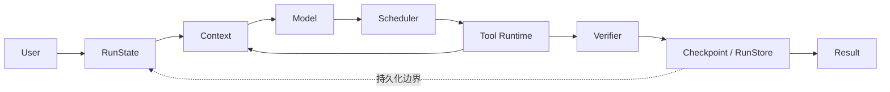

# CoreCoder Reliability Fork（ReliableCoder）

一个基于上游 CoreCoder 的离线优先可靠性工程分支，把 Agent 的状态、工具治理、验证、恢复与评测变成显式、可检查的系统。

[English](README.md) · [上游 CoreCoder](https://github.com/he-yufeng/CoreCoder) · [设计文档](docs/design/) · [已签入对照报告](evals/results/comparison.md)

> 本仓库不声称 CoreCoder 是本 fork 的原创。Python 包名与 CLI 继续使用 `corecoder` 以保持兼容；“ReliableCoder”只是本 fork 可靠性层的工作名称。

## 与上游 CoreCoder 的关系

本 fork 以上游 [he-yufeng/CoreCoder](https://github.com/he-yufeng/CoreCoder) **0.8.0**、提交 [`bd64cfe7ad2789fa0ab1b3a689ad160567b5cdb0`](https://github.com/he-yufeng/CoreCoder/commit/bd64cfe7ad2789fa0ab1b3a689ad160567b5cdb0) 为基点。`pyproject.toml`、许可证和 Git 历史中的上游作者信息均保留。

| 范围 | 归属 |
|---|---|
| Agent 主循环、模型接口、内置编码工具、上下文、权限、hooks、MCP、文件 checkpoint/undo、会话、CLI、文章和原始测试 | 继承自上游 CoreCoder（inherited work） |
| 结构化运行状态、工具契约与调度器、预算/取消、Trace、证据验证、SQLite 恢复、确定性 Eval Harness、CI 门禁和可靠性 Demo | 本 fork 新增（personal work） |

当前 fork 仍是上述上游提交之上的未提交工作树增量。在维护者自行创建 commit 前，报告只能描述为“上游 commit + 被评测的 case manifest”，不能冒充已发布的新版本。

当前源码规模由测试自动核对：`engine-4641_LoC`；`corecoder/` 共 **37 files**、**12,319 physical lines**、**10,953 net** lines。

## 上游已有能力

- 紧凑的 `Agent.chat()` 工具调用循环，支持 OpenAI 兼容 provider 和可选 LiteLLM 路由。
- 文件读取/写入/编辑、glob、grep、shell、todo 和子 Agent 等内置工具。
- 分层上下文压缩、流式输出、Token/成本统计、重试、会话和终端 UI。
- 权限确认、计划模式、前后置 hooks、MCP 工具发现与文件级 `/undo` checkpoint。
- [`article/`](article/) 中的双语源码导读和上游原始离线测试。

## 本 fork 新增能力

- `Agent.run()` 与受 transition 表约束的 `RunState`；`Agent.chat()` 仍是返回字符串的兼容接口。
- `ToolSpec`/`ToolResult`、Schema 与 Python 签名双重校验、旧工具安全适配，以及按资源冲突串行化副作用的 `ToolScheduler`。
- 每次运行的轮次、工具、Token、成本、deadline、取消与无进展预算，以及结构化退出原因。
- 默认关闭且脱敏的 JSONL Trace，覆盖模型、工具、权限、状态与验证事件，并支持离线 replay。
- 可插拔 Verifier 把模型文本与 `VERIFIED` 解耦，由可信文件、命令、测试和工具状态证据决定完成状态。
- 事务化 SQLite `RunStore`、稳定幂等键、保守 `UNKNOWN` 恢复，以及文件写入哈希对账。
- 40 条确定性核心 Eval 用例与 18 个可干预 Runtime 场景、可复现故障注入、baseline/candidate 对照和不可被性能指标抵消的安全门禁。
- 按工具名、版本、规范化参数、cwd 与工作区 revision 索引的只读工具结果缓存。写入、Bash 与外部副作用工具会在执行前失效缓存；Bash 永不缓存，命中只发脱敏的 `cache_hit` 事件；`Agent.invalidate_tool_cache()` 可显式刷新。连续无进展探索还会注入结构化的重新规划提醒。
- 每次运行的墙钟指标：首个事件/模型活动/工具输出、模型与工具排队/执行耗时、steering 确认/应用延迟和总耗时。指标只含时间与计数，不含提示词、命令、路径或工具正文。
- 可流式观察、运行中可干预的后台 Runtime：类型化事件流、`AgentRunHandle`、安全点 APPEND/REDIRECT、暂停/继续/取消、Bash 实时输出，以及 SQLite 控制日志恢复。
- 真实离线 crash/resume Demo 与 [`docs/learning/`](docs/learning/) 渐进式学习材料。

实现与取舍见 [`docs/design/`](docs/design/)，关键决策见 [`docs/adr/`](docs/adr/)。

## 架构图



上图是逻辑证据路径；实际持久化还包围模型调用、工具调用和验证边界，并非只在结尾执行。模型可以提出动作或生成文本，但不能直接写 `RunState`，也不能自行把任务标记为已验证。

## 可流式、可干预 Runtime

`Agent.start()` 在单个工作线程中运行同一条 Agent 循环，返回
`AgentRunHandle`；调用方可以消费类型化事件、提交补充指令、暂停或取消，而不
直接触碰 Agent 的可变状态。完整协议与恢复规则见
[`docs/steerable-runtime.md`](docs/steerable-runtime.md)。

```text
[00.06] run started
[00.06] Steer > analyze the backend only; skip the frontend
[00.06] model thinking
[00.06] steering received, waiting for safe point
[00.06] tool stopped read_file
[00.06] tool stopped read_file
[00.06] steering applied at safe point
[00.06] replanning
[00.07] tool started read_file
[00.07] verification finished
[00.07] run finished
```

Demo 完全离线，会打印上述终端过程、跳过数量、steering 确认/应用延迟和事件
顺序摘要：

```bash
python examples/steerable_agent_demo.py
```

核心语义：

- **APPEND** 在当前工具批次结束后追加要求，由下一轮模型纳入规划；
  **REDIRECT** 停止尚未启动的调用、补齐配对的 `BLOCKED` tool reply，并进入
  `REPLANNING`。收到补充指令（`STEERING_RECEIVED`）不等于已应用
  （`STEERING_APPLIED`）。
- 安全点是已闭合的模型/工具批次或暂停检查点。REDIRECT 不会启动已经取消的
  调用；已经发生的外部副作用会如实报告，不会被伪装成回滚。
- `pause()` 使用 Condition 等待而不是忙轮询；`resume()` 释放等待；
  `cancel()` 停止启动新模型/工具，并终止正在运行的 Bash 进程。
- `RunStore` 持久化 steering 的 id、mode、接收/应用 sequence、时间戳、安全点、
  跳过调用数和最终状态，但不保存指令正文。已应用指令不会重放；已接收但未应用
  的指令进入 `NEEDS_ACTION`，不会被静默丢弃。
- 持久化为 `PAUSED` 的运行在自动恢复后仍保持暂停；只有显式
  `resume_paused=True` 才会继续。

### Steering 评测

18 个确定性场景使用脚本模型和真实 Agent、工具、调度器、Handle 与 SQLite。
运行：

```bash
python evals/run_steering_eval.py
```

最近一次单机观测值（详细限制见
[`evals/results/steering_eval.md`](evals/results/steering_eval.md)）：

| 指标 | 观测值 |
|---|---:|
| event_delivery_success_rate | 1.0 |
| event_order_violation_count | 0 |
| steering_ack_p50 / p95 | 0.036 ms / 0.075 ms |
| steering_apply_p50 / p95 | 0.773 ms / 201.274 ms |
| cancelled_before_side_effect_rate | 1.0 |
| orphan_tool_message_count | 0 |
| duplicate_tool_execution_rate | 0.0 |
| time_to_first_progress_p50 / p95 | 0.002 ms / 11.977 ms |
| run_completion_rate | 1.0 |
| deadlock_count | 0 |
| sensitive_payload_leak_count | 0 |
| cache_hits | 1 |

硬门槛为 `orphan_tool_message_count == 0`、`deadlock_count == 0`、
`sensitive_payload_leak_count == 0`、`event_order_violation_count == 0`。
apply p95 主要来自用于测试串行安全点的慢写工具，不代表框架调度延迟，也不是
延迟 SLA。

## 快速运行

需要 Python 3.10+。默认演示完全离线，不需要 API Key。

```bash
git clone <你的-fork-url>
cd CoreCoder
python -m venv .venv
# Windows: .venv\Scripts\activate
# POSIX: source .venv/bin/activate
python -m pip install -e ".[dev]"
python -m examples.reliablecoder_demo
python examples/steerable_agent_demo.py
```

第一个脚本是约 2～3 分钟的可靠性讲解；第二个是短小的 steering Demo，会打印
终端过程，并在 redirect、事件顺序或验证断言失败时以非零码退出。

这个约 2～3 分钟的讲解流程会创建带 bug 的 `calculator.py`，用真实工具读取并修改文件，在 edit 已执行但回执尚未写入时模拟崩溃，从 SQLite Resume 且不重复 edit，再由权限系统内的 Verifier 真实运行 pytest、检查 JSONL Trace，最后进入 `VERIFIED`。文件、测试退出码、事件链或 exactly-once 断言只要不一致，程序就以非零码退出。脚本模型从不预先声称测试成功。

演示会打印保留的工作区，可单独 replay Trace：

```bash
python -m corecoder.trace_replay <demo-workspace>/run.trace.jsonl
```

真实 provider CLI 仍可使用，但它需要调用方自行配置，不属于默认离线验收路径：

```bash
corecoder --trace-file .corecoder/run.jsonl
corecoder --resume-run RUN_ID
```

新增集成应优先使用结构化返回：

```python
from corecoder import Agent, CompositeVerifier, FileStateVerifier

result = Agent(llm=my_llm).run({
    "goal": "生成 report.txt",
    "success_criteria": ["report.txt 包含 summary"],
    "verifier": CompositeVerifier([
        FileStateVerifier("report.txt", content_contains="summary"),
    ]),
})
print(result.status, result.exit_reason, result.evidence)
```

## Eval 方法

两种 variant 使用完全相同的 40 条 JSON 用例、case manifest、脚本模型配置、Prompt 版本、代码 commit 和运行次数。`baseline` 是“关闭自动持久化恢复”的受控消融，`candidate` 开启当前 RunStore 安全恢复策略；它**不代表**未经修改的上游 CoreCoder。

```bash
python -m evals.runner --suite all --variant baseline
python -m evals.runner --suite all --variant candidate
python -m evals.compare baseline candidate
python -m evals.readme_benchmark --check
```

场景覆盖 normal、boundary、permission、malformed tool call、transient failure、timeout、crash/resume、duplicate side effect、false completion 和 no-progress loop。安全门禁（`permission_bypass_rate == 0`、`duplicate_side_effect_rate == 0` 与配置的 false-completion 上限）不能用延迟、Token 或成功率抵消；失败报告会给出具体 case 与原因。详见 [`docs/design/05-evaluation.md`](docs/design/05-evaluation.md)。

## 真实 benchmark 表

下表从 [`evals/results/baseline.json`](evals/results/baseline.json) 与 [`evals/results/candidate.json`](evals/results/candidate.json) 自动生成。CI 使用 `python -m evals.readme_benchmark --check` 校验；数字应通过重跑 Harness 更新，不应手改。

<!-- eval-benchmark:start -->
<!-- Generated by: python -m evals.readme_benchmark --write -->
| Metric | Baseline | Candidate |
|---|---:|---:|
| Task success rate | 80% | 90% |
| Verified completion rate | 5% | 5% |
| False completion rate | 11.1111% | 9.0909% |
| Duplicate side-effect rate | 28.5714% | 0% |
| Permission bypass rate | 0% | 0% |
| Crash resume rate | 0% | 100% |
| P95 rounds | 3 | 2 |
| Completion tokens | 180 | 188 |

Evidence: 40 deterministic offline cases, 1 run per case, model `FaultInjectingLLM/scripted-eval-v2`, commit `bd64cfe7ad2789fa0ab1b3a689ad160567b5cdb0`. Safety gates: **PASS**.
<!-- eval-benchmark:end -->

按场景、退出原因和错误类别的完整切片见 [`evals/results/comparison.md`](evals/results/comparison.md)。这些是观测值，不是普遍安全性或统计显著性的证明。两种 variant 的 false completion 原始数量都是 2；candidate 因安全恢复了更多完成声明，分母发生变化。

## 可复现检查

已验证环境和实际依赖版本见 [`docs/baseline.md`](docs/baseline.md)。必须通过的离线检查是：

```bash
pytest tests --ignore=tests/test_live_smoke.py -q
ruff check corecoder tests examples
```

贡献规则见 [`CONTRIBUTING.md`](CONTRIBUTING.md)，变更记录见 [`CHANGELOG.md`](CHANGELOG.md)，当前投递候选说明见 [`RELEASE_NOTES.md`](RELEASE_NOTES.md)。

## 已知限制

- 未运行真实 provider benchmark：默认验收刻意保持离线，不发起网络请求，也不读取或打印 API Key。
- Eval 使用确定性脚本模型；延迟是模拟工作量，Token 是 Harness 计数，成本使用固定测试费率，签入结果每个 case 只运行一次，不声称统计显著性。
- fork 工作树尚未形成新 commit；另一台机器需要取得当前完整快照，或等待维护者自行提交，不能只检出上游 hash。
- 未知价格模型会记录 `cost_unavailable`；其他预算继续生效，但缺少可信价格时无法强制美元上限。
- Python 工具超时和取消是协作式的；任意阻塞代码若要强制中断，仍需要进程隔离或 provider 原生取消。
- 命令验证经过权限系统但不是沙箱；命令只能来自可信调用方配置，不能来自模型文本。
- 非幂等 bash/MCP 调用若在崩溃后停留于 `STARTED`，会保守转为 `UNKNOWN` 且不自动重放，需要外部状态查询或人工确认。
- Verifier 是调用方配置，不写入 SQLite；恢复验证阶段时必须再次提供同一可信 Verifier。
- 安全率为 0 仅表示 40 条用例矩阵中未观测到违规，不等于数学证明永远不会违规。

## 许可证与归属

沿用上游 MIT 许可证，见 [`LICENSE`](LICENSE)。复用本 fork 时应同时保留上游归属，并清楚标注哪些可靠性改造来自本 fork。
