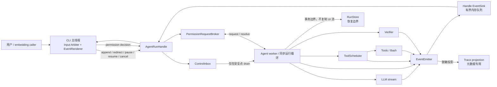

# 可流式观察、可运行中干预的 Agent Runtime

状态：设计草案，尚未实现

适用范围：`Agent.run()`、`Agent.chat()`、交互式 CLI、工具调度、权限询问、验证与运行持久化。

本文只定义目标协议、并发所有权和安全语义。本步骤不修改运行时代码。后续实现必须保持 Python 3.10+ 兼容，并保持现有 `Agent.chat()`、`Agent.run()` 和非交互 CLI 的调用与返回行为。

## 1. 背景与当前行为

当前主路径是一个同步循环：调用模型，完整收集响应，规划并执行工具，把工具结果写回消息历史，再进入下一轮；模型不再请求工具时进入验证并返回结果。

### 1.1 模型流已经存在，但观察面很窄

- `LLM.chat()` 向 OpenAI 兼容接口传入 `stream=True`，因此底层模型 HTTP 响应已经是流式的。
- `LLM._drain()` 消费完整 HTTP 流并组装一个 `LLMResponse`。`on_token` 只接收普通 assistant 文本的 `delta.content`，无法观察工具调用参数的形成过程、阶段变化或工具输出。
- thinking provider 的 `reasoning_content`/`reasoning` 当前走独立的 `on_reasoning` 兼容回调，不进入消息历史。新运行进度协议不得依赖、复制或持久化这类原始 chain-of-thought。
- 工具调用的 `id`、名称和 JSON 参数碎片在 `LLM._drain()` 的 `tc_map` 中静默拼装；只有整个流结束且 JSON 解析完成后，`Agent` 才能看到 `ToolCall`。
- 流中途失败时，当前实现会重试整次模型请求。此前通过 `on_token` 显示的部分文本可能再次出现，因此新事件协议需要标识 model attempt，渲染器也必须能区分重试，而不能把部分内容误认为已提交的消息历史。

### 1.2 Agent 与 CLI 是同步阻塞关系

- `Agent.run()` 在调用线程中完成模型、工具、验证和持久化的整个循环，最后返回 `AgentResult`。
- `Agent.chat()` 是 `Agent.run()` 之上的字符串兼容层；它等待完整结果并在内部错误时继续保持原有抛出行为。
- `_run_once()` 和 `_repl()` 都直接同步调用 `agent.chat()`。调用期间 CLI 主循环不能再次读取普通用户输入。
- 权限回调 `_ask_permission()` 会在工具执行路径上直接调用 `prompt_toolkit.prompt()`。这进一步把工具工作线程、运行控制和终端输入耦合在一起。
- 用户当前只能等待运行完成或按 `Ctrl+C`。无法在模型生成、工具排队、工具执行或验证前补充要求，也无法请求暂停后继续。

### 1.3 工具输出不是流式的

- `BashTool.execute()` 使用 `run_shell(..., capture_output=True)`，等待进程退出后一次性取得 stdout/stderr。
- 输出随后被合并、截断并作为单个工具结果返回。长时间运行的命令没有增量 `tool_output`，运行中也没有可由 Agent 安全处理的 stdin/control 通道。
- 当前 `CancellationToken` 是协作式的，只在预算边界被检查；它不能强行中断正在进行的模型 HTTP 流、Python 工具调用或 Bash 子进程。

### 1.4 已有的可靠性边界必须保留

- `RunState`、`RunBudgetController`、`ToolScheduler`、验证器和 `RunStore` 已经定义了模型前后、工具前后及验证前后的可靠性边界。
- `ToolScheduler` 会按工具元数据决定串行或并行。当前并行批次把任务提交到 `ThreadPoolExecutor` 后等待所有 future 收敛，并保证每个工具调用都有一个结果槽位。
- assistant 消息一旦包含 `tool_calls`，消息历史中必须为每个 call id 追加恰好一个 tool 消息；`_answer_pending_tool_calls()` 已经在中断路径维护这一 OpenAI 兼容协议不变量。
- Trace 当前是默认关闭、失败开放、元数据专用的通道，明确不记录 prompt、reasoning、工具参数、工具结果和文件内容。
- RunStore 是为恢复服务的持久化日志，会保存经过清洗的状态和消息，单独管理工具调用的 `PLANNED`、`STARTED`、`SUCCEEDED`、`FAILED`、`UNKNOWN`。它不是 UI 事件流，也不能通过直接落盘所有 UI 事件来扩展。

## 2. 目标、非目标与兼容性

### 2.1 目标

目标运行时需要做到：

1. 调用者能够按顺序观察模型活动、普通 assistant 文本、工具生命周期、受控工具输出、验证和终态。
2. 调用者能够在运行期间提交 `append` 或 `redirect` 指令，并得到“已收到”和“已应用”的明确回执。
3. pause、resume、cancel 和权限响应都通过同一个线程安全控制面进入 Agent。
4. redirect 只取消尚未开始的操作；已经开始或已经产生的副作用必须被真实记录并反馈给下一轮模型。
5. 任意控制路径都维持合法 assistant/tool 消息配对、RunState 状态转换和 RunStore 恢复语义。
6. CLI 的所有终端读取和渲染最终由主线程统一管理。

### 2.2 非目标

MVP 不承诺：

- 强行终止正在进行的模型 HTTP 流。
- 抢占任意正在执行的 Python 工具函数。
- 自动回滚已经开始的写文件、Bash、MCP 或其他外部副作用。
- 把原始 chain-of-thought 当作进度信息。
- 让同一个 `Agent` 实例并发运行多个任务；并发任务应使用独立 Agent 实例。
- 让自由文本 steering 自动改写调用者信任的 `success_criteria` 或 verifier 配置。

### 2.3 向后兼容

- 新增 `Agent.start_run(...) -> AgentRunHandle` 作为可观察、可控制入口。
- `Agent.run(...) -> AgentResult` 仍是同步 API，并继续在调用线程执行共享的内部运行循环，避免改变现有回调线程语义。
- `Agent.chat(...) -> str` 继续是 `Agent.run()` 的字符串兼容层。
- `on_token`、`on_tool`、`on_reasoning` 保留为兼容适配器；它们不是新事件协议。尤其 `on_reasoning` 不得被转成可持久化的进度事件。
- 一次性 CLI 的 stdout/stderr 和退出码保持兼容。交互式 CLI 可以改用 `start_run()`，但现有命令和最终答案语义不变。

## 3. 目标架构



核心并发规则是：Agent worker 独占消息历史、RunState 和运行决策；其他线程只能把不可变控制消息放入 `ControlInbox`，不能直接修改 Agent 状态。

## 4. 核心组件

### 4.1 `AgentEvent`

`AgentEvent` 是不可变、带版本的运行观察信封。建议的逻辑结构如下；名称是协议，不要求首次实现逐字采用该 Python 类型：

```python
@dataclass(frozen=True, slots=True)
class AgentEvent:
    schema_version: int
    event_id: str
    run_id: str
    sequence: int
    event_type: str
    emitted_at: str
    phase: str
    round: int | None
    model_attempt: int | None
    tool_call_id: str | None
    instruction_id: str | None
    payload: Mapping[str, JSONValue]
    content_class: tuple[str, ...]
```

约束：

- `sequence` 在单次 run 内严格单调递增，由 `EventEmitter` 在锁内分配。
- parallel tool 的全局事件只保证“发射顺序”，因果关系由 `tool_call_id` 和每个工具自己的 `chunk_sequence` 表达。
- `payload` 必须可 JSON 序列化，但“可序列化”不代表“允许持久化”。每个 sink 先做内容策略投影。
- `content_class` 只能取 `user_content`、`model_text`、`tool_arguments`、`tool_output`、`file_content`、`metadata` 等已知类别。
- 不定义 `reasoning_content` 类别；任何原始 chain-of-thought 都禁止进入 `AgentEvent`。

### 4.2 `EventEmitter` / `EventSink`

`EventEmitter` 是唯一的事件编号和分发点。它接受运行时的语义事件，再按 sink policy 生成不同投影。

`EventSink` 最小协议：

```python
class EventSink(Protocol):
    def emit(self, event: AgentEvent) -> None: ...
```

设计要求：

- Handle 自带的内存 sink 是运行控制基础设施，必须保证生命周期、权限和终态事件可达。
- 外部观察 sink 失败开放，不能让 UI、Trace 或插件故障破坏任务。
- assistant token 和 tool output 是高频事件。队列压力过大时可以合并相邻文本块或丢弃 `model_stream_activity` 心跳，但不得丢弃控制回执、权限请求、工具终态和 run 终态。
- Trace 通过单独的 metadata projection 接收事件，不得直接把内容丰富的 `AgentEvent.payload` 交给现有 `TraceSink`。
- `on_token`/`on_tool` 等兼容回调通过一个 adapter sink 实现；新逻辑不能反向依赖这些回调。

### 4.3 `AgentRunHandle`

`AgentRunHandle` 表示一个正在运行或已结束的任务，并拥有 worker、事件队列和控制入口。

建议 API：

```python
handle.events(timeout=None)              # 迭代/拉取 AgentEvent
handle.steer(text, mode="append")        # 返回 instruction_id
handle.pause(reason=None)
handle.resume()
handle.cancel(reason=None)
handle.resolve_permission(request_id, decision)
handle.result(timeout=None)               # 返回 AgentResult
handle.done()
handle.phase
handle.run_id
```

语义：

- `steer()` 成功只表示进入 inbox，并立即产生 `steering_received`；只有 `steering_applied` 才表示 Agent 已在安全点把它纳入消息历史。
- `result()` 可以阻塞，但不会读取终端。
- run 到达终态后，新的控制请求返回明确的 `RunAlreadyFinished`，不能静默丢弃。
- Handle 不允许调用者直接访问或修改 `agent.messages`、`RunState`、scheduler future 或权限回调。

### 4.4 `ControlInbox`

`ControlInbox` 是线程安全、多生产者、单消费者队列。只有 Agent worker 能 drain。

它保存：

- `SteeringInstruction`
- `PauseControl`
- `ResumeControl`
- `CancelControl`
- 权限决定的引用（完整权限对象由 broker 管理）

处理规则：

1. 控制消息按 inbox sequence 保持顺序。
2. cancel 优先于 pause 和 steering；cancel 被应用后不再开始新工作。
3. pause 在下一个安全点使 worker 停驻；停驻期间仍接受 steering、resume 和 cancel。
4. 多条 steering 不静默覆盖。它们按接收顺序进入消息历史；后来的自然语言要求可由模型按“后指令优先”解释。
5. drain 和 apply 必须是 worker 的一个原子决策区间，避免在“检查为空”和“启动副作用”之间插入竞态。实现上应在启动模型、工具或 verifier 前再次读取 generation/sequence 水位。

### 4.5 `SteeringInstruction`

建议字段：

```text
instruction_id
run_id
mode = append | redirect
text
submitted_at
inbox_sequence
submitted_by
supersedes (optional)
status = received | applied | rejected
applied_at / applied_boundary / rejection_reason
```

`text` 是用户内容，只能存在于调用者进程内存和应用后所需的经过清洗的对话持久化中。Trace 只记录 instruction id、mode、长度、摘要 hash 和应用边界。

自由文本 steering 只改变本次执行对话，不自动改变受信任的 verifier、success criteria 或工具权限。若用户实际改变了验收目标，调用者需要通过未来的结构化 task-spec revision API 更新 verifier；MVP 应把这种情况标为未验证或需要处理，不能沿用旧 verifier 宣称新目标已验证。

### 4.6 `PermissionRequestBroker`

权限请求不能再由 Agent worker 直接调用 `prompt_toolkit.prompt()`。Broker 提供：

- worker 调用 `request(tool_call_id, tool_name, arguments, policy)`，得到一个可等待的 request/future；
- broker 把完整参数保存在进程内存中，只向事件流发出 request id、工具名、风险和经过工具 spec 脱敏/截断的 preview；
- CLI 主线程显示请求并通过 `AgentRunHandle.resolve_permission()` 返回 `once`、`always`、`deny` 或 `cancelled_by_redirect`；
- 同时存在多个请求时，broker 以 FIFO 串行展示，避免多个 prompt 争抢终端；
- redirect 到达“已规划、未执行”的权限等待点时，可以撤销请求并生成合法的 cancelled tool receipt，而不是把它伪装成 permission denied；
- 非交互 `Agent.run()` 继续使用现有同步 permission policy，不强制创建终端 broker。

### 4.7 CLI `EventRenderer`

交互式 CLI 使用一个主线程事件循环同时管理：

- 唯一一个 `prompt_toolkit.Application` 或等价 input arbiter；
- Rich/纯文本事件渲染；
- 普通 steering 输入；
- permission prompt 模式；
- `/redirect`、`/pause`、`/resume`、`/cancel` 等控制命令；
- run 结束后恢复普通 REPL prompt。

worker 和 sink 不得直接读取 stdin，也不应直接对终端 `console.print()`。所有终端输入最终由主线程管理，确保普通输入与权限询问不会出现两个 `prompt_toolkit` reader 竞争同一 TTY。

## 5. 事件协议

### 5.1 生命周期和最小 payload

下表中的字段是建议的最小公开 metadata；内容字段是否允许见下一节。

| 事件 | 触发时机 | 最小 payload / 约束 |
|---|---|---|
| `run_started` | RunState 创建或恢复并取得运行所有权 | `status`、`resumed`、`budget_summary` |
| `phase_changed` | 运行阶段改变 | `from_phase`、`to_phase`、`reason` |
| `model_started` | 即将发起一次模型请求 | `model`、`round`、`model_attempt` |
| `model_stream_activity` | 收到不能安全显示为 assistant 文本的流活动，或限频心跳 | chunk/byte 计数、elapsed；绝不含 reasoning 文本或参数碎片 |
| `assistant_token` | 收到普通 `delta.content` | `text`、`model_attempt`、`token_sequence`；仅 UI/private projection |
| `model_finished` | 一次模型流完整收敛 | `finish_kind=text|tool_calls`、usage、duration、call_count |
| `tool_call_detected` | 流中首次识别某个 tool call id/name | `tool_call_id`、已确认的 `tool_name`；不含未完成 JSON |
| `tool_planned` | `_drain()` 完成解析、RunState/RunStore 已记录计划 | 工具名、风险、副作用、schedule metadata、受控参数 preview |
| `permission_requested` | 工具等待交互许可 | `request_id`、工具名、风险、受控参数 preview |
| `permission_resolved` | 权限请求已决定或撤销 | `request_id`、`decision`；不重复参数 |
| `tool_started` | durable `STARTED` 边界之后、调用工具之前 | 工具名、attempt、schedule mode |
| `tool_output` | 工具产生增量输出 | `channel`、`text`、`chunk_sequence`、`truncated`；仅内容授权 sink |
| `tool_finished` | 工具得到最终 ToolResult 或被安全地取消于启动前 | `outcome`、duration、exit/error category、output summary |
| `verification_started` | 已经过 steering 安全点，验证即将执行 | verifier 名称、criteria count、evidence count |
| `verification_finished` | verifier 返回并记录结果 | status、evidence refs/count、failed criteria hashes |
| `steering_received` | Handle 成功入队 | instruction id、mode、长度、hash |
| `steering_applied` | worker 在安全点把指令纳入对话 | instruction id、mode、boundary、cancelled call count |
| `replanning` | redirect 已修复当前轮并准备再次调用模型 | reason、instruction ids、completed/cancelled call counts |
| `pause_requested` | pause 成功入队 | control id、reason category |
| `run_paused` | worker 到达安全点且不再启动新工作 | boundary、pending instruction count |
| `run_resumed` | paused worker 被恢复 | paused duration、pending instruction count |
| `cancel_requested` | cancel 成功入队 | control id、reason category |
| `run_cancelled` | worker 在安全点完成合法收尾 | boundary、exit reason、side effects completed count |
| `run_finished` | 正常到达非失败、非取消终态 | RunStatus、ExitReason、verification status、usage |
| `run_failed` | 到达 FAILED 或未处理的内部错误已被结构化 | error category、ExitReason、usage；无异常正文/堆栈 |

终态规则：UI 事件流恰好以 `run_finished`、`run_failed` 或 `run_cancelled` 之一结束。现有 Trace 可以继续保留自己的 `run_cancelled` 后再记 `run_finished` 的审计形态；Trace taxonomy 与 UI protocol 不要求一一对应。

### 5.2 内容许可矩阵

符号含义：

- **否**：producer 不得放入该类内容。
- **摘要**：只允许 hash、长度、计数、类型、受控路径/证据引用等非正文 metadata。
- **私有 UI**：只允许进程内、经授权的 UI sink；Trace 必须移除，默认不得落盘。
- **受控 UI**：私有 UI 之外还必须按 ToolSpec 做字段脱敏、长度限制和通道标记。

“模型文本”只指普通 assistant 输出，不包括原始 chain-of-thought。即使模型在普通输出中复述了文件内容，它仍按模型文本处理；producer 不得额外把它标成可信文件证据。

| 事件 | 用户内容 | 工具参数 | 文件内容 | 模型文本 |
|---|---|---|---|---|
| `run_started` | 摘要 | 否 | 否 | 否 |
| `phase_changed` | 否 | 否 | 否 | 否 |
| `model_started` | 否 | 否 | 否 | 否 |
| `model_stream_activity` | 否 | 否 | 否 | 否 |
| `assistant_token` | 否 | 否 | 否 | 私有 UI |
| `model_finished` | 否 | 否 | 否 | 摘要 |
| `tool_call_detected` | 否 | 否 | 否 | 否 |
| `tool_planned` | 否 | 受控 UI | 否 | 否 |
| `permission_requested` | 否 | 受控 UI | 否 | 否 |
| `permission_resolved` | 否 | 否 | 否 | 否 |
| `tool_started` | 否 | 摘要 | 否 | 否 |
| `tool_output` | 否 | 否 | 受控 UI | 否 |
| `tool_finished` | 否 | 摘要 | 摘要 | 否 |
| `verification_started` | 摘要 | 否 | 摘要 | 否 |
| `verification_finished` | 摘要 | 否 | 摘要 | 否 |
| `steering_received` | 私有 UI | 否 | 否 | 否 |
| `steering_applied` | 摘要 | 否 | 否 | 否 |
| `replanning` | 摘要 | 摘要 | 否 | 否 |
| `pause_requested` | 否 | 否 | 否 | 否 |
| `run_paused` | 否 | 否 | 否 | 否 |
| `run_resumed` | 否 | 否 | 否 | 否 |
| `cancel_requested` | 否 | 否 | 否 | 否 |
| `run_cancelled` | 否 | 摘要 | 摘要 | 否 |
| `run_finished` | 否 | 摘要 | 摘要 | 私有 UI |
| `run_failed` | 否 | 摘要 | 摘要 | 否 |

所有行都隐含第五条规则：原始 reasoning/chain-of-thought 一律为“否”。`model_stream_activity` 可以报告“收到 reasoning 类型的不可显示 delta”及计数，但不能包含其文字、token 或可逆摘要。

### 5.3 顺序、重试和背压

- 同一 `model_attempt` 内，`model_started < assistant_token/tool_call_detected < model_finished`。
- 模型流失败重试时，先产生失败 attempt 的 `model_finished(outcome=retrying)`，再产生新的 `model_started`。渲染器可清理或标记前一 attempt 的暂存文本；只有完整 `LLMResponse.message` 才进入正式消息历史。
- `tool_started < tool_output* < tool_finished`。启动前被 redirect 取消的调用没有 `tool_started`，但有 `tool_finished(outcome=cancelled_before_start)`，从而形成可观察的闭环。
- 对每个 tool call，`tool_finished` 只出现一次。并行调用之间不承诺完成顺序。
- 高频事件可以批量化，但批量不能跨 model attempt、tool call、channel 或控制边界。
- sink 从中途订阅时先取得一个 content-free snapshot（phase、round、活动工具和 sequence watermark），不重放默认不持久化的敏感正文。

## 6. Steering 语义

### 6.1 `append`

`append` 表示“保留当前方向，在下一个自然模型边界补充要求”。

- 不取消已经规划的工具，也不打断正在执行的工作。
- 如果在模型生成期间收到，先让当前模型流完整收敛。
- 如果当前响应包含工具调用，完成该工具轮（包括合法 receipts）后，把 steering 作为新的 user message 追加，再进入下一次模型调用。
- 如果当前响应是准备结束的普通文本，则在验证开始前的安全点追加 steering，跳过本次终结，继续下一轮模型调用。
- 多条 append 按 inbox 顺序成为独立 user messages，避免把不同用户动作静默拼成一段无法审计的文本。

### 6.2 `redirect`

`redirect` 表示“当前方向不再适用；取消尚未执行的操作，并在下一个安全点重新规划”。

- 尚未开始的模型调用、工具调用、permission request 或 verifier 不再启动。
- 已经开始的操作不在 MVP 中强行中断；它们完成后以真实结果进入状态和消息历史。
- 已经产生的写文件、命令或外部副作用不会被自动回滚，也不会被标记为“未发生”。下一轮模型必须收到其真实 tool receipt。
- redirect 被应用后发出 `steering_applied` 和 `replanning`，然后才允许下一次 `model_started`。
- redirect 不是 cancel：run id、预算使用、证据、已完成工具和对话历史都继续保留。

### 6.3 assistant/tool 配对算法

redirect 必须保证 assistant/tool 消息配对合法。应用顺序如下：

1. 完整模型响应先作为 assistant message 进入历史；半个模型流永远不提交。
2. 已完成的工具追加真实 tool message。
3. 已规划但未启动的工具追加合成的 `ToolResult`，其 outcome 为 `cancelled_before_start`，安全正文明确说明“因用户 redirect 未执行，不得假设副作用发生”。
4. 已启动但结果未知的副作用遵循 RunStore 的 `STARTED -> UNKNOWN` 恢复策略，不能合成“已取消”或“成功”。
5. 只有该 assistant message 的所有 call id 都有且仅有一个 tool message 后，才追加 steering user message。
6. 下一次模型调用会同时看到真实结果、未执行回执和新要求，据此重新规划。

不得通过删除 assistant tool call、重写已完成 tool receipt 或把 redirect 伪装成普通工具错误来“修复”历史。

## 7. 安全点

安全点是 worker 可以在不破坏消息协议、状态机或副作用真实性的情况下 drain `ControlInbox` 的位置。

| 安全点 | 可以做什么 | 必须先满足的条件 |
|---|---|---|
| 模型调用前 | 应用 append/redirect、pause、cancel | 上一轮消息已闭合；尚未发起 HTTP 请求 |
| 模型返回、工具执行前 | redirect 取消整批未执行工具；append 排队到工具轮后 | 完整 `LLMResponse` 已解析并持久化计划；不得使用半截 tool JSON |
| 串行工具之间 | redirect 取消后续调用；pause/cancel 停止启动新调用 | 前一个工具结果和 durable receipt 已记录，后续工具尚未 `STARTED` |
| 工具批次完成后 | 应用 append/redirect，开始 replanning | 所有已启动 future 已收敛；每个 call id 有真实或合成结果 |
| 验证开始前 | steering 使本次终结失效并继续模型；pause/cancel 阻止 verifier 启动 | assistant 文本已提交，verifier 尚未执行 |
| 验证完成、终态提交前 | 处理验证期间到达的控制；必要时把该验证标为 superseded | 验证结果已记录，但尚未发出 run 终态 |
| 下一轮模型调用前 | 最后一次 drain，合并本轮所有已接收指令 | 工具消息配对合法、状态和 RunStore 边界一致 |

“检查 inbox”与“把操作标记为 started”之间必须有明确的所有权协议。对于工具，持久化 `STARTED` 是不可再按 redirect 视作“未执行”的分界；对于模型和 verifier，则以实际请求/调用开始为分界。

## 8. redirect 在不同时机的行为

| 收到时机 | MVP 行为 | 下一安全点的状态与消息处理 |
|---|---|---|
| 模型正在生成 | 不强行中断 HTTP 流；记录 `steering_received`，当前 attempt 继续 | 模型完整返回后应用。若有 tool calls，全部在执行前取消并补齐 tool receipts；若是文本，跳过验证，追加 redirect 并重新规划 |
| 工具已规划但未执行 | 撤销未决 permission request，不启动工具 | 为每个未执行 call 写 `cancelled_before_start` receipt，持久化边界后追加 redirect |
| 只读工具正在执行 | 不抢占正在运行的函数/future；如果同一串行批次还有未启动工具，取消后续 | 等当前只读结果真实落地；闭合整轮后 replan。未来可为显式支持协作取消的只读工具增加快速取消 |
| 写文件工具正在执行 | 不打断、不自动 undo、不声称未修改 | 等工具完成并持久化结果；下一轮明确告知模型文件可能已经改变，后续未启动调用取消 |
| Bash 正在执行 | 当前 `capture_output` 路径无法安全流式控制；MVP 等待退出或原 timeout，不发送隐式 kill | 命令结果/timeout 真实记录后应用 redirect。未来 Popen 实现把“终止进程组”作为独立、显式 cancel 策略，不等同于 redirect |
| 并行工具批次正在执行 | 已经开始的 future 全部收敛；调度器尝试取消尚未开始的 queued future，并为它们生成取消回执 | 等所有 running future 完成，按原模型顺序组装真实/取消结果，闭合批次后 replan |
| 验证即将开始 | 不启动 verifier | assistant 文本保留，追加 redirect，标记原终结被 supersede，回到模型循环 |

若 redirect 在 verifier 已经开始后到达，MVP 同样不抢占 verifier。verifier 完成后、终态提交前的安全点把结果标为 superseded；新 steering 尚未被该证据覆盖，因此不能用旧证据宣称新要求已验证。

## 9. Pause、resume、cancel 与权限

### 9.1 Pause / resume

- `pause()` 立即发出 `pause_requested`，但只有到达安全点才发出 `run_paused`。
- paused 状态不启动新模型、工具或验证；已在执行的操作先完成。
- paused 时 steering 可以继续入队，但不会应用；`resume()` 发出 `run_resumed` 后，worker 先 drain steering，再开始新工作。
- paused 时 cancel 必须唤醒 worker 并进入安全取消路径。
- MVP pause 是进程内运行态；进程崩溃后的恢复继续遵循 RunStore，而不是假装恢复 UI pause 状态。

### 9.2 Cancel

- cancel 表示结束 run，redirect 表示继续 run；两者不可混用。
- cancel 同样是协作式的：MVP 不强行中断模型 HTTP 流、任意工具或 Bash。
- 到达安全点后，所有未执行 tool calls 获得合法取消 receipt，RunState 进入 CANCELLED，并发出唯一的 `run_cancelled` 终态事件。
- 已开始副作用的未知结果仍必须按 `UNKNOWN` 处理，不能因为 run cancelled 就改写为“未执行”。

### 9.3 权限等待

权限等待本身是一个安全点，因为工具尚未开始。控制优先级为 cancel、redirect、pause、permission decision、append：

- cancel：撤销请求并结束 run；
- redirect：撤销请求，为 call 生成 `cancelled_before_start`；
- pause：保留 request，但 UI 退出 permission mode，恢复后再展示；
- permission decision：按现有 once/always/deny 语义继续；
- append：不改变本次许可，工具轮结束后应用。

## 10. 状态、持久化与安全边界

### 10.1 Runtime phase 与 RunStatus 分离

UI 所需的 `streaming_model`、`replanning`、`paused` 等是短生命周期 runtime phase，不应全部塞进持久化终态机。

- `RunStatus` 继续表达可靠性状态：RUNNING、WAITING_APPROVAL、EXECUTING、VERIFYING 及终态。
- `RuntimePhase` 由 handle/worker 拥有，通过 `phase_changed` 观察。
- 只有会影响 crash recovery 的边界才更新 `RunState.current_step` 并写 RunStore。
- 若验证期间收到 steering，后续实现需要允许 controller 将已记录但 superseded 的验证从 VERIFYING 安全返回 RUNNING；该转换只能由 controller 触发，并清除“可用于终态”的验证资格，不能删除证据审计记录。

### 10.2 三种通道的安全边界

| 通道 | 目的 | 允许的内容 | 默认生命周期 |
|---|---|---|---|
| Trace | 跨运行诊断、性能和审计 metadata | id、阶段、计数、hash、duration、分类；禁止 prompt、reasoning、完整参数、工具/文件正文、模型正文 | 可选 JSONL/内存，失败开放 |
| UI Event | 当前用户实时观察与控制 | 经授权的 assistant 文本、受控参数 preview、受控工具输出；禁止 raw chain-of-thought | 默认仅进程内、有界缓冲，不自动持久化 |
| RunStore | crash recovery 和 exactly-once 边界 | 经过清洗的必要消息/状态、工具状态、可安全 replay 的参数、结果摘要和证据引用 | SQLite 持久化，事务边界 |

因此：

- 不能把 UI Event 全量复制到 Trace 或 SQLite。
- steering 在 `received` 时只以 id/hash 进入 Trace；在 `applied` 后才作为必要的、经过清洗的 user message 进入 RunStore。
- PermissionRequestBroker 的完整参数默认只存在于进程内；RunStore 仍按 ToolSpec 的 redaction/replay 规则记录工具计划。
- `tool_output` 默认不持久化；RunStore 保存最终 ToolResult 的受控摘要/证据。需要保留完整命令输出时，应由显式 artifact store 负责，而不是放宽 Trace。

### 10.3 崩溃窗口

MVP 的 `ControlInbox` 是进程内队列：已经 `steering_received` 但尚未 `steering_applied` 的指令可能在进程崩溃时丢失。Handle 必须向 embedding caller 暴露这一语义，调用者在没有 `steering_applied` 回执时可以安全重送。

后续如需 durable inbox，应新增独立的 control journal，以 `(run_id, instruction_id)` 去重，并在同一事务中记录 applied 状态与消息边界；不得仅靠重放 UI event 猜测指令是否应用。

## 11. Bash 与通用工具输出流

目标工具协议可选接受一个 `ToolExecutionContext`：

```text
emit_output(channel, text)
is_cancel_requested()
deadline
run_id / tool_call_id
```

兼容策略：

- 旧 `Tool.execute(**arguments) -> str` 继续工作；adapter 在完成时最多发出一个 `tool_output`，再生成现有 ToolResult。
- 支持流式的工具显式声明 capability，adapter 才传入 context；不能用函数签名猜测。
- Bash 的后续实现用 `subprocess.Popen` 和并发 drain stdout/stderr，避免管道死锁；输出事件与最终给模型的 head+tail 截断结果分开。
- redirect 不向 Bash 发送 kill。显式 cancel 是否终止进程组由单独 policy 决定，并必须报告“termination requested/confirmed/unknown”。
- output 事件要限制单块大小、总内存和渲染速率；即使 UI 丢弃中间块，最终 ToolResult 仍按当前规则稳定生成。

## 12. 关键不变量

实现和测试必须共同维护：

1. MVP 不强行中断正在进行的模型 HTTP 流，控制先排队到安全点。
2. 已经开始的副作用不能假装没有发生；结果未知时使用 UNKNOWN/需要人工确认。
3. redirect 后每个 assistant tool call 都有且仅有一个对应 tool message。
4. 运行进度不能通过暴露原始 chain-of-thought 实现。
5. Trace、UI Event 和持久化日志具有不同安全边界，不能共享未经投影的 payload。
6. CLI 所有终端输入由主线程管理，不能同时存在两个 `prompt_toolkit` 输入循环。
7. 只有 Agent worker 能修改消息历史、RunState 和工具调度决策。
8. `steering_received` 不等于 `steering_applied`；调用者必须能观察两者。
9. 工具启动前取消不会产生 `tool_started`；工具启动后不得改写成 `cancelled_before_start`。
10. 旧同步 API 和 callbacks 不依赖新 CLI，也不要求真实 LLM 或 API key。

## 13. 验收标准

### 13.1 未来运行时验收

- `Agent.run()`、`Agent.chat()` 和现有一次性 CLI 的兼容测试保持通过。
- `Agent.start_run()` 能产生有序事件并返回与同步 `run()` 等价的 `AgentResult`。
- 普通 assistant 文本以 `assistant_token` 增量出现；工具参数碎片不泄漏，完整工具计划只在解析成功后出现。
- 使用确定性 Scripted/Fake LLM 覆盖 append 在模型中、工具后和验证前到达的行为。
- 使用确定性 Scripted/Fake LLM 覆盖 redirect 在本文第 8 节全部时机；不调用真实 provider。
- 所有 redirect/cancel 测试都校验 assistant/tool call id 集合完全配对。
- 写工具/Bash 已开始后收到 redirect 的测试证明副作用结果被保留，未启动调用才被取消。
- 并行批次测试证明 running future 收敛、queued future 可取消、返回结果仍保持模型原顺序。
- pause 后不出现新的 `model_started`、`tool_started` 或 `verification_started`，resume 后先应用积压 steering。
- permission prompt 与普通输入由一个主线程 input arbiter 驱动；测试中不存在两个 `pt_prompt` 调用者。
- Trace 测试证明 user content、模型正文、工具参数、工具输出、文件内容和 reasoning 均未落入 Trace。
- RunStore crash/recovery 测试覆盖 redirect 前后的 PLANNED/STARTED/UNKNOWN 边界。
- 慢 sink、失败 sink 和事件队列背压不影响 run 的正确终态，且关键控制/终态事件不丢失。
- 全部新增测试离线运行，使用确定性 Fake/Scripted LLM，不读取真实 API key。

### 13.2 本设计文档步骤验收

- 只新增本文件，不修改 Agent、LLM、CLI、工具、状态机或测试运行时代码。
- 文档覆盖当前行为、目标组件、架构图、事件协议、两种 steering、安全点、redirect 时机、安全原则、验收标准和分阶段计划。
- 只运行文档相关的格式/空白检查和现有文档测试；不运行真实 LLM。

## 14. 分阶段实施计划

### 阶段 1：事件基础设施，不改变控制流

- 增加 `AgentEvent`、`EventEmitter`、sink policy 和内存事件队列。
- 在现有同步循环发出生命周期事件。
- 用 adapter 保留 `on_token`、`on_tool`、`on_reasoning`；reasoning 不进入事件。
- `tool_output` 对旧工具先只在完成时发一个受控块。
- 增加事件顺序、内容策略、失败开放和背压的离线测试。

### 阶段 2：`AgentRunHandle` 与 CLI 主线程渲染

- 抽取共享 `_run_loop`，同步 `run()` 仍在调用线程执行；`start_run()` 才创建 worker。
- 实现 handle events/result/cancel 基础能力和单 active run 保护。
- 交互式 CLI 改用主线程 `EventRenderer`，一次性 CLI 保持同步。
- 暂不开放 steering，先验证事件和终态等价性。

### 阶段 3：ControlInbox、append 与 redirect

- 增加 instruction 生命周期和全部安全点检查。
- 实现 append 自然边界语义。
- 实现 redirect 对未启动工具的合成 ToolResult、合法消息配对和 replanning。
- 与 RunStore 的 planned/started/receipt 边界对齐，并增加 crash injection 测试。

### 阶段 4：权限 broker、pause/resume 和统一输入

- 把交互式 permission 从 worker 的 prompt 调用迁到 broker。
- 主线程实现输入模式切换和控制命令。
- 完成 pause/resume/cancel 优先级、权限撤销和终端所有权测试。

### 阶段 5：增量工具输出与 Bash 进程策略

- 增加显式 ToolExecutionContext capability。
- Bash 迁移到安全 drain 的 `Popen` 实现，发出 stdout/stderr `tool_output`。
- 单独设计 cancel 的进程组终止 policy；redirect 继续只在安全点重规划。
- 保留最终 ToolResult、截断、cwd 跟踪、权限和危险命令检查的兼容行为。

### 阶段 6：耐久控制与多前端

- 按实际需求增加 durable control journal、instruction id 去重和 crash 后重放。
- 为非 CLI embedding、Web/TUI 前端提供相同 EventSink/Handle 协议。
- 在不放宽 Trace 安全边界的前提下增加可选 artifact store。

## 15. 已知限制与待决策项

- MVP 在模型 HTTP 流、阻塞 Python 工具和当前 Bash 调用结束前可能长时间无法应用 steering。
- `model_stream_activity` 只能证明“仍有流活动”，不能解释模型内部推理。
- 流式 token 在 provider 中途失败重试时可能已被用户看到；UI 需要按 `model_attempt` 标记暂存/重试，不能修改已经进入终端的历史字节。
- 旧工具返回的字符串可能混合 stdout、stderr 或文件内容；在工具声明更精确的 content classification 前，只能按最敏感的 `tool_output` 处理。
- 自由文本 redirect 不自动修改 verifier。改变验收目标需要未来的结构化 task-spec revision。
- paused 和 received-but-not-applied steering 在 MVP 中不耐久；调用者必须依据 applied 回执决定是否重送。
- Windows 与 POSIX 的子进程组终止语义不同，Bash cancel policy 必须单独测试，不能由 redirect 隐式触发。
