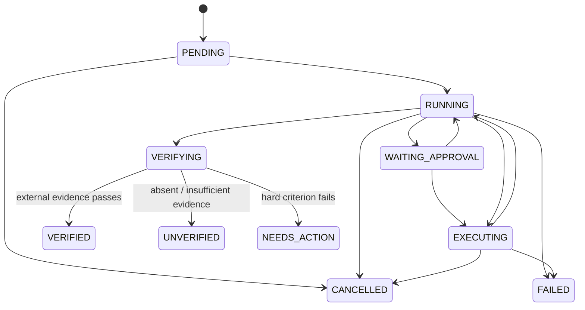

# 01 · Explicit RunState state machine

## Problem

The inherited agent loop used message history and return strings as implicit state. That is compact, but budgets, cancellation, verification, Trace, and crash recovery need one controller-owned source of truth. A model response must not be able to declare a durable state transition merely by saying “done”.

## Model

`corecoder/state.py` defines `RunStatus`, `ExitReason`, `RunState`, and `AgentResult`. `RunState` owns the goal, criteria, round, pending/completed calls, evidence references, budget usage, version, timestamps, final model text, and verification result.

The transition table rejects unlisted edges with `InvalidStateTransition`. Entering `VERIFIED` also requires a passed `VerificationResult` with evidence. Every accepted or rejected transition records the before/after `state_version` in Trace.

## API boundary

- `Agent.run(task_spec) -> AgentResult` is the structured API. It accepts a goal string or caller-owned mapping containing the goal, success criteria, and optional Verifier.
- `Agent.chat(text) -> str` remains compatible. Internally it calls `run()`, re-raises controller errors, and returns the display text. Unverified results are visibly marked.
- The model receives messages and tool schemas, not a mutable `RunState` reference.
- Every terminal path has an `ExitReason`, including individual budget limits, cancellation, interruption, no progress, verification outcomes, and internal failure.

## Budgets and progress

`RunBudgetController` checks limits before/after model calls, before/after tools, and before the next round. Action fingerprints combine tool name, canonical arguments, and result summary; repetition only counts as no progress when state version, evidence, and task progress also fail to advance. Cancellation is cooperative at safe boundaries so tool replies are still backfilled before termination.

Unknown model pricing sets `cost_unavailable` rather than treating the cost as zero. Other limits continue to apply.

## Compatibility and limits

This fork preserves the inherited prompt/tool loop instead of replacing it with a graph runtime. `Agent.chat()` text is compatible in type but now labels unverified completion claims. Cooperative cancellation cannot forcibly stop arbitrary third-party blocking code; those integrations still need native timeouts or process isolation.
