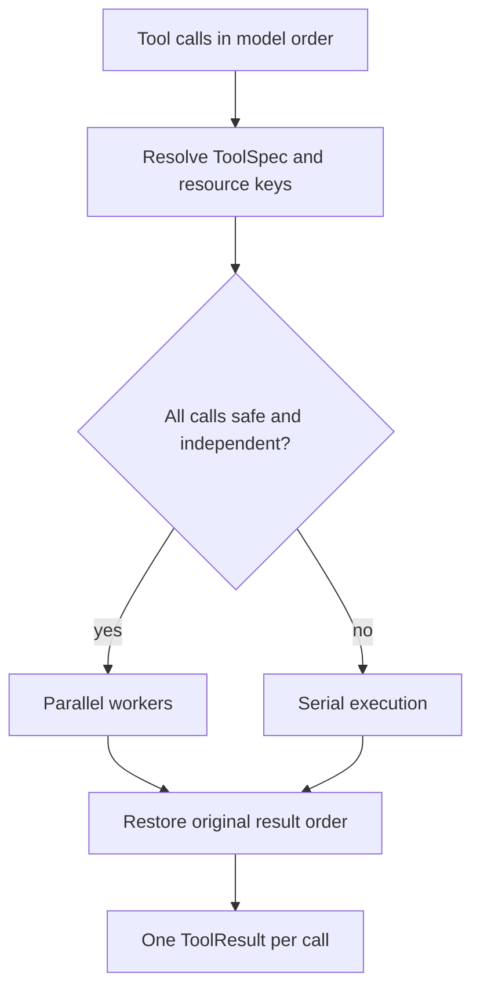

# 02 · Tool contract and safe scheduling

## Two different contracts

`ToolSpec` deliberately separates the schema visible to Function Calling from governance metadata used only by the runtime.

| Model-visible | Runtime-only |
|---|---|
| name, description, input JSON Schema | output schema, side effect, risk, permissions |
| parameter properties and required fields | confirmation, idempotency, parallel safety |
| no retry, redaction, or scheduler policy | timeout, retry policy, redacted fields, version |

This prevents a model from treating governance policy as something it may negotiate. Input is checked against the supported JSON Schema subset and the Python `execute()` signature. `LegacyToolAdapter` converts existing string-returning tools into `ToolResult`, so built-ins did not need an all-at-once rewrite.

`ToolResult` separates model-safe output from runtime diagnostics. Expected business errors expose a controlled message and category; timeouts and unknown exceptions never expose a traceback to the model. Sensitive fields are redacted in Trace and persistence.

## Scheduling

`ToolScheduler` reads `ToolSpec`; it does not maintain a list of special tool names. A batch can run concurrently only when every call is parallel-safe, needs no interactive approval, has no unresolved dependency, and has no overlapping resource key.

File tools use normalized absolute paths as resources. Bash conservatively claims the global shell/current-working-directory resource. MCP defaults to a server/tool resource and conservative external, high-risk, non-parallel metadata unless trusted metadata says otherwise. Write, external, and high-risk work is serial by default; edits and writes to one file therefore cannot race.

Failure of one parallel worker does not discard peer results. Cancellation, `KeyboardInterrupt`, or scheduler failure produces a legal result for every pending tool-call ID, preserving message history validity. Trace records the scheduling decision, reason, queue wait, and execution duration.

## Limits

The schema validator intentionally implements the subset used by built-in and common MCP schemas, not full JSON Schema Draft 2020-12. Thread timeouts can return a controlled result but cannot kill a Python function already blocked in an uninterruptible third-party call.
