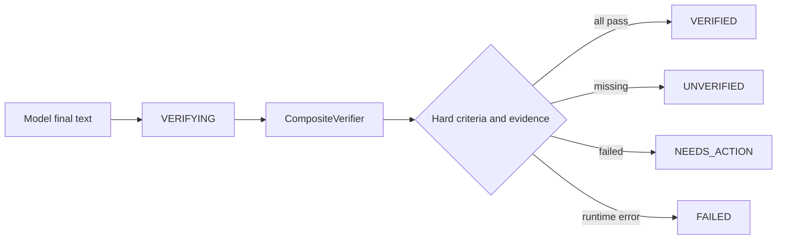

# 03 · Evidence-based verification

## Completion is not prose

A model's final text is a proposal to stop the loop, not proof that the task succeeded. The controller moves to `VERIFYING`, invokes caller-configured Verifiers, and stores model text separately from verification status, evidence, and failed criteria.

## Verifier protocol

`VerificationRequest` is an immutable view of the run. `VerificationEvidence` contains a stable ID, verifier, kind, source, criterion, pass/fail result, safe summary, and metadata. `VerificationResult` reports `PASSED`, `FAILED`, `INSUFFICIENT_EVIDENCE`, `ERROR`, or `NOT_RUN`. A passed result without evidence is rejected.

The first implementation includes:

- `FileStateVerifier`: existence, text, SHA-256, and “must remain unchanged” checks.
- `CommandExitCodeVerifier`: a caller-provided command and accepted exit codes.
- `TestResultVerifier`: the test-specific command variant.
- `NoFailedToolCallVerifier`: no failed or pending calls remain.
- `RequiredEvidenceVerifier`: configured evidence references exist.
- `CompositeVerifier`: all hard conditions must pass.

Verification commands are trusted caller configuration. They are executed through the Agent's permission-aware command runner; model text is never promoted to a command. Trace stores verifier identity, timing, hashed source/criterion references, and outcome without raw file content or command output.

## Result semantics

`AgentResult.model_text` preserves what the model said. `verification_status`, `evidence`, and `failed_criteria` preserve what the runtime established. `Agent.chat()` still returns a string, but its display layer prefixes unverified or action-required results rather than rewriting them as success.

## Limits

A file-content check proves only the configured property, not semantic correctness. A test proves only the selected test command. A legacy boolean callable can be adapted, but its trustworthiness belongs to the caller. Verifier configuration is not persisted in SQLite and must be supplied again when resuming a run interrupted during verification.
