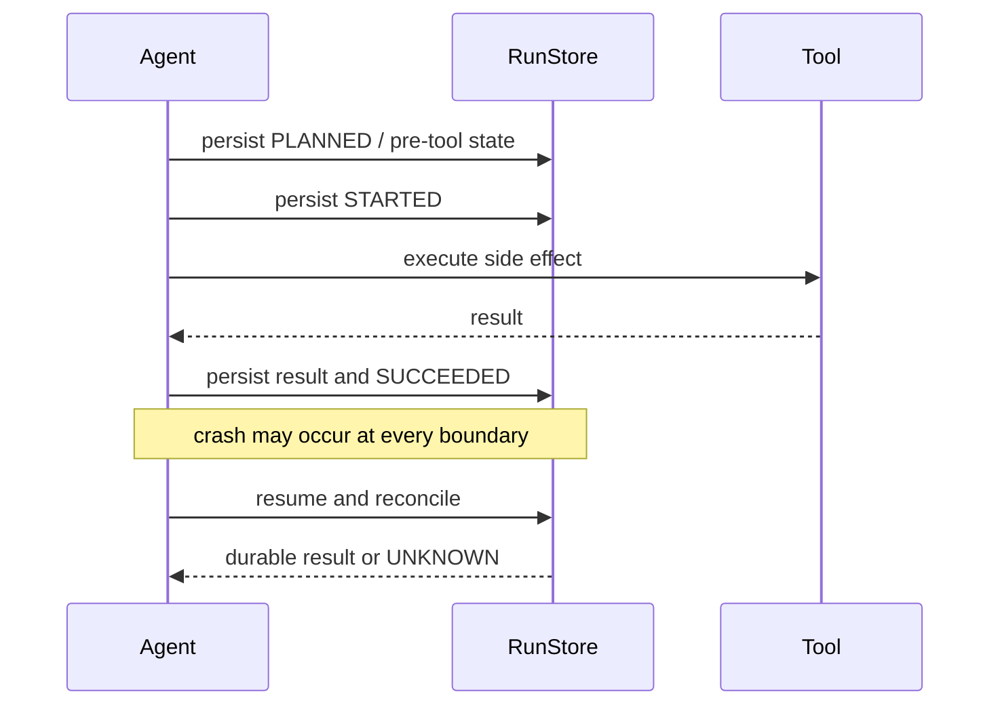

# 04 · File undo and task-level crash recovery

## Two layers with different jobs

The inherited `checkpoints.py` keeps pre-write file snapshots for `/undo`; this behavior remains intact. The fork adds `RunStore`, a SQLite journal for task state and recovery. A task resume may consult a file checkpoint/hash, but it does not replace user-visible undo.

RunStore uses transactions, WAL mode, foreign keys, a schema version, and the standard-library `sqlite3` module. It stores:

- `runs`: latest state and sanitized message history;
- `state_versions`: boundary snapshots;
- `tool_calls`: lifecycle, policy, hashes, safe arguments/result, and idempotency key;
- `evidence`: verification evidence;
- `event_refs`: references into Trace.

State is persisted before and after model, tool, and verification boundaries. Secret-like keys and configured redaction fields are removed; full sensitive tool arguments and API credentials are not stored.

## Exactly-once decision model

Side-effect calls use `run_id + logical_step + tool_version + canonicalized arguments` as a stable idempotency key. Their journal state is `PLANNED`, `STARTED`, `SUCCEEDED`, `FAILED`, or `UNKNOWN`.

| Recovered state | Default action |
|---|---|
| `SUCCEEDED` | Return the durable result; never execute again |
| retryable `FAILED` on an idempotent tool | Retry only within the declared policy |
| `PLANNED` before execution | Safe to continue through normal policy checks |
| `STARTED` file write/edit whose expected hash matches | Reconcile to `SUCCEEDED` without replay |
| `STARTED` non-idempotent or externally ambiguous call | Convert to `UNKNOWN`; require status lookup or human action |
| `UNKNOWN` | Never automatically replay a non-idempotent side effect |

The offline demo injects a crash after an edit succeeds but before its receipt is written. On resume, the target hash confirms the edit, the call becomes succeeded, the edit counter remains one, and verification continues.

## Safety failures

Corrupt JSON/SQLite and incompatible schema versions fail closed with actionable domain errors. Bash and MCP are conservatively ambiguous unless their service offers trustworthy idempotency or status-query semantics. Repeated resume of a terminal run does not replay its effects.
