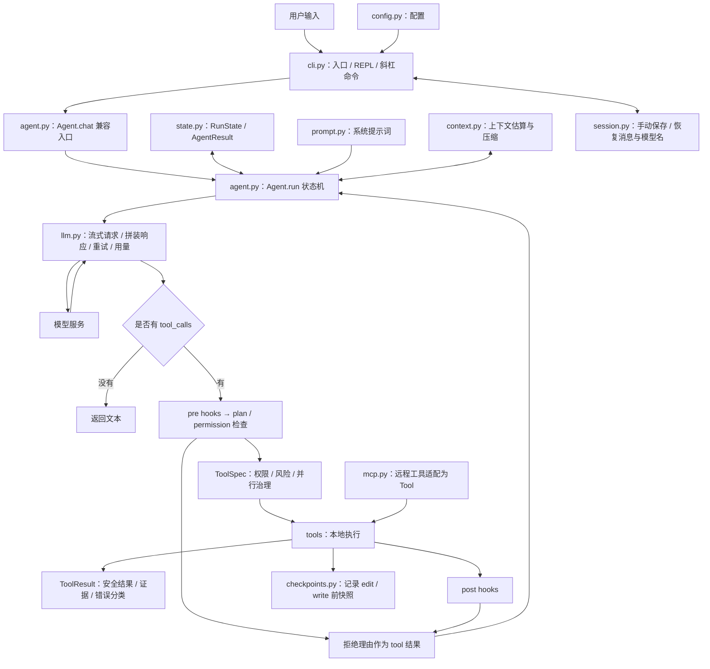

# CoreCoder 渐进式源码学习路线

目标：先能独立解释和调试原版，再完成有实验数据支撑的二次开发，最后把自己的贡献整理成简历项目。

本轮解析基于本地 CoreCoder **0.8.0**，源码提交 `bd64cfe7ad2789fa0ab1b3a689ad160567b5cdb0`。本文中的架构结论来自这份源码，不代表其他版本或其他编程 Agent 的实现。

## 1. 先建立项目定位

这是一个终端编程助手，主要能力是：理解用户任务、让模型选择工具、执行工具、读取结果，再决定下一步。

- Python 核心包共 30 个 `.py` 文件；默认直接使用 OpenAI 兼容客户端，可选 LiteLLM 后端。
- 没有依赖 LangChain / LangGraph 来编排主流程，主循环在 `Agent.run()`；`Agent.chat()` 是返回字符串的兼容入口。
- 终端界面使用 Rich 与 prompt_toolkit；配置使用环境变量及 `.env`。
- 主要数据结构是内存里的 `list[dict]` 消息历史，会话以 JSON 保存。
- 已有并行工具、子 Agent、上下文压缩、权限、计划模式、hooks、MCP 工具和文件撤销，后面不能把这些原生能力直接算作自己的创新。

这里的“Agent”可以先理解为：**有状态的控制循环 + 模型接口 + 可执行工具**。模型通过接口获得消息与工具说明；本地 Python 代码负责真正访问文件和启动进程。

## 2. 架构地图



“层”是学习时的逻辑划分，项目实际采用平铺模块结构。

| 学习层次 | 关键源码 | 要解决的问题 |
|---|---|---|
| 用户入口 | `cli.py`、`config.py`、`__main__.py` | 命令如何启动程序，输入如何到达 Agent？ |
| 决策循环 | `agent.py`、`prompt.py` | 谁控制下一步，什么时候停止？ |
| 模型适配 | `llm.py` | 流式碎片如何变成文本和完整工具参数？ |
| 执行动作 | `tools/base.py`、`tools/protocol.py`、`tools/*.py` | Function Schema 与治理元数据如何分离，调用如何统一为 ToolResult？ |
| 状态与记忆 | `context.py`、`session.py`、`tools/todo.py` | 哪些状态保存在内存，哪些落盘，哪些会被压缩？ |
| 执行约束与扩展 | `permissions.py`、`hooks.py`、`mcp.py`、`checkpoints.py`、`shell.py` | 如何授权、阻断、扩展和撤销操作？ |

阅读时把“模型看到的 JSON”和“Python 执行的对象”分开，再沿调用关系连起来。

## 3. 一次真实请求的入口链路

```text
corecoder 命令（pyproject.toml 的 project.scripts）
  或 python -m corecoder（corecoder/__main__.py）
    → cli.main()
    → 解析命令行，Config.from_env()，命令行覆盖环境配置
    → 构建 LLM / LiteLLM
    → 构建 Permission、加载 MCP tools 与 hooks
    → 构建 Agent
    → 可选：恢复会话
    → 一次性模式 _run_once() 或交互模式 _repl()
    → agent.chat(用户输入) → agent.run(结构化任务)
    → 拼消息与工具 schema → 请求模型 → 执行或拒绝工具 → 回填
    → 下一轮请求，直到没有工具调用，或达到轮数上限
```

`--demo` 在创建真实模型客户端之前就走离线演示分支。`/help`、`/tokens` 等斜杠命令由 CLI 本地处理，通常不会进入模型调用；计划模式中的 `approve` 会关闭开关并把批准消息送给模型。

## 4. 按理解依赖组织的八课

每课采用“问题 → 源码 → 跟踪一次数据变化 → 小实验 → 复述”的方式，不用先通读全仓库。

| 顺序 | 内容 | 主要源码 / 原有测试 | 学完应能做到 |
|---|---|---|---|
| 1，本轮 | 架构、消息协议、主循环 | `agent.py`；`demo.py`；`test_core.py` | 画出一次调用链；手写 user → assistant/tool_calls → tool → assistant |
| 2 | 工具声明、分发和错误反馈 | `tools/base.py`、`read.py`、`edit.py`、`write.py`；`test_tools.py` | 解释 schema 与 execute 的区别；定位唯一匹配失败；理解签名检查的边界 |
| 3 | 模型接口、流式拼接、重试、成本 | `llm.py`；`test_core.py`、`test_litellm.py` | 跟踪分片 JSON 如何拼完整；解释为何不能重复执行工具；区分估算和真实账单 |
| 4 | 上下文窗口与压缩 | `context.py`、`tools/todo.py`；`test_core.py` | 解释 50% / 70% / 90% 的处理和消息配对约束；分析信息丢失 |
| 5 | 并行和子 Agent 的状态边界 | `agent.py`、`tools/agent.py`、`tools/bash.py` | 区分独立历史与共享实例；解释线程池、文件锁、cwd 传递 |
| 6 | 权限、计划模式、hooks | `permissions.py`、`hooks.py`；`test_permissions.py`、`test_plan_mode.py`、`test_safety_matrix.py` | 按真实顺序解释阻断流程，知道哪个阶段仍可能执行 shell |
| 7 | CLI、会话、快照、MCP | `cli.py`、`session.py`、`checkpoints.py`、`mcp.py`；对应测试 | 恢复会话；解释恢复了什么；跟踪一个远程工具的注册和调用 |
| 8 | 原版复现与改造立项 | 全链路、小型任务集、自己的设计说明 | 独立定位一次失败；形成原版基线；为一项改造设计对照实验 |

仓库的 `article/01-the-loop.md` 到 `article/08-extensibility.md` 可以作为辅助材料。先读对应代码，再看文章里的取舍解释；文章引用的其他产品架构不能当作本项目之外的已核实事实。

## 5. 现在的动手入口

在 PowerShell 中进入真正包含 `pyproject.toml` 的目录：

```powershell
Set-Location 'D:\桌面\agent\CoreCoder\CoreCoder'
```

如果依赖尚未安装：

```powershell
python -m venv .venv
.\.venv\Scripts\python.exe -m pip install -e '.[dev]'
```

先执行为第一课增加的跟踪脚本：

```powershell
.\.venv\Scripts\python.exe examples/learning_loop_trace.py
.\.venv\Scripts\python.exe examples/learning_loop_trace.py --scenario missing
.\.venv\Scripts\python.exe examples/learning_loop_trace.py --scenario denied
```

它打印每轮发给模拟模型的消息、工具调用、工具结果与最终历史，分别演示读成功、读失败和权限拒绝。它使用临时文件和显式 `Permission()`，不调用真实模型，不加载用户 hooks / MCP，也不执行 shell。系统提示词只在屏幕上省略，实际仍由原版代码构造和传入。

接着阅读 [第一课：Agent 主循环](01-agent-loop.md)。原有测试也可以作为可执行教材：

```powershell
.\.venv\Scripts\python.exe -m pytest tests/test_core.py tests/test_permissions.py tests/test_safety_matrix.py -q
```

全量离线回归显式排除需要真实模型的测试文件：

```powershell
$env:PYTHONUTF8 = '1'
$env:PATH = (Join-Path (Get-Location) '.venv\Scripts') + [IO.Path]::PathSeparator + $env:PATH
.\.venv\Scripts\python.exe -m pytest tests --ignore=tests/test_live_smoke.py -q
```

这两项设置只影响当前 PowerShell 会话：UTF-8 避免中文文档的默认编码差异，PATH 确保测试内部通过 shell 执行的 `python` 也使用虚拟环境。

原版 `python -m corecoder --demo` 也用脚本模型，但会调用写文件和 bash 工具、记录快照。它的最终回答是预先写好的，不能仅凭“测试通过”的回答判断底层测试是否成功；应核对工具输出和文件结果。

## 6. 读原版时要保留的工程问题

这些是后续课程的观察点，目前只记录实现边界，先不展开改造方案：

| 当前源码行为 | 学习时需要追问 |
|---|---|
| `Agent` 默认 `permission=None`，`_permit()` 直接放行；CLI 才显式配置权限层 | 当作库嵌入时，谁负责传入权限？ |
| pre hooks 在计划模式及权限检查之前执行，hook 本身可启动 shell | “计划模式只读”具体限制的是哪些动作？ |
| 多工具调用统一提交到最多 8 个线程的线程池 | 工具之间有依赖时，谁保证顺序？返回顺序是否等于执行顺序？ |
| edit / write 使用一个全局文件锁；bash、MCP 的文件副作用不受它覆盖 | 防止丢更新与隔离所有副作用有什么区别？ |
| 子 Agent 有新消息列表，但共享 LLM、权限、hooks 及多数工具实例；默认工具表也是已创建的实例列表 | 并发任务的状态可能在哪些位置相互影响？ |
| 上下文 token 数是粗估，`maybe_compress()` 传入的是历史消息 | system prompt、工具 schema、输出预留空间是否计入预算？ |
| `/undo` 快照仍只记录 edit / write；fork 另用 SQLite RunStore 保存运行状态、工具账本、证据和事件引用 | 文件撤销、恢复对话与安全恢复整个执行状态分别解决什么问题？为什么未知的非幂等副作用不能自动重放？ |
| `RunBudget` 可限制轮次、工具数、token、已知价格成本、截止时间与无进展步数；取消在安全边界协作生效 | 阻塞中的第三方工具为何仍需要原生超时或进程隔离？未知价格成本该如何由部署方补齐？ |

## 7. 什么时候进入简历项目改造

满足以下条件后再制定具体优化方案：

- 不看文章，能解释 `Agent.chat()` 如何兼容调用 `Agent.run()`，以及显式状态变化、工具执行和停止条件。
- 能说明工具结果为什么按 id 回填，以及中断和压缩为什么要保护配对关系。
- 能用离线脚本稳定复现一个成功和一个失败场景，并定位到代码。
- 能说清子 Agent、权限、持久化的真实边界，而不只会报功能名称。
- 能记录原版完成任务的结果、模型配置、token、耗时和失败原因。

之后选择一个明确场景作为主线，例如仓库问答或小型缺陷修复，再从实际失败中选优化点。每项贡献都需要“原版问题 → 自己的设计 → 实现与验证 → 前后对照 → 局限”，并区分继承的开源能力和自己新增的工作。

届时再细化代码检索、工具调度、预算控制或评测可观测性等候选方向；不提前承诺提升百分比。质量数据必须来自相同任务集、明确的模型配置及可重复的评测条件。

## 8. 当前进度

- [x] 核对项目定位、主入口和核心源码调用关系。
- [x] 整理原版已有能力与实现边界。
- [x] 提供第一课笔记及三种离线跟踪场景。
- [x] 增加显式 `RunState`、结构化 `AgentResult` 与状态迁移 Trace。
- [x] 增加统一 `ToolSpec` / `ToolResult`、旧工具适配和元数据驱动调度。
- [x] 增加事务化 SQLite RunStore、幂等键与崩溃后的保守任务恢复。
- [x] 增加统一 `RunBudget`、`CancellationToken`、用量 Trace 和无进展检测。
- [ ] 学习者完成第一课复述和预测题。
- [ ] 逐课阅读工具、模型、上下文和扩展模块。
- [ ] 建立原版任务基线，再确定简历改造主题。

运行验证结果见 [本轮验证记录](VALIDATION.md)。
