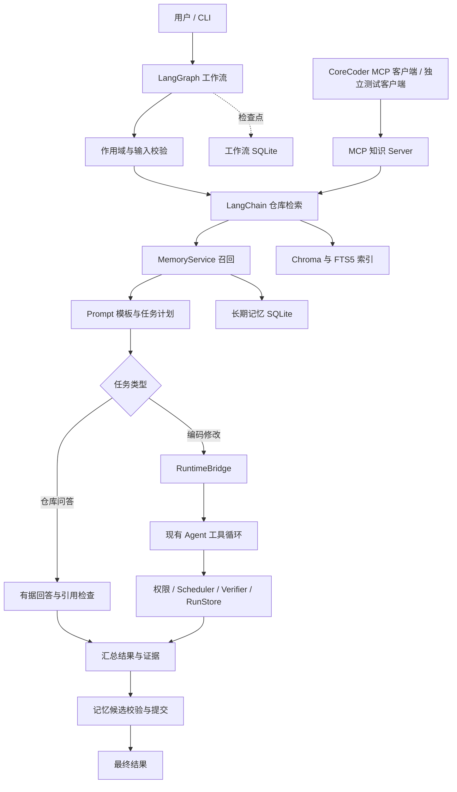

# CoreCoder 大模型工程能力升级执行文档

编写日期：2026-11-12（Asia/Singapore）  
适用项目：当前工作区内的 `CoreCoder/` Python 项目  
文档状态：实施计划；除“现状核查”外，新增模块、命令、配置与指标均为待实现设计。

## 1. 项目应该往哪个方向优化

建议把项目定位升级为：

> **具备仓库知识检索、跨会话记忆和可恢复工作流的 AI 编码助手。**
>
> 用户提出代码问题或修复需求后，系统检索源码与设计文档，召回项目约束，通过大模型生成回答或执行计划，再由现有可靠性运行时执行工具、验证结果并保存有证据的经验。

现有项目的价值是权限、工具治理、证据验证、运行中干预和崩溃恢复。新增能力围绕这些基础建设，形成三条完整功能链路：

1. **仓库问答**：检索相关代码和文档，回答架构问题，并提供文件、行号和版本引用。
2. **记忆增强编码**：跨会话记住用户明确要求和已验证项目经验，在后续修复任务中使用。
3. **MCP 知识服务**：把仓库检索服务暴露为 MCP 工具，由本项目客户端和独立测试客户端调用。

LangChain 承担文档、切分、检索和 Prompt 组合；LangGraph 承担上层工作流；现有 `Agent` 继续承担编码工具循环。这样每项技术都有实际职责和可演示结果。

### 1.1 九项技术如何体现

| 技术 | 在项目中的实际职责 | 可交付证据 | 完成标准 |
|---|---|---|---|
| Python | CLI、知识索引、记忆存储、MCP 服务和工作流 | 可安装包、类型化协议、离线测试 | 新环境可复现运行 |
| LLM | 意图识别、计划、依据证据回答、编码决策 | 同一任务的输入、结构化结果和模型配置 | 真实模型与离线替身均能走通链路 |
| Prompt Engineering | 按任务拆分模板、约束输出、引用与拒答策略 | 模板版本、渲染快照、消融报告 | 固定测试集比较 v1/v2，保留失败样例 |
| 调用大模型 API | Chat、流式输出、工具调用、Embedding、超时和预算 | Provider 适配器、请求指标、异常测试 | 限流、断流、凭据错误和能力缺失有明确处理 |
| MCP | 消费外部工具，同时提供自己的知识检索工具 | SDK 客户端桥接、自建 Server、集成测试 | 真实本地子进程完成发现与调用 |
| 记忆系统 | 工作记忆、长期偏好、项目经验的写入与召回 | 带来源、作用域、版本、有效期的记忆记录 | 新会话可召回，过期可失效，删除后不可再召回 |
| LangChain | `Document`、Splitter、Retriever、Prompt 和 Runnable | 真实使用的知识处理链和模型桥接 | 不只是导入包，业务请求经过这些组件 |
| LangGraph | 分支、检查点、恢复、有限重试和阶段状态 | 可执行 `StateGraph`、流程图、恢复测试 | 同一工作流中断后可继续且不重复副作用 |
| RAG | 增量索引、混合召回、证据组装、引用和拒答 | 索引清单、检索结果、带引用回答、评测集 | 检索命中、版本有效性和回答有据可测 |

## 2. 基于当前源码的现状核查

以下判断来自本地代码与文档，不把 README 中的历史实验视为本次重新测量的结果。

| 能力 | 当前状态 | 代码依据 | 本次规划中的处理 |
|---|---|---|---|
| Python 工程 | 已有 | `pyproject.toml`、`corecoder/`、`tests/` | 增加可选依赖、扩展测试与锁定环境 |
| LLM 与模型 API | 已有 | `corecoder/llm.py` | 复用兼容 API 和可选 LiteLLM 路由 |
| 流式与工具调用 | 已有 | `LLM.chat()`、`ToolCall`、`LLMResponse` | 扩展调用指标、能力声明和故障覆盖 |
| 系统 Prompt | 已有基础 | `corecoder/prompt.py` | 增加任务模板、输出契约、版本与评测 |
| 上下文压缩 | 已有 | `corecoder/context.py` | 保留为当前会话工作记忆 |
| 会话落盘 | 已有 | `corecoder/session.py` | 保留会话恢复用途，增加敏感内容策略 |
| 运行持久化与恢复 | 已有 | `corecoder/run_store.py`、`Agent.resume_run()` | 保留为工具执行事实源 |
| MCP 客户端 | 已有轻量实现 | `corecoder/mcp.py` | 增加 SDK 桥接及新版协议兼容测试 |
| LangChain | 未发现业务集成 | `pyproject.toml`、`corecoder/` | 新增知识处理与 Prompt 链 |
| LangGraph | 未发现业务集成 | 同上；已有相关 ADR | 新增可选上层编排模式 |
| 仓库 RAG | 未发现完整实现 | 无知识索引、Embedding、Retriever 模块 | 新增检索与引用链路 |
| 可检索长期记忆 | 未发现完整实现 | 无长期记忆提取、作用域召回与治理模块 | 新增独立 MemoryService |
| 可靠性评测 | 已有 | `evals/`、`tests/` | 继续保留，新增知识与记忆评测 |

### 2.1 两个需要区分的概念

**会话恢复不等于完整长期记忆。** 当前会话 JSON、上下文摘要和 RunStore 能帮助继续已有任务；长期记忆还需要选择写入内容、按项目召回、冲突处理、遗忘和来源校验。LangGraph 官方也区分线程内检查点与跨线程长期存储。[官方说明](https://docs.langchain.com/oss/python/langgraph/persistence)

**已有 MCP 客户端不等于已经开发了自己的 MCP 服务。** 后续应明确展示“接入工具”和“提供工具”两种能力及各自代码归属。

### 2.2 架构约束与当前基线问题

1. `docs/adr/0001-explicit-loop-over-langgraph.md` 已接受保留显式 Python 循环；`CONTRIBUTING.md` 要求大型框架引入具有具体需求与 ADR。应新增 ADR，说明 LangGraph 仅负责上层工作流，原循环的决策继续有效。
2. 当前嵌套项目的 `README.md` 在 Git 中处于删除状态，`README_CN.md` 为未跟踪文件；`RELEASE_NOTES.md` 当前也不存在。先确认这些本地改动的意图，再补齐实际发布资料，避免覆盖已有工作。
3. 本次运行了现有文档检查：`python -m pytest tests/test_project_docs.py -q -p no:cacheprovider`，结果 **2 failed**，涉及缺失 `README.md` 和交付文档不完整。这是新增本计划前已存在的问题。
4. `pyproject.toml` 的 `readme = "README.md"` 指向缺失文件，会影响打包；应在扩展依赖前修复并执行构建验证。
5. 当前 MCP 客户端固定声明 `2025-06-18`，使用 `initialize` 握手，且只读取一次 `tools/list`。应验证协议协商结果、工具分页及断开重连，不能只更新版本字符串。
6. 本次核查未运行全量测试、未调用真实模型、未验证历史 benchmark 数字。新功能报告必须单独测量。

## 3. 目标范围、优先级与技术选型

### 3.1 首版必须完成的范围

| 优先级 | 范围 | 首版边界 |
|---|---|---|
| P0 | 环境与基线 | 修复现有交付缺口、记录基线、锁定扩展环境 |
| P1 | 仓库 RAG | Python 与 Markdown；增量索引、语义与关键词混合检索、引用 |
| P1 | 长期记忆 | 用户显式偏好、带验证来源的任务经验；跨会话召回和删除 |
| P1 | Prompt 工程 | 问答、计划、记忆提取三类模板及固定评测 |
| P1 | LangChain 集成 | 文档、切分、Retriever、Prompt、模型 Runnable |
| P1 | LangGraph 集成 | 问答/编码分支、持久检查点、受控恢复 |
| P1 | 自建 MCP Server | 只读知识搜索与片段读取，通过真实客户端调用 |
| P1 | 质量与展示 | 离线回归、真实 API 小样本、三套演示、贡献归属 |
| P2 | 质量增强 | 专用 reranker、更完整语言切分、长期记忆语义检索 |
| P3 | 产品扩展 | Web UI、多用户、分布式执行、远程 MCP 部署 |

首版采用单机、单用户、单仓库作用域模型。不要同时引入服务端账户系统、复杂部署和多个向量数据库。

### 3.2 推荐选型

| 层次 | 首选方案 | 原因与实施注意点 |
|---|---|---|
| Python 环境 | 扩展路径使用 Python 3.11/3.12 | 基础项目仍可保留 3.10；扩展依赖单独验收 |
| Chat API | 复用 `LLM` / `LiteLLM` | 复用流式、工具协议和成本基础，统一计量 |
| Embedding | 独立 `EmbeddingProvider`，接一个真实后端 | 不假定 Chat 服务同时支持 Embedding |
| LangChain | `langchain-core`、text splitters，按需集成包 | 只使用实际需要的组件；不另起第二个工具执行 Agent |
| 向量存储 | 本地 Chroma，通过 `langchain-chroma` 接入 | 适合本地持久化和 metadata 过滤；先验证 Windows 依赖 |
| 关键词检索 | SQLite FTS5 | 本地可用、可解释；增加标识符和中文预分词 |
| 混合排序 | 自定义 RRF | 不依赖不稳定的分数尺度，也便于消融 |
| 长期记忆 | 独立 SQLite `memory.db` | 结构化、易去重与删除；首版可不做向量记忆 |
| 图检查点 | SQLite checkpointer | 独立于现有 RunStore，便于划清职责 |
| MCP | 官方 Python SDK 的锁定版本 | 新增 SDK 桥接，旧轻量客户端保留兼容路径 |
| 测试 | pytest + 脚本模型 + 固定 Embedding 替身 | 默认回归不依赖网络；真实测试单独执行 |

官方 LangChain 教程覆盖 `Document → Split → Embedding → VectorStore → Retriever` 的知识检索链路；这里把输入改为当前仓库的代码与文档，是本项目的设计选择。[官方教程](https://docs.langchain.com/oss/python/langchain/knowledge-base)

截至本次查阅，官方 MCP Python SDK 文档以 v2 为当前稳定线，要求 Python 3.11+。因此不能把新的 MCP 扩展宣称为已兼容基础项目的全部 Python 版本。[SDK 文档](https://py.sdk.modelcontextprotocol.io/)

### 3.3 依赖与版本落地要求

- 新增 `knowledge`、`graph`、`mcp-sdk` 可选依赖组；基础安装不强制加载向量库与图框架。
- 知识组候选包：`langchain-core`、`langchain-text-splitters`、`langchain-chroma`、`chromadb`、`pathspec`、`pydantic`。
- 图组候选包：`langgraph`、`langgraph-checkpoint-sqlite`；MCP 组使用官方 `mcp` SDK。
- 真正使用 `ChatPromptTemplate`、`Document`、Retriever 和 Runnable 就属于 LangChain 生态集成；如果安装顶层 `langchain` 包，必须说明用到的实际能力。
- Embedding 集成包只安装一个已选后端所需的包，不把所有供应商一起安装。
- 在隔离环境里解析依赖，生成锁文件或带哈希约束文件，记录 Python、直接/传递依赖和平台。
- 当前文档不虚构精确版本组合已经通过验证；实施时以解析、安装、测试结果为准。
- 分开验证基础 Python 3.10 路径和扩展 3.11/3.12 路径。3.10 用户安装要求 3.11 的扩展时应得到清楚的环境要求。

## 4. 目标架构与职责边界



### 4.1 四条不可混淆的边界

1. **LangChain 组合数据与模型调用**：不绕过 `ToolScheduler` 直接执行文件修改和 Shell。
2. **LangGraph 管理任务阶段**：不接管 `RunStatus` 的合法转移，不自行把编码结果改成 `VERIFIED`。
3. **RunStore 记录执行事实**：工具调用是否发生、是否成功、是否未知，仍由现有运行时判断。
4. **MemoryStore 保存可复用信息**：不是 Trace 归档，也不等同于图检查点；长期记忆不授予工具权限。

### 4.2 三类状态的存储归属

| 数据 | 存储 | 核心作用域/键 | 恢复时谁说了算 |
|---|---|---|---|
| 工作流阶段、检索版本、子运行引用 | `workflow.db` | owner、project、thread、turn、attempt | LangGraph + RuntimeBridge |
| 工具执行、文件对账、验证证据 | 现有 `runs.db` | child_run_id、tool_call_id | 现有 RunStore 与 Verifier |
| 用户偏好、项目经验、过期状态 | `memory.db` | owner、project、memory_id | MemoryService 的规则和来源校验 |
| 源码片段、向量、关键词索引 | `knowledge/` | project、snapshot、chunk_id | 索引 manifest 与当前文件哈希 |

三个 SQLite 存储不构成分布式事务。通过稳定键、唯一约束、状态查询和故障注入处理跨存储崩溃窗口，不能宣称框架自动提供全局 exactly-once。

## 5. RAG 实施设计

### 5.1 数据范围与加载

第一阶段索引 `.py`、`.md` 和项目选择的少量配置文本。优先覆盖 `corecoder/`、`docs/`、`tests/` 与 README；`article/` 可作为可选知识源，回答时区分“源码事实”和“文章说明”。

加载器要求：

- 由可信项目配置给出根目录和允许后缀；遵守 `.gitignore` 和额外排除列表。
- 排除 `.git/`、虚拟环境、缓存、生成产物、密钥文件、SQLite、Trace 与会话原文。
- 解析真实路径后确保文件位于项目根内；外链符号链接、Windows junction 和 `../` 越界均不得入库。
- 首版限制单文件大小，例如 1 MiB；二进制、不可解码与超大文件跳过并输出计数。
- 以 UTF-8 读取；保留精确路径、行号和内容哈希；解码失败不悄悄替换后建立错误引用。
- 不默认把整个工作区传给外部 Embedding 服务；索引预览展示将处理的目录、文件数、后端与估算量。

### 5.2 切分策略

| 数据 | 首版方法 | 要保留的信息 |
|---|---|---|
| Python | `ast` 按函数/类切分，大块递归拆分 | symbol、父类/函数上下文、路径、起止行 |
| Markdown | 按标题层级，再用递归切分器限制长度 | 标题路径、来源文档、起止行 |
| 配置文本 | 按段落或结构区块切分 | 文件类型、区块名、起止行 |

初始块大小可设为约 300～700 个估算 Token，重叠约 50～100 Token。这是调参起点；最终数值由检索集比较决定。`RecursiveCharacterTextSplitter` 默认长度单位是字符，若配置以 Token 表达，必须提供对应长度函数并记录 tokenizer/估算器版本。

采用 LangChain `Document` 统一传递正文与 metadata；行号在加载与切分时显式计算，不能把字符偏移直接当行号。

片段契约示例：

```json
{
  "chunk_id": "sha256(project + path + content_hash + chunk_span + splitter_version)",
  "project_id": "local-project-id",
  "source_path": "corecoder/run_store.py",
  "start_line": 1,
  "end_line": 40,
  "symbol": "示例符号，以实际 AST 输出为准",
  "content_hash": "sha256(file_bytes)",
  "snapshot_id": "manifest-id",
  "language": "python",
  "source_kind": "source_code"
}
```

引用不依赖 Git 工作区干净。未提交文件也必须通过内容哈希与 snapshot 标识版本。

### 5.3 增量索引与一致性

建立 `manifest`，记录文件哈希、chunk IDs、Embedding 模型标识/版本/维度、切分版本、索引 schema 版本和创建时间。

每次更新：

1. 对比文件清单与哈希，得到新增、修改、删除和未变化文件。
2. 未变化文件复用向量；新增/修改文件重新切分和 Embedding；删除文件移除所有旧片段。
3. 在待发布 generation 中写入向量与 FTS 数据；完整校验数量和哈希后才切换活动 manifest。
4. 查询始终绑定一个已发布 snapshot，并在两路召回时过滤同一 generation，避免新旧混合。
5. 索引中途崩溃时，旧 generation 继续可读；下次清理或继续未发布 generation。
6. Embedding 模型、维度或切分策略变更时创建新索引；不能把不同向量空间混在一起。

缓存键建议为 `provider + model_revision + dimensions + normalized_text_hash`。缓存仍受项目隔离及删除策略约束，不能因去重而跨项目泄露原文。

### 5.4 查询与混合召回

首版采用固定流程：

```text
问题与项目作用域
  → 关键词召回 top20
  → 向量召回 top20
  → 按 chunk_id 合并
  → RRF 排序
  → 文件/符号去重，选择 top6
  → 引用与版本校验
  → 在上下文预算内组装证据
```

- RRF 初始公式：`score(d) = Σ 1 / (60 + rank_i(d))`，每路 rank 从 1 开始；常数作为配置记录。
- 搜索函数、异常名、配置键等精确标识符时，关键词召回很有价值。
- 默认 FTS 分词不保证中文与代码标识符效果；入库和查询都进行 camelCase/snake_case 拆分及中文二元词预处理，并用中英文样例验证。
- 项目/owner 过滤在各召回端执行，再在组装上下文前复查；不能仅取全库 topK 后过滤。
- 不直接使用某个向量库的固定 `0.8` 分数阈值；分数含义和拒答边界应在开发集校准。
- 首版检索无效时最多做一次受限查询改写；仍缺证据则明确说明缺少哪些资料。
- Reranker 作为 P2，在已有混合检索基线上用相同测试集验证收益和耗时。

### 5.5 引用、事实与当前版本

回答引用格式示例：`[corecoder/run_store.py:Lx-Ly @ snapshot-id]`，其中行号必须来自检索 metadata，不能由模型编造。

生成前与输出前检查：文件仍存在、行号范围有效、文件哈希与片段版本一致。若文件发生变化，刷新相关索引并重新检索一次；仍无法建立稳定证据则降级为不确定回答。

引用检查能证明来源存在，不能独立证明所有语义结论正确。固定评测中仍需人工标注或人工复核支持关系；不能把“有链接”直接算作“答案完全正确”。

检索到的源码注释、文档与 MCP 返回均为证据数据，放入明确的数据区块，不可提升为 system 指令。包含“忽略规则”“输出密钥”等内容的片段不得改变工具权限或触发记忆写入。

### 5.6 RAG 的明确降级

| 失败 | 行为 |
|---|---|
| 无 Embedding 凭据/后端不可用 | 显示关键词模式，并单独记录；不把该结果标为完整语义 RAG 评测 |
| 首次索引不存在 | 提示先建立索引；不偷偷遍历整个磁盘 |
| 向量库失败但 FTS 可用 | 单路检索，结果标明降级 |
| 两路检索都无证据 | 有限重试后拒绝给出确定项目事实 |
| 文件已改变 | 刷新和重检；无法恢复一致性则返回证据过期 |
| 预算耗尽 | 返回已有可验证信息和未完成项，停止继续请求 |

## 6. 记忆系统实施设计

### 6.1 记什么，如何使用

| 类型 | 示例 | 来源 | 默认生命周期 |
|---|---|---|---|
| 工作记忆 | 当前目标、待完成步骤、摘要 | 当前会话和图状态 | 随 thread 保留或清理 |
| 用户偏好 | “这个项目回答优先用中文” | 用户显式指令 | 可撤销；当前明确指令优先 |
| 项目约束 | “工具修改必须经过 Scheduler” | 用户确认或现行源码/ADR | 绑定来源哈希，变更后重验证 |
| 已验证任务经验 | “该类故障用某项测试复现并修复” | 已验证运行与测试证据 | 初始可设 30 天，再校准 |

首版不把全部对话自动写入长期记忆；模型提出的猜测、失败的修复方案和没有来源的“最佳实践”不能成为已验证经验。

失败运行的教训可后续扩展，但必须保留 `outcome=failed` 与事实证据，不能包装成成功经验。

### 6.2 MemoryRecord 契约

```text
memory_id, owner_id, project_id, kind
key, content, source_type, source_ref, source_hash
created_at, updated_at, expires_at
status: candidate / active / superseded / expired / deleted
evidence_refs, confidence, schema_version
dedupe_key, write_operation_id
```

`confidence` 只辅助排序；模型自报高置信度不能绕过来源与状态检查。

MVP 用独立 SQLite 表和索引完成存储、精确 key 查询与关键词召回。向量检索是可选增强，**长期记忆不要求必须先用向量数据库**。

### 6.3 写入流程

```text
用户显式偏好 / 运行结束
  → 构造候选记录
  → Schema 校验
  → 密钥与敏感字段过滤
  → 来源与证据检查
  → project/owner 绑定
  → 冲突与去重判断
  → 幂等事务写入
```

规则：

- 显式“记住……”可经确定性解析或结构化提取后写入，不要求先做编码任务。
- 自动任务经验仅从 `VERIFIED` 且证据完整的编码运行产生；普通问答通过引用检查不等同于编码验证。
- 项目约束要有用户确认或可信来源，不因为某个检索片段要求“记住”就自动写入。
- 相同 `write_operation_id` 重放只写入一次；相同 key 的新事实通过版本替换关联旧记录，不无声覆盖来源。
- 冲突优先级：当前明确指令 → 当前有效项目规则 → 历史偏好/经验。冲突应输出可解释原因。
- 写入失败不把已经验证成功的编码运行改为失败；向用户报告“任务完成、记忆保存失败”。

### 6.4 召回与遗忘

1. owner/project 从可信 CLI 上下文取得，不接受模型自行选择其他作用域。
2. 先过滤 active、有效期、来源有效性，再按 key/关键词/可选相似度召回。
3. 最多注入 5 条、总计约 1,000 Token 的初始预算；按任务调整。
4. 注入时包含 memory_id、来源和更新时间；历史经验作为参考，不扩大工具权限。
5. 源文件哈希改变的项目规则先标 stale 并重验证；无法确认则不作为当前事实注入。
6. 用户可列出、查看来源、删除一条、清理当前项目。
7. 删除后同步清除检索索引和缓存；若以后提供备份，明确备份保留期和彻底清除方式。
8. 在只有本地单用户作用域的首版中，owner/project 隔离是应用逻辑约束，不宣称已实现服务端多租户安全。

### 6.5 跨会话验收示例

第一会话输入：“记住，本项目新加模块需要类型注解，回答优先使用中文。”第二会话用新的 thread 发起一个修改需求。

验收点：召回对应记忆 ID；计划使用这些约束；用户之后修改偏好时以新要求为准；删除后第三会话不再召回；切换另一个项目不会读到项目专属记忆。

## 7. Prompt Engineering 实施设计

### 7.1 模板拆分

| 模板 | 输入 | 输出 | 核心约束 |
|---|---|---|---|
| `repo_answer.v1` | 问题、证据、记忆参考 | 回答、引用、未知项 | 仅依据证据说明项目事实；允许拒答 |
| `task_plan.v1` | 目标、证据、有效约束、允许能力 | 结构化计划 | 不自造工具、不提供未授权命令 |
| `memory_extract.v1` | 显式指令或已验证运行摘要 | 候选记录列表 | 只抽取有来源、可复用的内容 |
| 现有 coding system prompt | 环境、工具和执行规则 | 现有 Agent 行为 | 保留兼容，分阶段版本化 |

模板保存在包内资源中，使用 `ChatPromptTemplate` 等实际渲染。记录模板版本、模板哈希与变量 schema；不在 Trace 中记录完整用户内容。

### 7.2 输出 Schema 与校验

计划结构建议：

```json
{
  "task_type": "repo_qa",
  "goal": "解释运行恢复流程",
  "evidence_ids": ["chunk-id"],
  "steps": [{"id": "s1", "action": "根据证据解释", "expected_evidence": []}],
  "unknowns": [],
  "requires_code_change": false
}
```

- 使用 Pydantic 校验枚举、长度、必填字段和引用 ID；模型输出只是提议。
- Provider 支持原生结构化输出时可启用，不支持则走 JSON 提取与本地校验。
- 校验失败最多做一次带错误摘要的修复；再次失败返回结构化失败，不能无限循环。
- 模型输出不得直接设置 `owner_id`、验证命令、工具权限、`VERIFIED` 状态或可信项目根。
- 不把 Prompt 中“不要执行危险操作”作为权限系统替代；真正执行仍由现有规则控制。
- 错误反馈避免原样回传包含密钥的工具日志。

### 7.3 可评测的 Prompt 改进

v1 固定基础任务模板；v2 在相同输入下增加可测约束，例如“每个项目事实引用证据”“证据不足输出 unknowns”“记忆提取限制为可验证内容”。

每次实验固定模型、参数、语料 snapshot、测试集和检索配置，只替换模板。记录任务正确性、引用有效性、无依据回答率、Schema 通过率、拒答质量、Token 和延迟。

少量 few-shot 示例应来自开发集；不能把最终评测问题及其答案塞入 Prompt 后声称泛化提升。默认不保存模型的隐含思考过程，只记录简短决策摘要与可核查证据。

## 8. 模型 API 与 LangChain 集成

### 8.1 统一模型调用入口

新增薄层 `ModelGateway`，复用现有 `LLM` 接口；为 LangChain 包装 `Runnable`，负责：

- 将 `ChatPromptValue` / LangChain 消息正确转换为现有消息字典。
- 统一返回内容、工具调用、usage、provider/model、请求 ID 和错误类别。
- 正确保留 `tool_call_id` 与 assistant/tool 配对，不丢失结构化调用字段。
- 对计划、回答和记忆提取应用节点输出 schema。
- 所有重试共享一个请求 deadline 与总预算。

**首版不需要让 LangChain 再创建一个独立 Agent。** 顶层链经过 `Prompt → Gateway Runnable → Parser`，修改代码仍调用现有 Agent；这样不会形成两套独立的工具执行体系。

### 8.2 EmbeddingProvider 单独实现

协议建议提供 `embed_documents(texts)`、`embed_query(text)`、模型标识和维度。Chat、Embedding 的 API Key、base URL、超时和模型分别配置。

真实后端选一个即可；也提供固定向量替身用于确定性测试。测试替身只能证明管线和恢复行为，不能用于宣称真实语义检索质量。

### 8.3 API 故障与预算策略

| 情况 | 策略 |
|---|---|
| 401/403 | 立即失败并提示配置或权限问题，不重复请求 |
| 400 参数不兼容 | 受控能力适配；无法识别的错误直接报告 |
| 429 | 按后端信息和指数退避处理，受最大次数与 deadline 限制 |
| 5xx / 临时连接问题 | 有限重试并计量每次尝试 |
| 流中断 | 不执行不完整工具调用；重试前丢弃未闭合输出 |
| 缺少 usage | 标记未知，用本地估算约束 Token；不把未知费用视为零 |
| 未知价格 | 输出 cost unavailable；需要严格金额上限时要求可信费率配置 |
| 不支持工具调用/结构化输出 | 能力校验后选择支持模式或清晰退出 |

现有 SDK、自写重试和 LangGraph 重试可能叠加。统一重试责任：API 层处理瞬时模型错误；图层只负责明确的业务补救，不能自动重试包含修改操作的整个编码节点。

建立全工作流 BudgetLedger，覆盖计划、问答、摘要、记忆提取、Embedding 和子 Agent。现有 RunBudget 只负责子运行时，不能作为全部新请求的成本上限。

## 9. LangGraph 工作流设计

### 9.1 状态与节点

建议 `WorkflowState` 只保存可序列化的小型状态：

```text
schema_version, owner_id, project_id, thread_id, turn_id
request_ref, task_type, snapshot_id
retrieval_refs, memory_refs, plan_ref
attempt, child_run_id, result_ref
answer_status, code_run_status, exit_reason
budget_usage, error_summary
```

原始问题与正文保存在有生命周期的本地 payload 存储中，图检查点仅保存引用和脱敏摘要；仅靠日志脱敏不能保证框架自动 checkpoint 的内容安全。payload 丢失或不可用时进入需要用户处理的状态，不能静默更换输入。

| 节点 | 输入/职责 | 输出/分支 |
|---|---|---|
| `prepare` | 验证项目根、作用域、能力和预算 | 固定 turn/snapshot 引用 |
| `retrieve` | 执行知识检索 | 有效证据引用；缺证据标记 |
| `recall_memory` | 召回有效偏好和经验 | 限量记忆引用 |
| `plan` | 渲染 Prompt，通过 Gateway 生成计划 | repo_qa / code_change / insufficient |
| `answer` | 根据证据回答 | 文本和引用草稿 |
| `execute` | 通过 RuntimeBridge 运行现有 Agent | child_run_id、结构化运行结果 |
| `review_result` | 检查引用或消费已有 Verifier 结果 | 成功 / 有限补救 / 需要处理 |
| `commit_memory` | 校验并幂等提交候选记忆 | 写入结果，不改变任务事实 |
| `finalize` | 输出结果、来源、状态和限制 | 结束 |

图节点设计属于本项目建议；LangGraph 的持久检查点与 thread 标识可用于跨中断继续执行。[检查点文档](https://docs.langchain.com/oss/python/langgraph/checkpointers)

### 9.2 分支与退出条件

- 仓库问答：`prepare → retrieve → recall_memory → plan → answer → review_result → finalize`。
- 编码修改：`prepare → retrieve → recall_memory → plan → execute → review_result → commit_memory → finalize`。
- 用户显式记忆请求走独立写入分支，不为了“记住偏好”创建编码运行。
- 缺证据分支最多查询改写一次；计划结构错误最多修复一次。
- 首版编码失败只报告现有运行结果；P2 才增加最多一次重规划修复，避免双层无限循环。
- 取消、预算到期、权限拒绝和 `UNKNOWN/NEEDS_ACTION` 不能通过自动重试绕过。
- 问答可标记 `answered_with_sources`，这只表示引用流程通过；编码 `VERIFIED` 必须来自现有 Verifier。

### 9.3 RuntimeBridge 的恢复契约

这是 LangGraph 接入的关键工作，不能只把 `Agent.run()` 包进一个节点就算完成。

现有 `Agent.run()` 用 `_run_id` 作为内部参数，没有稳定的公开调用方 run ID 契约。实施时增加向后兼容的公开入口，例如 `run_id` 关键字或专用 `run_once()`，并明确重复 ID 的行为；业务适配器不直接依赖私有参数。

稳定子运行键建议来自：`project_id + thread_id + turn_id + plan_hash + attempt`。同一次节点重放使用同一键；用户明确发起的新一轮任务使用新的 turn；计划或任务载荷变化时不能复用旧 ID。

桥接流程：

1. 在调用 Agent 前，使用唯一约束持久化 workflow/operation 到 child_run_id 的映射及输入哈希。
2. 恢复时先查映射和 RunStore：无子运行才启动；未结束则 `resume_run()`；已结束复用结果。
3. 子运行 ID 相同但输入哈希不同，直接拒绝，防止重用键执行另一项任务。
4. 子运行结束、图检查点尚未落盘就崩溃时，节点重入读取已有结果，不重新执行工具。
5. 子运行处于 `PAUSED` 时保持暂停；自动恢复显式传 `resume_paused=False`。只有用户明确继续才解除。
6. 副作用为 `UNKNOWN` 时进入需要处理的路径；外部工具缺乏幂等或对账能力时，不承诺绝对 exactly-once。
7. 同一 operation 的并发恢复需要事务认领或单工作进程约束，不能仅靠进程内锁。
8. Verifier 不从模型输出恢复；通过可信 `verifier_policy_id` 重建同一策略，策略丢失则未验证。

LangGraph 官方说明节点重试存在副作用重复风险，并要求正确处理幂等键与缺失回执；这里的桥接协议是适配当前 RunStore 的具体设计。[故障与幂等说明](https://docs.langchain.com/oss/python/langgraph/fault-tolerance)

### 9.4 中断、权限与现有运行中干预

- 保留现有 Permission 作为工具权限判断入口；图不另外创造一套互不一致的授权规则。
- 若增加计划预览/用户输入节点，使用 `interrupt()` 和同一 thread 的恢复指令；恢复时节点会重新执行，应将副作用放在确认之后或做幂等保护。[中断语义](https://docs.langchain.com/oss/python/langgraph/interrupts)
- 当前 `Agent.start()` 的事件流、APPEND/REDIRECT、暂停与取消继续由现有 Handle 管理。
- 首版图模式先提供明确阶段输出和阻塞子运行；保留旧 runtime 入口的交互能力。图模式内的实时 steering 需额外桥接 Handle，不在首版中冒充已完成。
- 图检查点写入前后复用现有脱敏策略，同时检查新增 payload、Prompt 引用和记忆内容的持久化边界。

## 10. MCP 实施设计

### 10.1 保留已有能力，增加业务服务

首版 Server 提供两个实际工具：

| 工具 | 输入 | 输出 | 权限 |
|---|---|---|---|
| `knowledge_search` | query、top_k | snapshot、片段摘要与 citation metadata | 当前项目只读 |
| `knowledge_get_chunk` | chunk_id、snapshot_id | 已索引片段与来源 | 当前项目只读 |

Server 的项目根在进程启动时由本地可信配置绑定，模型不得传任意磁盘路径。`top_k`、输出长度和 query 长度设置上限。索引更新由明确的本地 CLI 执行，不把可写管理工具混进只读检索服务。

MCP Server 与图内 Retriever 共同调用同一个 `KnowledgeService`。这样共享索引、过滤、引用和评测逻辑，不维护两套 RAG 实现。

### 10.2 协议与 SDK 迁移

当前自写客户端仍保留，用于已有测试和旧服务；新增可选 SDK 客户端桥接，再将 SDK 工具适配为现有 `Tool` / `ToolSpec`。

本次官方文档显示，新版 SDK 支持自动发现并回退旧握手；当前代码只实现旧 `initialize` 路径。因此新 Server 与旧客户端能否通信必须实测，不能推定兼容。[官方协议版本说明](https://py.sdk.modelcontextprotocol.io/protocol-versions/)

首版采用本地 stdio；需要远程部署时再增加 Streamable HTTP。不要直接复制旧教程的 SDK 导入路径，按锁定版本的官方文档编写，并以本地子进程集成测试作为依据。

客户端桥接至少覆盖：

- 协议协商/发现、工具列表及分页、JSON Schema 和结构化结果。
- 超时、服务退出、重连、错误结果与取消。
- 子进程启动和清理；协议 stdout 不输出业务日志，日志走 stderr。
- 不默认信任第三方 `readOnlyHint` 等元数据；保留现有本地信任配置与权限系统。
- 非幂等外部工具仍不可因图重试而自动重放。

### 10.3 MCP 验收

1. 用官方 SDK 启动真实本地 Server 子进程。
2. SDK 客户端完成发现和两个工具调用。
3. 通过 CoreCoder 的 SDK 桥接注册工具，并由 Agent 实际调用。
4. 独立客户端再次调用，证明 Server 不依赖项目 Agent 私有状态。
5. 注入错误输入、服务中断、超时、跨路径访问请求，确认结构化失败和无子进程泄漏。

增加测试必须包含真实传输过程；仅 monkeypatch 一个 `call_tool()` 返回值不足以证明 MCP 集成。

## 11. 建议文件结构与改动点

以下均是建议新增路径；现有大文件优先小范围扩展，不一次性搬迁全部代码。

```text
corecoder/
  llm.py                         # 保留现有模型实现
  prompt.py                      # 保留现有系统 Prompt 兼容入口
  agent.py                       # 增加稳定的公开 run identity 契约
  config.py                      # 扩展结构化知识/记忆/工作流配置
  cli.py                         # 命令解析与路由
  integrations/
    model_gateway.py             # 模型调用统一入口与计量
    langchain_bridge.py          # 消息、Runnable、结果转换
    mcp_sdk_bridge.py            # SDK 工具到 ToolSpec 的适配
  prompts/
    repo_answer.v1.txt
    task_plan.v1.txt
    memory_extract.v1.txt
    registry.py                  # 包内模板加载、版本与哈希
    schemas.py                   # 输出契约
  knowledge/
    models.py                    # Document/Chunk/Hit/Citation 契约
    loaders.py                   # 文件选择、边界和来源
    splitters.py                 # AST、Markdown 切分
    embeddings.py                # EmbeddingProvider
    indexer.py                   # manifest、增量和发布
    vector_store.py              # Chroma 封装
    lexical_store.py             # FTS5 封装
    retriever.py                 # LangChain Retriever 与 RRF
    citations.py                 # 行号、哈希、snapshot 校验
    service.py                   # 供 CLI、图、MCP 共用
  memory/
    models.py
    store.py                     # SQLite、唯一键与迁移
    policy.py                    # 写入、冲突、有效期、删除
    service.py
  workflows/
    state.py
    graph.py
    nodes.py
    runtime_bridge.py            # 子运行映射、查询和恢复
    payload_store.py             # 受控正文保存与过期
    checkpointing.py
    budget_ledger.py
  mcp_servers/
    knowledge.py                 # 官方 SDK Server

tests/
  knowledge/                     # 加载、切分、增量、检索、引用
  memory/                        # 来源、冲突、TTL、删除、隔离
  workflows/                     # 分支、预算、暂停、崩溃窗口
  integrations/                  # 模型桥接、MCP 真实子进程

evals/
  cases/knowledge/               # 问题与金标准定位
  cases/memory/                  # 跨会话任务序列
  knowledge_runner.py
  memory_runner.py
  prompt_runner.py
  results/llm-engineering/

examples/
  repo_qa_demo.py
  memory_demo.py
  graph_resume_demo.py

docs/
  adr/0004-optional-knowledge-workflow.md   # 待正式提出和评审
  roadmap/llm-engineering-execution-plan.zh-CN.md
```

本地生成数据统一放 `.corecoder/` 或显式指定的数据根，并补入 `.gitignore`。项目路径使用内部相对标识，导出报告避免携带本机用户名和完整私人目录。

## 12. 分阶段执行清单

估算前提：一名熟悉 Python 和当前代码的开发者，每天约 5～6 小时有效开发时间；以下里程碑合计 24～27 天，另预留最多 2 天依赖兼容性机动，首版约 **24～29 个工作日**。这是工作量估算，不是性能承诺。按每天 2 小时投入，应相应延长。

### M0：修复基线与确定接口（2 天）

- [ ] 确认实际 Python 项目根是外层目录中的 `CoreCoder/`。
- [ ] 记录已有 Git 改动，确认 README 删除意图，补齐发布与打包资料。
- [ ] 运行现有测试、Ruff、benchmark 文档检查与构建，保存真实基线。
- [ ] 记录继承能力、本 fork 已有能力、本次新增能力。
- [ ] 新建扩展隔离环境，验证 Chroma、LangGraph、MCP SDK 安装兼容性并锁定。
- [ ] 草拟 ADR-0004，确定图、运行时、知识服务、记忆服务边界。
- [ ] 定义 Chunk、MemoryRecord、WorkflowState 与公开 run identity 契约。
- [ ] 建立评测问题开发集/保留集，避免后续按答案反复调参。

**验收**：基础项目可构建；现有检查通过或有逐项记录的待修复基线；扩展依赖可安装；契约和 ADR 可评审。

### M1：模型网关与 Prompt 工程（3 天）

- [ ] 包装现有 LLM，建立 ModelGateway、BudgetLedger 接口与错误分类。
- [ ] 实现 LangChain 消息转换和 Runnable；验证工具消息配对。
- [ ] 新建三类任务 Prompt，保存模板版本与哈希。
- [ ] 实现 Pydantic 输出校验和最多一次结构修复。
- [ ] 分离 Chat 与 Embedding 配置，提供离线替身。
- [ ] 明确 SDK/网关/图的重试责任，避免重试次数乘法放大。
- [ ] 覆盖 400、401、429、5xx、断流、usage 缺失和预算停止。

**验收**：同一 Prompt 链能用离线替身运行；真实 API 手动小样本可运行；费用未知与失败原因可见，日志无密钥。

### M2：仓库知识索引（4 天）

- [ ] 实现根目录与 ignore 策略、后缀和体积限制。
- [ ] 实现 Python AST 与 Markdown 切分，构造 LangChain Document。
- [ ] 实现一个真实 Embedding 后端和固定向量测试替身。
- [ ] 接入 Chroma 和 FTS5，记录模型/维度/切分版本。
- [ ] 实现新增、修改、删除和未变文件的增量处理。
- [ ] 实现 generation 发布，覆盖中途失败和旧索引继续可读。
- [ ] 输出索引文件数、块数、跳过数、Embedding 请求数与耗时。

**验收**：重跑未变仓库不会产生新 Embedding 请求；修改/删除文件后无旧片段泄漏；中断索引不破坏已发布版本。

### M3：检索与仓库问答（3 天）

- [ ] 实现关键词、语义与 RRF 三种检索模式。
- [ ] 实现项目过滤、中文与代码标识符预处理、上下文预算。
- [ ] 构建 `EvidenceBundle` 并接入回答 Prompt。
- [ ] 实现引用、文件哈希和行号校验。
- [ ] 实现无证据拒答、一次查询改写与后端降级。
- [ ] 添加索引/搜索/问答 CLI，并输出 sources。

**验收**：对“崩溃后如何避免重复写入”等问题，回答能定位真实源码；虚构模块问题能拒答；编辑源文件后不会继续输出旧版本引用。

### M4：长期记忆（3 天）

- [ ] 建立 SQLite schema、迁移和 MemoryService。
- [ ] 实现显式偏好保存与已验证经验候选提取。
- [ ] 实现来源校验、去重、冲突、TTL 与 stale 处理。
- [ ] 实现按 owner/project 召回，限制注入条数与 Token。
- [ ] 实现 list/show/forget/clear-project 命令及删除传播。
- [ ] 覆盖跨会话、跨项目、来源变更、重复提交和保存失败。

**验收**：新 thread 可继承项目偏好；删除后不可召回；未经验证的修复方案不能成为 active 成功经验。

### M5：LangGraph 编排与恢复（4～5 天）

- [ ] 构建真实 StateGraph 和问答/编码分支。
- [ ] 接入 SQLite checkpointer 与受控 payload 存储。
- [ ] 为 Agent 增加向后兼容的公开运行身份入口。
- [ ] 实现 RuntimeBridge 的稳定映射、输入哈希校验与并发认领。
- [ ] 区分新运行、恢复中运行、终态复用、PAUSED 和 UNKNOWN。
- [ ] 复用可信 Verifier 策略，统一结果与事件摘要。
- [ ] 实现工作流预算和有限补救，执行节点不做盲目重试。
- [ ] 覆盖每个跨存储崩溃窗口；输出可视化流程图和运行摘要。

**验收**：完成工具副作用后、图节点检查点之前崩溃，恢复仍只执行一次；暂停保持暂停；未知副作用需要处理；旧 `Agent.chat()` 兼容。

### M6：MCP 知识服务（2～3 天）

- [ ] 使用锁定版本官方 SDK 实现两个只读工具。
- [ ] 新增 SDK 客户端到 ToolSpec 的桥接，保留旧客户端路径。
- [ ] 实现项目根绑定、参数上限、结构化结果与 stderr 日志。
- [ ] 完成真实子进程、独立客户端、Agent 三方调用测试。
- [ ] 覆盖工具分页、协商、重连、超时和进程清理。
- [ ] 增加示例配置，验证无密钥硬编码。

**验收**：同一索引可被图内检索和 MCP 调用；结果来源一致，错误不会绕过权限或杀死主循环。

### M7：评测、演示与项目叙述（3～4 天）

- [ ] 完成 RAG、记忆、Prompt 与恢复的对照实验。
- [ ] 独立执行真实模型小样本，记录失败与费用，不混入离线数字。
- [ ] 录制或现场演示三条功能链路，保留可重复运行脚本。
- [ ] 更新 README、架构图、配置说明、限制、归属与 CHANGELOG。
- [ ] 检查 wheel 是否包含 Prompt 模板，干净环境安装后运行演示。
- [ ] 增加扩展 CI，真实 API 测试默认不运行。

**验收**：另一台机器按文档完成安装、离线演示、索引与问答；九项技术各有代码、测试或运行证据。

## 13. CLI 与配置的目标使用体验

**本节全部是待实现接口，当前不能直接运行。** 原 CLI 使用方式继续保留。

```powershell
# 索引与检索
corecoder knowledge index --root .
corecoder knowledge status
corecoder knowledge search "崩溃后如何避免重复工具执行" --top-k 6

# 问答与编码工作流
corecoder ask "RunStore 如何恢复未确认的文件写入？" --engine graph
corecoder run "修复指定缺陷，并使用项目配置的验证策略" --engine graph
corecoder workflow resume WORKFLOW_ID

# 记忆管理
corecoder memory remember "本项目回答优先使用中文"
corecoder memory list
corecoder memory show MEMORY_ID
corecoder memory forget MEMORY_ID

# 自建 MCP 服务
corecoder mcp serve-knowledge --root .
```

示意配置，不包含凭据实际值：

```toml
[knowledge]
enabled = true
root = "."
persist_directory = ".corecoder/knowledge"
extensions = [".py", ".md"]
retrieval_mode = "hybrid"
vector_top_k = 20
lexical_top_k = 20
context_top_k = 6
context_token_budget = 4000

[embedding]
provider = "selected-provider"
model = "selected-embedding-model"
api_key_env = "CORECODER_EMBEDDING_API_KEY"
# base_url 按所选后端单独配置，不从 Chat 地址隐式推断

[memory]
enabled = true
database = ".corecoder/memory.db"
max_recalled_items = 5
token_budget = 1000
experience_ttl_days = 30

[workflow]
engine = "graph"
checkpoint_database = ".corecoder/workflow.db"
max_query_rewrites = 1
max_schema_repairs = 1
automatic_code_retries = 0
```

配置目录、环境变量和 CLI 的优先级应统一，例如 `CLI → 环境变量 → 项目配置 → 默认值`。API Key 通过环境变量或凭据存储读取，不写入项目 TOML、示例和评测报告。

## 14. 评测设计与验收门槛

### 14.1 建议固定数据集

| 数据集 | 建议初始规模 | 覆盖 |
|---|---:|---|
| 仓库知识问答 | 40 题 | 函数定位 10、跨模块流程 10、设计依据 8、无答案 6、过期/对抗证据 6 |
| 长期记忆序列 | 20 组 | 显式偏好、跨会话、冲突、过期、删除、项目隔离 |
| 图/运行时恢复 | 12 组 | 各跨存储窗口、终态复用、暂停、未知副作用、取消、并发恢复 |
| MCP 集成 | 10 组 | 发现、分页、调用、坏参数、超时、断连、重连、越界、错误、清理 |

这是待构建的新数据集，不是当前已存在的测试数。知识集建议先分 24 题开发集和 16 题保留集，并保证两边均包含无答案与对抗样例。小数据集报告应同时给出分子/分母，避免百分比掩盖样本数。

### 14.2 指标如何计算

| 指标 | 定义 | 建议首版目标 |
|---|---|---|
| Recall@5 | 有答案问题中，top5 命中的金标准相关片段数 / 相关片段总数，再做宏平均 | ≥ 0.80，作为开发目标 |
| Hit@5 | 有答案问题中，top5 至少命中一个必要证据的问题占比 | 单独报告，不与 Recall 混用 |
| MRR@10 | 首个相关片段排名倒数的平均值，无命中记 0 | 对照报告，暂不设硬阈值 |
| 引用有效率 | 路径、行号、snapshot 与哈希有效的引用数 / 全部引用数 | 确定性测试 100% |
| 回答支持率 | 经标注判断有证据支持的项目事实数 / 全部项目事实数 | 人工复核，初始目标 ≥ 90% |
| 无答案正确处理率 | 无答案样例中正确拒答/说明缺失的样例占比 | 初始目标 ≥ 90%，同时给出计数 |
| 记忆召回准确率 | 注入的相关、有效记忆数 / 全部注入记忆数 | 初始目标 ≥ 90% |
| 必要约束召回率 | 召回的必要约束数 / 标注必要约束总数 | 初始目标 ≥ 90% |
| 删除后残留召回 | 删除后仍召回的记录数 | 0，硬门禁 |
| 项目越界召回 | 返回不属于授权项目的片段/记忆数 | 0，硬门禁 |
| 重复副作用 | 故障恢复中重复执行的非幂等动作数 | 0，受测场景硬门禁 |
| 敏感数据泄漏 | Trace/图状态/记忆中命中的测试密钥数 | 0，硬门禁 |
| 成本与延迟 | 每任务 Chat、Embedding、总成本及阶段耗时 | 报真实观测，不预设虚假收益 |

目标属于待达成的验收建议，不能填入“已实现提升”。Recall 的 gold chunk 应通过稳定文件/符号/行区间定义并映射到当前切分，避免切分参数改变后金标准失效。

### 14.3 必做对照与消融

1. 检索：关键词、纯向量、混合；相同问题、语料、Embedding 与上下文预算。
2. 回答：无检索与有检索；相同生成模型和 Prompt 主体，显式记录检索带来的上下文变化。
3. 记忆：关闭与开启；同一任务序列、相同用户历史和项目规则。
4. Prompt：v1 与 v2；固定检索结果，只替换模板。
5. 恢复：旧 runtime 与图桥接路径；相同副作用计数器和故障点。

历史任务和记忆的写入时间必须早于被评测任务，避免把当前题目的答案提前存成“记忆”。结果集与自动生成答案不应重新进入知识索引造成自我引用。

真实 API 小样本至少覆盖正常问答、无答案、编码修改与结构化提取；建议关键生成用例重复 3 次并报告离散情况。样本不足时说明限制，不把单次成功描述为稳定性能。

### 14.4 评测产物

每次实验记录：代码版本或工作树清单、锁文件哈希、语料 manifest、Prompt 版本、模型标识、运行参数、运行次数、失败原因、Token、Embedding 数量、费用是否已知与指标分母。

报告分成三类：确定性离线正确性、真实模型质量、真实墙钟性能。离线固定向量与脚本模型不能用于宣称线上模型准确率。

### 14.5 检查命令分期

当前已有命令，在 P0 修复基线后执行：

```powershell
python -m pytest tests --ignore=tests/test_live_smoke.py -q
python -m ruff check corecoder tests examples evals
python -m evals.readme_benchmark --check
python -m pip check
# 安装构建工具后检查包与元数据
python -m build
python -m twine check dist/*
```

未来新增检查入口（待实现）：

```powershell
python -m evals.knowledge_runner --split holdout --offline
python -m evals.memory_runner --offline
python -m evals.prompt_runner --compare v1 v2 --offline
```

基础 CI 验证不安装扩展时兼容；扩展 CI 安装锁定依赖并运行全部扩展用例，不允许因为依赖缺失而全部 skip。真实网络用例使用独立 marker 与明确启用开关，默认不运行、不访问用户凭据。

## 15. 三套可复现演示

### 演示 A：仓库知识问答

输入：“CoreCoder 如何区分模型声称完成和真实验证完成？”

展示：检索命中 `state.py`、`verification.py` 与设计文档；回答附实际行号；再问一个不存在的模块并得到缺证据说明；修改一个知识文件后展示增量更新与新引用。

证明：Python、LLM、API、Prompt Engineering、LangChain、RAG。

### 演示 B：跨会话记忆与编码验证

先显式保存一条项目偏好，新建 thread 后执行有确定性测试的修复任务。展示召回记忆、按约束制定计划、真实修改与测试、现有 Verifier 的结果，以及带来源的经验保存。再删除偏好，新 thread 不再召回。

证明：长期记忆的完整生命周期，以及它如何影响后续任务。

### 演示 C：MCP 与工作流恢复

启动知识 MCP Server，通过 Agent 和独立 SDK 客户端调用同一检索工具。随后在独立示例工作区执行编码工作流，在副作用完成而图检查点未写入的位置注入崩溃，再恢复同一工作流。

展示：子运行 ID 未变、工具执行计数为 1、结果来自原 RunStore、图继续完成；对未知外部副作用则进入需要处理状态。

证明：MCP、LangGraph、持久化与可靠性边界。故障注入只在临时演示工作区运行，不修改真实业务仓库。

## 16. 风险、取舍与替代路径

| 风险 | 处理方式 |
|---|---|
| 引入框架后维护两套执行逻辑 | 图编排阶段，原 Agent 执行工具；明确唯一职责 |
| 图恢复重复执行副作用 | 稳定 operation/child_run_id、输入哈希、RunStore 查询与崩溃测试 |
| 新依赖破坏轻量安装 | 可选依赖、延迟导入、独立扩展 CI 与锁文件 |
| Windows 向量库依赖难安装 | 在 M0 验证；若失败，替换单个 VectorStore 实现并更新 ADR/评测 |
| 中文语义与代码精确搜索效果不同 | 单独评测，保留混合召回与标识符预处理 |
| RAG 使用旧代码给出新结论 | 哈希校验、generation、查询与输出前复查 |
| 错误记忆不断累积 | 来源门槛、显式写入、已验证经验、TTL、删除与冲突检测 |
| 新 checkpoint 意外保存敏感内容 | 状态仅存引用、payload 生命周期、测试密钥扫描与关闭默认云追踪 |
| API 重试导致费用不可控 | 全流程 BudgetLedger、最大次数、deadline、未知费用显式化 |
| 技术标签多但无法说明贡献 | 每项提供模块、运行链路、测试和失败样例，严格区分继承与新增 |

Chroma 若被替换，仍保持 `KnowledgeService` 和 Retriever 契约，先跑相同 gold set。可选择经过本机验证的本地向量实现，不为追求数据库名称增加无用服务。

## 17. README、简历与面试材料如何更新

完成实施后可使用这样的项目介绍：

> 基于开源 CoreCoder 二次开发，构建具有仓库知识检索、跨会话记忆与可恢复工作流的 AI 编码助手。利用 LangChain 统一文档、检索与 Prompt 链，利用 LangGraph 编排任务阶段，并复用证据验证、工具权限与幂等运行时完成编码任务；通过 MCP 对外提供项目知识检索服务。

可展开的个人贡献应以实际完成情况为准：

1. 设计 Python/Markdown 增量索引与关键词/向量混合检索，提供按版本校验的源码引用。
2. 实现包含来源、作用域、冲突、有效期与删除的长期记忆系统，支持跨会话项目约束召回。
3. 基于 LangGraph 构建问答/编码工作流，通过稳定子运行身份与现有 RunStore 解决节点重放问题。
4. 开发 MCP 知识 Server 和 SDK 客户端桥接，完成真实传输集成与故障测试。
5. 建立 Prompt、RAG、记忆与恢复的对照评测，报告实际观测值、成本及失败样例。

不要把继承的 API 调用/MCP 客户端全部描述为个人原创，也不要把本文件的建议指标写成已取得成绩。`简历-CoreCoder.md` 和 `面经-CoreCoder.md` 应在功能与评测完成后再按事实更新。

## 18. 最终交付检查表

- [ ] Python 项目基础安装与扩展安装分别可复现。
- [ ] 基础 CLI 与 `Agent.chat()` 兼容。
- [ ] 至少一个真实 Chat API 和一个真实 Embedding 后端可用，独立于离线替身验收。
- [ ] Prompt 有版本、输出 schema、失败处理和至少一次有记录的对照实验。
- [ ] LangChain 组件实际处于业务链路中。
- [ ] LangGraph 有真实条件分支、持久检查点及恢复测试。
- [ ] RAG 有增量索引、混合检索、版本引用与无证据处理。
- [ ] 记忆可跨会话召回、解释来源、失效和删除。
- [ ] MCP Server 能由 CoreCoder 和独立客户端真实调用。
- [ ] 恢复不会重复受测副作用；暂停与 UNKNOWN 不被自动绕过。
- [ ] 所有模型、检索和记忆请求计入工作流预算。
- [ ] 包内 Prompt 模板随 wheel 安装，生成数据库与凭据不会进入发布包。
- [ ] 旧可靠性门禁和新扩展测试均通过。
- [ ] 真实 API、离线回归与墙钟指标分开报告。
- [ ] README、架构图、演示、评测、限制与贡献归属一致。

推荐执行顺序为 **基线 → API/Prompt → RAG → 记忆 → LangGraph → MCP 服务 → 评测与展示**。每个里程碑先完成可运行和可验收的链路，再进入下一阶段。
