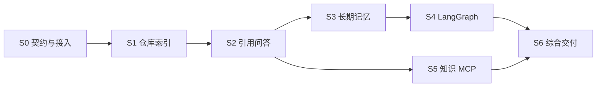

# CoreCoder 后续阶段详细执行文档

日期：2026-11-13（Asia/Singapore）  
起点：当前工作区已完成模型网关、Prompt 模板、LangChain 结构化输出链和共享调用预算。  
范围：从现有 M1 基础继续建设仓库 RAG、长期记忆、LangGraph 工作流和知识 MCP 服务。  
状态：待实施任务清单；本文件中的新增 API、命令、测试文件与质量目标均不代表已交付。

## 1. 本文与已有文档的关系

- [总体执行计划](llm-engineering-execution-plan.zh-CN.md)：解释九项技术如何组成完整项目，作为总体设计基准。
- [当前实施记录](implementation-status.zh-CN.md)：说明已经完成的内容、历史验证结果与限制。
- **本文**：只拆解尚未完成的工作，提供依赖顺序、接口、文件、任务、测试和退出条件。

本文不会要求重写现有 ModelGateway、Prompt 注册器、Pydantic 输出链或可靠性运行时。涉及新业务时补齐适配与契约即可。

### 1.1 可以直接复用的现有能力

| 现有模块 | 后续用途 | 目前边界 |
|---|---|---|
| `corecoder/integrations/model_gateway.py` | 问答、计划、记忆提取的模型入口 | 尚未接管旧 Agent 的全部模型请求 |
| `corecoder/integrations/langchain_bridge.py` | 复用 `StructuredPromptChain` | 接受调用方提供的 evidence，尚不负责检索和引用新鲜度 |
| `corecoder/prompts/registry.py` | 加载六个已打包的 v1/v2 模板 | 变量集合必须精确匹配，不能随意添加新字段 |
| `corecoder/prompts/schemas.py` | 校验答案、计划和记忆候选 | Schema 成立不代表内容正确、来源可信或可自动执行 |
| `corecoder/config.py::EmbeddingConfig` | 读取独立 Embedding 配置 | 仅有配置契约，没有 Embedding 调用实现 |
| `corecoder/workflows/budget_ledger.py` | 多次模型请求共享限额 | 暂无 Embedding 批次与编码子任务的完整适配 |
| `Agent.run()` / `Agent.resume_run()` | 执行与恢复编码任务 | 需要公开、稳定的调用方 run identity 契约 |
| RunStore、ToolScheduler、Verifier | 副作用治理、权限和完成证据 | 继续作为执行事实来源 |
| `corecoder/mcp.py` | 保留旧 MCP 客户端兼容路径 | 固定旧握手，尚无自建知识 Server |

当前实施记录报告完整离线回归 436 项通过、Prompt 两版本各 14/14 个契约用例符合预期。这些是历史受测环境的结果，本次编写文档没有重跑全量测试，也没有调用真实 API。

### 1.2 本轮目标与首个交付

最终目标：用户提出代码问题或修改需求，系统能检索当前仓库、召回有效项目约束、执行有证据的任务，并在中断后按已记录事实恢复。

**首个交付只做“带引用的仓库问答”。** 完成项目加载、增量索引、关键词/向量检索和引用检查后，用户已经能使用真实业务功能。后续记忆、图和 MCP 在这条稳定链路上扩展。

首版不纳入 Web UI、多用户服务器、分布式调度、远程 MCP 部署、任意语言 AST、多模态和多个向量数据库。

## 2. 里程碑、依赖和投入

估算前提：一名熟悉当前项目的开发者，每天约 5～6 小时有效开发。实施合计 20～22 个工作日，可预留 2 天兼容性机动，即 **20～24 个工作日**。实际完成以验收为准。

| 阶段 | 任务编号 | 时间 | 依赖 | 可独立验收的产物 |
|---|---|---:|---|---|
| S0 接入准备 | A01～A04 | 1 天 | 当前代码 | 基线、数据契约、依赖试装、CLI 路由方案 |
| S1 仓库索引 | B01～B08 | 5 天 | S0 | 安全加载、切分、Embedding、双索引、增量发布 |
| S2 仓库问答 | C01～C05 | 3 天 | S1 | 混合检索、带来源回答、引用与拒答评测 |
| S3 长期记忆 | D01～D05 | 3 天 | S2 | 显式偏好、有效经验、跨会话召回和删除 |
| S4 图工作流 | E01～E07 | 4～5 天 | S2、S3 | 分支、检查点、预算接入和安全恢复 |
| S5 知识 MCP | F01～F05 | 2～3 天 | S2 | Server、SDK 桥接、真实传输调用 |
| S6 综合交付 | G01～G04 | 2 天 | S3、S4、S5 | 对照报告、干净安装、三套演示、项目材料 |

S5 的知识服务逻辑只依赖 S2，不强制依赖 LangGraph；首版仍按表顺序推进，避免同时维护多个未验收模块。



任务管理规则：每完成一个编号，至少留下代码/文档改动、针对性验证结果和已知限制。新增检查命令只有真正实现并验证后，才从“计划接口”移入 README 的“可运行”部分。

## 3. S0：接入准备

### A01：冻结当前事实基线

**改动范围**：`docs/roadmap/implementation-status.zh-CN.md`、新阶段报告目录。  
**前置**：无。  
**预计**：0.25 天。

- 记录 HEAD、已有工作树文件清单和关键源码 SHA-256；当前实现存在未提交文件，不能仅靠 HEAD 复现。
- 在项目自己的 `.venv` 或隔离环境运行已有离线检查，保存环境版本与结果。
- 复核 README、发布说明与 wheel 的模板资源，已修复的问题不重复列为待修复。
- 如果 Windows 沙箱影响 Shell 进程终止测试，分别记录受限环境结果和原因，不删除失败检查或伪造通过。

**验收**：有可定位到实际工作树的起点报告；已存在的失败与新增失败可区分。

### A02：补齐扩展依赖验证

**改动范围**：`pyproject.toml`、`requirements/`、`.github/workflows/ci.yml`。  
**前置**：A01。  
**预计**：0.25 天。

1. 保留现有 `knowledge` extra 和 `langchain-core` 基础，解析 text splitters、Chroma 集成与 ignore 匹配所需依赖。
2. 先在独立环境验证 Windows 与 Python 3.11/3.12 的安装、导入、FTS5 和本地向量写读；保留已有 3.14 环境作为另一个受测组合。
3. 图和 MCP extra 到所属阶段才加入，不提前制造不可运行的安装选项。
4. 生成新环境约束或锁快照，注明平台；不能把 Windows 快照宣称为跨平台锁。
5. 本地 Chroma 不能因未显式传 Embedding 实现而触发默认模型下载。离线测试必须禁止网络并注入固定向量。

LangChain 的 Chroma 集成提供本地持久化与检索能力；本项目使用哪组版本，以当前依赖解析和实际测试为准。[官方集成文档](https://docs.langchain.com/oss/python/integrations/vectorstores/chroma)

**验收**：至少一个扩展环境完成写入、过滤查询、重开读取和删除；失败时给出具体依赖冲突，不继续假定该组合可用。

### A03：定义三个领域契约

**新增**：`corecoder/knowledge/models.py`、后续 memory/workflow 契约设计说明。  
**前置**：A01。  
**预计**：0.25 天。

知识领域先实现以下类型，名称是建议接口，实施时保持统一：

| 类型 | 最小字段 |
|---|---|
| `ProjectScope` | owner_id、project_id、root、允许目录、索引数据根 |
| `SourceDocument` | path、text、raw_hash、normalized_hash、language、source_kind |
| `Chunk` | chunk_id、path、span、symbol、heading、text、hash、splitter_version |
| `SnapshotManifest` | snapshot_id、scope、schema、embedding_space、文件与 chunk 清单 |
| `SearchHit` | chunk_id、snapshot_id、各路 rank、融合分数、citation |
| `EvidenceBundle` | query_id、scope、snapshot_id、evidence 列表、降级与排除原因 |

作用域从可信本地上下文生成；首版 project ID 可保存在本地配置中，并绑定 canonical root。owner 为本地安装标识，不宣称构成服务器身份认证。

**验收**：字段、序列化、版本、合法范围和 ID 生成规则明确；路径与身份不由模型补写。

### A04：确定 CLI 分流和配置优先级

**改动**：`corecoder/cli.py`；新增 `corecoder/knowledge/cli.py` 等阶段入口。  
**前置**：A03。  
**预计**：0.25 天。

当前 `main()` 在构造 Agent 前调用 `Config.from_env()` 并要求 Chat API Key。新增本地命令必须在这个检查前分流。

- 先识别 `knowledge`、`ask`、`memory`、`workflow`、`mcp` 等新入口，再调用所属命令解析器。
- 原 `-p`、`--demo`、`--resume-run` 和 REPL 行为保留；可令 `main(argv=None)` 便于测试，但旧调用方式继续有效。
- `knowledge status`、已有索引的关键词搜索、记忆列表与删除不应构造 Chat 客户端或要求 Chat Key。
- `ask` 需要生成后端；向量索引/查询需要对应 Embedding 后端。三者的能力和错误提示分别判断。
- 配置优先级统一为命令行、环境变量、项目配置、默认值。第一版仅承诺文档列出的参数位置，不暗中支持半套全局参数语法。

**测试**：清空相关环境变量，验证本地命令仍可执行；旧命令解析结果不变；未知子命令非零退出。

## 4. S1：仓库索引的领域与存储设计

### 4.1 建议目录

```text
corecoder/knowledge/
  __init__.py
  models.py
  scope.py
  loaders.py
  splitters.py
  embeddings.py
  embedding_gateway.py
  manifest_store.py
  vector_store.py
  lexical_store.py
  indexer.py
  retriever.py
  citations.py
  service.py
  cli.py

.corecoder/knowledge/
  metadata.db              # manifests、chunk 清单、FTS、活动 snapshot
  vectors/                 # 本地向量存储
  cache/                   # 作用域内 Embedding 缓存
```

运行数据已在 `.gitignore` 中排除。不要把真实源码索引、用户记忆、API Key 或 payload 混入可发布示例。

### 4.2 Chunk 与版本规则

1. `source_path` 使用相对根目录的 POSIX 风格路径，展示时再按平台处理。
2. 行号从 1 开始，闭区间；source kind 区分源码、测试、设计文档和文章。
3. `raw_hash` 对原始文件字节计算；规范化文本用于切分时另存 `normalized_hash`，CRLF 不能破坏行号映射。
4. `chunk_id = sha256(project_id + path + raw_hash + span + splitter_version)`。
5. 向量记录 ID 还绑定 snapshot：`vector_id = sha256(snapshot_id + chunk_id)`，避免同一 chunk 跨 generation 覆盖。
6. Embedding 空间由 provider、模型修订、向量维度和预处理版本确定；空间变化必须建立新索引。
7. chunk metadata 与模型 evidence ID 分开维护映射；最终展示路径和行号由程序取 metadata，不信任模型自由生成的引用文字。

### 4.3 索引发布策略

首版采用“完整 generation 清单、只重算变化文本向量”的策略，优先保证一致性。可以复制未变片段的既有向量，但不重新请求 Embedding。

```text
锁定项目写入任务
  → 枚举并计算文件哈希
  → 生成待发布 snapshot
  → 复用未变片段与缓存向量
  → 切分和嵌入变化文件
  → 写入新 snapshot 的向量与 FTS
  → 校验数量、维度、manifest 和 scope
  → 单个 SQLite 事务切换 active_snapshot
  → 延后清理无人使用的旧 snapshot
```

Chroma 与 SQLite 不共享事务。发布前先完成向量写入与完整性校验；查询绑定一个已发布 snapshot。旧 snapshot 有读者时延迟清理，不能查询中途删库。

Chroma 更新/插入可以显式传向量；若只传文档，后端可能重新计算向量，因此本项目须控制何时调用 Embedding。[官方数据更新说明](https://docs.trychroma.com/docs/collections/update-data)

## 5. S1：逐项开发任务

### B01：安全选择文件

**新增**：`scope.py`、`loaders.py`。  
**前置**：A02、A03。

- 首版允许 `.py`、`.md`；其他配置文本后续按需加入。
- 默认范围为 `corecoder/`、`docs/`、`tests/`、实际存在的 README；文章通过显式选项纳入。
- 遵守 `.gitignore`，排除虚拟环境、`.git`、`.corecoder`、构建产物、会话、Trace、评测输出和数据库。
- 解析最终路径并判断根目录包含关系；拒绝 symlink/junction 越界、盘符跳转与 `../`。
- 文件最大 1 MiB 作为初始配置；二进制、不可解码与过大文件分别计数，不能悄悄替换字符后生成错误引用。
- 文件读取前后检查稳定性；索引时持续变化的文件跳过并记录，不创建虚假的一致快照。
- 提供 `--dry-run`，只列路径和估算量，不读凭据、不发模型请求。

**针对性测试**：普通文件、忽略文件、UTF-8/CRLF、无效编码、超大文件、越界路径、Windows junction、读取中变化。

**验收**：所有入库文档都能追溯到授权根内的一份稳定文本。

### B02：按代码与标题切分

**新增**：`splitters.py`。  
**前置**：B01。

- Python 使用 `ast`，保留函数/类/方法、decorator、docstring 和符号名；超大块再递归切分。
- 语法不完整的源码可以降级为文本切分，明确记录 fallback，不导致整个索引失败。
- Markdown 按标题层级分区，再按长度拆分；处理代码围栏里的 `#`，避免误作标题。
- 不按拼接后的父类上下文伪造连续行号：额外符号提示与原始正文分字段保存。
- 采用 LangChain `Document` 和所选切分器；默认字符长度与 Token 长度不要混淆。
- 初始正文约 1,200～2,400 字符、重叠 200 字符，作为开发集调参起点；记录参数哈希。

**测试**：decorator、嵌套类、超长函数、中文文档、代码围栏、空文件、无结尾换行、语法错误降级、CRLF 行号回读。

**验收**：对每个 chunk，用起止行从源文件回读后能核对正文；切分输出稳定且不会丢掉长块。

### B03：实现独立 Embedding 调用与预算

**新增**：`embeddings.py`、`embedding_gateway.py`；扩展预算适配。  
**前置**：A02、B02。

建议协议：

```python
class EmbeddingProvider(Protocol):
    def describe(self) -> EmbeddingSpace: ...
    def embed_documents(self, texts: list[str]) -> EmbeddingBatch: ...
    def embed_query(self, text: str) -> EmbeddingVector: ...
```

实施要求：

- 首版接一个真实后端，可以是已选的兼容 API 或预部署本地服务；另有固定向量替身供离线测试。
- 延迟读取 `EmbeddingConfig.api_key_env` 指向的值，只在调用所选后端时读取；不继承 Chat 地址和 Key。
- 批量上限先设为 32 条，并配置单条/批次长度；按实际后端限制调整。
- 每批请求及查询 Embedding 都计入共享预算；使用现有 ledger 的 reserve/settle 适配输入量，输出 Token 为 0。
- 每个实际重试都占用请求次数；记录 batch size、维度和耗时，不记录正文。
- 返回条数与输入一致，索引次序正确，向量维度一致且全部为有限数；空向量、NaN、Inf 和维度变更受控失败。
- usage 缺失时按预留计量并显示未知，明确 Embedding 费率与 Chat 费率分别配置。
- 不把 Embedding 操作塞进当前只接受 Chat `LLMResponse` 的 ModelGateway；共享 ledger，而不是混淆返回协议。

**测试**：无 Chat Key 时独立运行、缺 Embedding 配置、批次重排、错误条数、维度变更、429、重试上限、预算停止、未知 usage。

**验收**：固定替身和真实后端使用同一领域协议；真实质量验证与管线测试分开报告。

### B04：建立 manifest 与迁移

**新增**：`manifest_store.py`。  
**前置**：A03、B02。

最少表：`projects`、`snapshots`、`source_files`、`chunks`、`snapshot_chunks`、`index_jobs`、`active_snapshots`。

- snapshot 生命周期为 building、ready、published、failed、retired。
- project/snapshot/chunk 的唯一键与外键明确；schema 版本不兼容时拒绝继续写。
- 检测陈旧 building job，保留旧 published 索引；清理动作可重入。
- 单个项目同一时间只允许一个索引写任务，使用 SQLite 事务认领/租约；首版不承诺多机索引。
- 失败摘要不存密钥、请求正文或完整私有绝对路径。

**测试**：首次建库、重开、重复 job、并发认领、schema 不匹配、事务回滚和陈旧任务恢复。

**验收**：索引中断后可以识别未完成任务，已有可读索引不受影响。

### B05：实现向量与关键词两种存储

**新增**：`vector_store.py`、`lexical_store.py`。  
**前置**：B03、B04。

| 存储 | 要实现的能力 | 必测行为 |
|---|---|---|
| Chroma | 显式向量写入、按 snapshot/scope 检索、按 ID 获取和删除 | 持久重开、过滤、维度、删除、无隐式网络 |
| SQLite FTS5 | 分词后写入、参数化查询、scope/snapshot 限定 | 中文、标识符、特殊字符、空查询、版本隔离 |

FTS 首版预处理：拆分 snake_case/camelCase，保留原标识符，中文用重叠二元词；查询同规则。构造受限 MATCH 表达式，不直接拼接用户提供的 SQL 或 FTS 操作语法。

FTS5 先做运行时能力探测；不可用时明确报环境错误或显式切换到已验收模式，不能把不同检索后端混在同一实验中。

**验收**：相同 scope/snapshot 的两路结果都可映射为合法 chunk；用另一个项目的最相似内容做诱饵也不能越界返回。

### B06：增量索引、缓存与发布

**新增**：`indexer.py`，整合 B01～B05。  
**前置**：B01～B05。

- 文件未变化：复用 chunks 与缓存向量，Embedding 请求数为 0。
- 文件新增/修改：仅处理变化文件，移除当前清单中旧版本片段。
- 文件删除/改名：新 snapshot 不得含原路径；改名即便复用向量，也必须更新引用。
- 缓存键绑定 project、Embedding 空间和规范化正文哈希；首版不做跨项目原文/向量共享。
- 改变模型、维度、切分版本或 schema 时，创建新空间/清单，禁止混用。
- 按第 4.3 节先完整落盘再切换活动指针。
- 清理旧 snapshot 时使用范围校验和存储 API，避免删除活动数据；Windows 文件句柄必须正确释放。

**故障注入**：嵌入完成前、向量写后、FTS 写后、发布指针前、指针切换后。每处验证活动索引可读、孤立数据可清理、再次运行不重复收费于已有缓存文本。

**验收**：冷启动、零改动、单文件改动、删除、改名和中断六类场景都可复现。

### B07：知识服务与本地 CLI

**新增**：`service.py`、`knowledge/cli.py`；改动 `cli.py`。  
**前置**：A04、B06。

建议服务接口：

```text
KnowledgeService.index(scope, options, ledger) -> IndexReport
KnowledgeService.status(scope) -> IndexStatus
KnowledgeService.search(scope, query, mode, top_k, ledger) -> SearchResult
KnowledgeService.get_chunk(scope, chunk_id, snapshot_id) -> Chunk
```

本阶段先提供 index/status 和单路检索入口；混合排序在 C01 接入。

- 人类模式输出文件/片段/跳过/请求计数；JSON 模式输出结构化报告。
- 凭据缺失、后端不可用、无索引、索引损坏使用不同错误码与原因。
- `get_chunk` 不接受磁盘路径；必须在已发布且授权的 snapshot 中查找。

**验收**：未配置 Chat API 的机器能完成 dry-run、status 和关键词检索；有 Embedding 后端时可建立语义索引。

### B08：建立可复现索引演示

**新增**：`examples/knowledge_index_demo.py`、`tests/knowledge/`、S1 实施记录。  
**前置**：B07。

在临时项目创建中文文档和两个 Python 模块，依次演示首次索引、无变化复用、修改、删除和故障恢复。固定向量替身证明行为，不宣称真实语义准确率。

**S1 退出条件**：双存储可持久化、增量行为正确、版本发布一致、无越界、无隐式网络、演示可重复。

## 6. S2：检索、引用和问答

### C01：实现 LangChain Retriever 与混合召回

**新增**：`retriever.py`。  
**前置**：B05、B07。

流程：关键词 top20、向量 top20 → 按 chunk_id 去重 → RRF 融合 → 文件/符号多样性去重 → top6 进入上下文。

- `RRF(d) = Σ 1 / (60 + rank_i(d))`，rank 从 1 开始，常数和各路 topK 记录入配置。
- 所有召回绑定同一 published snapshot，先过滤 scope，再检索，再复查结果。
- LangChain `BaseRetriever` 的输出为带 metadata 的 Document；领域 SearchHit 保留各路 rank 与降级信息。
- 不直接将不同后端相似度相加，也不使用未校准的固定 `0.8` 阈值。
- `mode=lexical/vector/hybrid` 明确区分；后端降级作为输出字段，禁止静默改变评测模式。
- 中文语义、函数精确名和跨模块问题分别评测。

**测试**：RRF 公式、稳定排序、重复片段、一个后端失败、scope 隔离、无结果、检索 budget。

### C02：建立 EvidenceBundle 与引用检查

**新增**：`citations.py`。  
**前置**：C01。

1. 分配稳定 evidence ID，构造 ID 到 chunk/snapshot/path/span/hash 的映射。
2. 生成前检查文件存在、哈希和行号有效；总上下文约 4,000 估算 Token，超长按片段裁剪，不能破坏引用范围。
3. 回答只接受已有 evidence ID；由程序把 ID 渲染为源码引用。
4. 输出前再次复查所引用文件哈希。发生变化时最多重建相关索引并重新回答一次，所有请求计入同一预算。
5. 仍不稳定则返回 `stale_evidence` 和已有可确认信息；不输出失效的确定结论。
6. 模型有真实来源 ID 仍可能误读含义，引用有效性与语义支持率分别评测。

**测试**：伪造 ID、已删文件、超范围行号、CRLF、生成过程中变化、多版本混合和恶意路径文字。

### C03：接入已有问答 Prompt 链

**改动**：知识 service、新 `corecoder/knowledge/answering.py`；只在必要时扩展模板。  
**前置**：C02。

现有 `repo_answer` 输入必须精确为 `question/evidence/memories`。首版适配为：

```text
question = 用户问题
evidence = [{id, text, source_path, start_line, end_line, snapshot_id}, ...]
memories = []                 # S3 完成前为空
```

- `answering.py` 先取真实 EvidenceBundle，再调用已有 `StructuredPromptChain`。
- 无证据时可以直接返回 insufficient，避免无意义模型调用；有限查询改写属于可配置补救，最多一次。
- 改写使用专门的输出契约，新增 Prompt 版本/种类时更新 registry、schema、包资源和测试，不能把它伪装成已有模板的另一套输入。
- 源码、注释和文档放在 evidence 数据内；其中“忽略规则”等文字不能触发工具执行、改变身份或写记忆。
- 不把普通问答的 `answered` 状态改为编码运行的 `VERIFIED`。

**测试**：完整回答、缺证据、一次结构修复、一次改写、恶意文档、预算到期和引用新鲜度。

### C04：提供 ask 与 sources 输出

**改动**：`cli.py`、`knowledge/cli.py`；新增 `ask` 路由。  
**前置**：C03。

首版不依赖图执行；`ask` 直接调用 KnowledgeService 和问答链。后续图模式使用同一服务，不重写逻辑。

输出必须包含答案状态、来源、snapshot、检索模式/降级、未知项、调用计数和费用是否可用。JSON 输出保证 stdout 可解析，进度和诊断走 stderr。

**验收**：用户能从引用回到真实源码位置；无 Chat Key 时 ask 给出生成后端错误，但 knowledge search 仍可用。

### C05：建立 RAG 数据集和验收报告

**新增**：`evals/cases/knowledge/`、`evals/knowledge_runner.py`、问答 demo。  
**前置**：C04。

- 初始 40 题：精确定位 10、跨模块流程 10、设计依据 8、无答案 6、过期/对抗 6。
- 24 题开发、16 题保留，分层抽样；调参期间不拿保留集逐题优化。
- gold 用路径/符号/行区间定义，再映射到当前 chunk，不绑定某个偶然切分 ID。
- 比较 lexical、vector、hybrid，报告 Hit@5、Recall@5、MRR@10、引用有效性和耗时。
- 固定向量测试只验证流程；真实语义指标必须使用真实 Embedding 后端，注明模型与数据版本。

**S2 退出条件**：能真实回答仓库问题、能拒绝不存在的事实、引用对应当前文件，有独立检索与问答证据。

## 7. S3：长期记忆

### D01：SQLite 存储与作用域

**新增**：`corecoder/memory/models.py`、`store.py`。  
**前置**：S2。

记录至少包括 memory_id、owner/project、kind、key、content、source_ref/hash、evidence_refs、status、创建/过期时间、supersedes、write_operation_id、schema_version。

- 状态为 candidate、active、superseded、expired、deleted。
- 显式偏好与已验证经验分类型；首版无需向量化记忆。
- 使用 UTC 时间和可注入时钟测试 TTL；当前时间不来自模型。
- 本地存储隔离不等同于服务端认证；文档明确单用户首版边界。

**测试**：迁移、重复 operation、项目隔离、时间边界和事务失败。

### D02：候选审核与写入门槛

**新增**：`memory/policy.py`、`service.py`。  
**前置**：D01。

- 复用已有 memory_extract 链，它只产生候选。服务端逻辑补充 owner/project、来源状态和审核结果。
- 用户明确“记住……”可保存为偏好；来自源码/ADR 的规则必须绑定实际文件哈希。
- 自动经验只能来自可信运行记录中 `VERIFIED` 的任务，source_ref 由调用方提供并回查 RunStore。
- 检查敏感字段、测试密钥、来源有效性和证据完整性；模型自报 VERIFIED 不可作为输入事实。
- 只允许候选 schema 中合法字段，写入参数不能新增工具权限、命令白名单或任意用户身份。
- 同 key 新偏好保留旧记录的 superseded 关系；同 operation 重放只写一次。
- 保存失败不改变已经验证成功的任务事实，单独报告记忆保存失败。

**测试**：伪造运行来源、未验证任务、敏感内容、重复写入、冲突、用户偏好变更和数据库不可写。

### D03：召回、有效性和删除

**改动**：MemoryService。  
**前置**：D02。

- 先过滤作用域、active、TTL 和来源有效性，再按 key/关键词召回。
- 最多 5 条、约 1,000 Token；排序依据相关性和来源，不把 confidence 当授权凭证。
- 当前明确指令优先于历史偏好；项目规则冲突时输出原因。
- 源文件变化先标 stale 并重验证；无法确定则不注入为当前事实。
- 删除同时清理检索缓存；保留必要的无正文 tombstone，防止同一旧 operation 把已删除偏好重新写活。
- 清空项目需要明确项目范围；首版不提供跨根目录的批量磁盘删除命令。

**验收**：换 thread 可召回、换项目不召回、过期与删除后不召回、删除后重放旧 operation 不复活。

### D04：接入问答与计划，不扩大权限

**改动**：问答/计划适配器；新增 memory CLI。  
**前置**：D03。

将有效记忆以 ID、content、来源和时间放入现有 `memories` 或 `constraints` 字段。历史经验是参考，不是 system 级权限规则。

本地 `memory list/show/forget` 不要求模型 Key。显式记忆命令可用确定性路径保存简单偏好，调用模型提取时才要求生成能力。

**验收**：用户偏好影响回答语言/格式或计划约束；不能因为记忆内容“允许执行任意命令”绕过 Permission。

### D05：跨会话任务序列评测

**新增**：`evals/cases/memory/`、`evals/memory_runner.py`、`examples/memory_demo.py`。  
**前置**：D04。

构造 20 组序列，覆盖明确写入、新 thread 召回、偏好冲突、来源变化、TTL、删除、越界和未经验证经验。

对照 memory off/on；写入时间必须早于被评测任务。报告召回准确率、必要约束召回率和删除残留数量。

**S3 退出条件**：记忆具备完整生命周期，候选与 active 严格区分，跨会话行为由运行证据证明。

## 8. S4：LangGraph 与可靠性运行时连接

### E01：定义图状态与任务结果边界

**新增**：`workflows/state.py`、`payload_store.py`；扩展 ADR-0004。  
**前置**：S2、S3。

图状态只含 schema、owner/project/thread/turn、request_ref、snapshot、retrieval/memory/plan/result 引用、attempt、child_run_id、预算摘要和阶段状态。

- 原问题、代码片段和记忆正文存到受控本地 payload 存储，检查点不直接保存原始正文。
- payload 有用途、生命周期和内容哈希；丢失时进入需要处理状态，不悄悄换输入。
- `workflow_status`、`answer_status`、`code_run_status` 分开；图结束不代表代码验证成功。
- 图/checkpoint 对象、Verifier 对象和密钥不直接序列化进状态。

LangGraph 检查点按 thread 保存图状态，可用于恢复工作流；实际副作用保证仍取决于本项目桥接协议。[官方检查点文档](https://docs.langchain.com/oss/python/langgraph/checkpointers)

### E02：公开稳定的子运行身份

**改动**：`agent.py`；新增 `workflows/runtime_bridge.py` 与持久化 operation 表。  
**前置**：E01。

当前内部 `_run_id` 不是稳定公开 API。提供向后兼容的公开 `run_id` 或 `run_once` 契约，明确：

- 新 ID 启动；相同 ID、相同载荷查询/恢复；相同 ID、不同载荷拒绝。
- 不改变旧 `Agent.chat()` 的字符串返回。
- 用 `(project, thread, turn, plan_hash, attempt)` 生成逻辑 operation 键，并在执行前持久化 child_run_id。
- 计划 hash 包括可信验证策略、工具配置与任务输入版本；新用户回合使用新 turn。
- 同一 operation 的并发启动使用 SQLite 唯一约束和认领；进程内锁不足以防跨进程重复。

**测试**：新启动、重入、输入不一致、并发认领和旧 API 兼容。

### E03：构建真实 StateGraph

**新增**：`workflows/graph.py`、`nodes.py`、`checkpointing.py`。  
**前置**：E02。

节点建议：prepare、retrieve、recall、plan、answer、execute、review、commit_memory、finalize。

问答分支调用已验收 KnowledgeService 和问答链；编码分支调用 RuntimeBridge，消费现有 Verifier 结果；显式记忆请求可走独立写入分支。

- 查不到证据允许最多一次查询改写；结构修复沿用现有限制。
- 首版自动重试整个编码任务的次数为 0；真实业务补救后续显式增加 attempt。
- 权限拒绝、取消、预算耗尽和 UNKNOWN 不作为普通错误自动重跑。
- 补齐计划引用校验：检查 `steps[].expected_evidence` 的含义。如果它表示已有证据 ID，必须纳入完整成员校验；如果表示未来证据需求，应另建类型，不能与现有来源 ID 混用。
- 持久化 planner 输出前进行 Schema、引用、可信输入和预算检查。

**验收**：至少覆盖问答、编码、缺资料三个真实条件分支，不能只是线性封装。

### E04：接通全流程预算

**新增**：`integrations/agent_llm_bridge.py`；扩展 BudgetLedger 持久化/恢复契约。  
**前置**：E03、B03。

当前 Agent 仍调用旧 `LLM.chat()`；仅把同一 ledger 传给 planner 不会限制编码子任务的请求。图模式为 Agent 注入预算适配 LLM：

- `.chat()` 兼容现有签名，内部经 ModelGateway 调用并返回现有 `LLMResponse`。
- 提供 Agent 需要的模型标识、usage 计数与成本属性；对回调语义明确兼容范围。
- 当前 `chat_once()` 是缓冲返回，首版可在完成后提供文本与阶段事件，不承诺 token 实时流；旧 runtime 路径保留其流式能力。
- 所有 planner、answer、memory、summary、query embedding、batch embedding 和 child Agent 请求进入同一总账；不同费率分别结算。
- 原 RunBudget 继续限制工具、轮次等，与工作流总账职责分开，不能把费用重复计入。
- 崩溃后恢复剩余预算，不能每次 resume 获得全新额度。请求预留与结算建立可重入记录；已发送但回执丢失的量保守记为未知消耗。

**测试**：子 Agent 耗尽总预算、摘要/重试计费、Embedding 与 Chat 合计、恢复不重置限额、未知 usage、记忆提取被预算阻止。

### E05：实现保守恢复与故障矩阵

**改动**：RuntimeBridge、图恢复入口、RunStore 查询适配。  
**前置**：E04。

| 崩溃位置/已有状态 | 恢复行为 | 必须证明 |
|---|---|---|
| operation 映射已写，子运行未创建 | 用同一 child ID 启动 | 不创建第二映射 |
| 子运行执行中 | 查询并恢复同一 RunStore 记录 | 保留已有工具事实 |
| 写文件完成、工具回执未落盘 | 复用既有文件哈希对账 | 不重复写入 |
| 子运行终态、图检查点未写 | 读取已保存结果 | 不再执行工具 |
| PAUSED | 保持暂停 | 自动恢复传 `resume_paused=False` |
| UNKNOWN / NEEDS_ACTION | 返回待处理状态 | 不盲目重试副作用 |
| Verifier 配置丢失/变更 | 未验证或需要处理 | 不接受模型代替策略 |
| 记忆已写、图未确认 | 用同一 write_operation 查询 | 只保存一次 |
| 外部请求发送、usage 未保存 | 保留未知预算占用 | 不恢复成零费用 |

可信 Verifier 通过配置的 policy ID 重建，不能把模型生成的命令当验证器。跨 SQLite 和外部服务不承诺全局 exactly-once，报告限定为已覆盖场景与外部能力。

**验收**：故障点都有可重复的测试或临时工作区 demo，副作用计数不是由模型自报。

### E06：图模式 CLI、事件与取消

**改动**：workflow/run 路由和事件适配。  
**前置**：E05。

- `ask --engine graph` 和编码工作流共用相同基础服务。
- resume 使用原 thread/turn/child ID，不重新生成任务身份。
- 工作流取消传递到子运行 CancellationToken；取消后不启动新模型或副作用工具。
- 图首版提供阶段事件、子运行状态、结果和恢复入口。运行中 APPEND/REDIRECT 要桥接 Handle 后才能声明支持。
- `workflow resume` 对 PAUSED 的继续意图与自动恢复区分，沿用原权限规则，不新增隐式 allow-all。

**测试**：CLI 恢复身份、取消传递、stdout JSON、暂停保持、缺 payload、不同项目错误恢复。

### E07：图恢复验收与兼容回归

**新增**：`tests/workflows/`、`examples/graph_resume_demo.py`、图评测场景。  
**前置**：E06。

至少构建 12 组恢复/控制场景，覆盖上表与并发恢复、取消。重跑既有可靠性用例，比较输入、配置和安全门禁，不以知识命中率提升抵消副作用回归。

**S4 退出条件**：真实 StateGraph 有持久检查点、全流程预算和受测恢复协议；现有显式工具循环仍是唯一执行入口。

## 9. S5：知识 MCP 服务

### F01：验证 SDK 与协议兼容

**改动**：新增 MCP extra、版本约束和 ADR 实施说明。  
**前置**：S2。

在独立环境锁定官方 SDK，并验证 stdio 工具发现与调用。现有自写客户端固定旧 `initialize` 流程；新 SDK 支持的协议可能采用不同发现机制，不能仅提高一个版本字符串就声称兼容。[官方协议版本文档](https://py.sdk.modelcontextprotocol.io/protocol-versions/)

首版支持矩阵至少区分：旧客户端/旧 fixture、SDK 客户端/新知识 Server；旧客户端/新 Server 仅在实测或显式 legacy 配置后承诺。

### F02：Server 包装 KnowledgeService

**新增**：`corecoder/mcp_servers/knowledge.py`。  
**前置**：F01。

| 工具 | 参数 | 输出 |
|---|---|---|
| `knowledge_search` | query、top_k、可选已发布 snapshot | 检索模式、片段 ID、摘要、citation、版本 |
| `knowledge_get_chunk` | chunk_id、snapshot_id | 授权片段正文、路径、行号、哈希 |

- 项目根绑定到启动配置，不允许模型传任意 root/path。
- 限制 query 长度、top_k 和返回正文大小；值域在 schema 和服务层双重检查。
- 默认只读；索引管理通过本地明确命令，不暴露给模型修改知识库。
- stdout 只写协议数据，stderr 输出脱敏诊断；服务退出释放向量库、SQLite 和进程资源。
- 如果搜索需要远程 query Embedding，Server 必须有自己的限额/调用上下文；本地 in-process ledger 不会跨进程自动共享。

**验收**：与图内服务使用相同索引、过滤和 citation 规则，不复制另一套检索实现。

### F03：SDK 工具到现有 ToolSpec 的桥接

**新增**：`integrations/mcp_sdk_bridge.py`。  
**前置**：F02。

- 适配 schema、结构化结果、错误、超时、取消和资源清理。
- 同步 Agent 调用异步 SDK 时使用单独可关闭的生命周期/事件循环线程，不在已有运行循环中随意嵌套 `asyncio.run()`。
- 工具发现覆盖分页；未知第三方元数据保留保守权限，不能因 readOnlyHint 自动信任。
- 旧 `load_mcp_tools()` 路径继续可用；新桥接用显式配置选择，不无声替换所有服务器。
- 远程嵌入成本与 Agent 侧调用成本分开记录，避免宣称进程边界外也已统一计费。

### F04：真实传输与故障测试

**新增**：`tests/integrations/test_knowledge_mcp.py`。  
**前置**：F03。

至少覆盖真实 Server 子进程、SDK 独立客户端、本项目 Agent 调用、坏参数、错误结果、工具分页、断开重连、超时、越界尝试和取消清理。

固定向量离线运行，不访问真实 Key；至少一次测试真实 stdio 传输。仅 mock 工具返回值不能作为 MCP 交付依据。

### F05：配置、状态与独立客户端演示

**新增**：示例 MCP 配置、`examples/knowledge_mcp_demo.py`、独立 SDK 调用脚本。  
**前置**：F04。

演示同一问题由图内服务、Agent 的 MCP 工具、独立客户端取得相同来源版本。远程部署、HTTP 鉴权与多用户能力后续单列，不混入本地 stdio 首版。

**S5 退出条件**：真实 Server 能被两个独立调用入口使用，且异常不会绕过权限或留下后台子进程。

## 10. S6：评测、复现和交付

### G01：固定数据集与对照实验

**改动**：`evals/`、新阶段结果目录。  
**前置**：S2～S5。

| 实验 | 固定变量 | 对照 | 输出 |
|---|---|---|---|
| 检索 | 语料、问题、Embedding 空间、topK | lexical/vector/hybrid | Hit、Recall、MRR、耗时 |
| 问答 | 模型、问题、生成预算 | 无检索/有检索 | 正确性、支持率、拒答质量、费用 |
| Prompt | 模型与检索结果 | 已有 v1/v2 | Schema、支持率、Token；与离线契约测试分开 |
| 记忆 | 相同历史和任务序列 | off/on | 有效召回、约束遵守、删除残留 |
| 恢复 | 相同工具与故障点 | 原 runtime/图桥接 | 重复副作用、恢复结果、预算延续 |

真实 Chat/Embedding 小样本在本地显式配置后执行；默认离线 CI 不读 Key、不发请求。每个真实实验先固定数据集与上限，关键用例可重复 3 次并保留失败。

### G02：质量门禁

| 条件 | 首版验收方式 |
|---|---|
| 项目越界返回 | 受测场景计数为 0，硬门禁 |
| 已删除记忆再次召回/复活 | 0，硬门禁 |
| 故障恢复重复副作用 | 0，硬门禁；明确覆盖范围 |
| 伪造 evidence ID 被接受 | 0，硬门禁 |
| 已失效源码引用被当作当前有效引用展示 | 0，硬门禁 |
| 测试密钥进入日志/checkpoint/记忆 | 0，硬门禁 |
| 真实 Embedding 的 Recall@5 | 初始目标 ≥ 0.80；报告 gold 定义、计数与样本限制 |
| 人工标注的回答支持率 | 初始目标 ≥ 90%；小样本同时报告分子/分母 |
| 无答案正确处理 | 初始目标 ≥ 90%；不只测 answered 样本 |
| 不变仓库增量索引 | 新增 document Embedding 请求为 0 |
| 实际费用与延迟 | 报冷/热索引、阶段耗时与未知项，不先写提升百分比 |

Recall@5 用每题命中的相关 gold 片段数除以该题 gold 总数，再做宏平均；Hit@5 只判断是否至少命中一个。引用有效不等于语义正确，两者分开计算。

### G03：安装包与 CI

**改动**：可选依赖、锁文件、CI、包资源测试。  
**前置**：G01、G02。

- 基础 Python 3.10 路径保持轻量；所有扩展仅在使用时导入。
- 扩展在声明的 Python/平台组合实际安装和运行；CI 配置存在不代表已执行成功。
- 扩展测试环境缺依赖必须失败，不允许整组 skip 后显示绿色。
- 使用临时源码夹具、固定模型和向量；禁用隐式下载与默认云追踪。
- wheel 安装到干净目录后执行问答 fixture、记忆生命周期和知识 MCP 示例。
- 保留旧测试和可靠性门禁，动态源码统计与 README 数字通过既有工具更新，不能靠删除检查解决漂移。

### G04：演示与项目材料

**改动**：README、CHANGELOG、RELEASE_NOTES、实施记录；功能验收后再更新外层简历/面经。

三套演示：

1. **仓库问答**：真实检索、源码引用、无答案处理、编辑后新索引。
2. **长期记忆**：保存偏好、新 thread 使用、用户改写、删除后不再使用。
3. **MCP 与图恢复**：两个客户端访问同一知识服务；临时项目中断后复用原子运行事实，不重复工具。

每套演示附运行命令、依赖、是否联网、是否收费、预期断言和失败提示。演示脚本不预先伪造“测试通过”，由真实断言决定退出码。

最终材料说明哪些来自上游、哪些是已有 fork、哪些是本轮新增。没有实测的质量、费用和性能收益不写成简历成绩。

## 11. 目标接口与命令清单

**以下命令全部是待实现接口，不能按当前代码直接运行。** 建议实施后在 `--help` 中保持一致。

```powershell
# 本地索引与检索；不要求 Chat Key
corecoder knowledge index --root . --dry-run
corecoder knowledge index --root .
corecoder knowledge status --root . --json
corecoder knowledge search "RunStore 的恢复流程" --root . --mode lexical
corecoder knowledge search "重复副作用如何避免" --root . --mode hybrid --top-k 6

# S2：直接服务模式；S4 后才有 graph 模式
corecoder ask "模型完成与验证完成有何区别？" --root . --sources
corecoder ask "RunStore 如何恢复？" --root . --engine graph --json

# S3：记忆生命周期
corecoder memory remember "当前项目回答优先使用中文" --root .
corecoder memory list --root .
corecoder memory show MEMORY_ID --root .
corecoder memory forget MEMORY_ID --root .

# S4：可信项目配置指定验证策略，模型不能临时发明验证命令
corecoder run "修复指定缺陷" --root . --engine graph
corecoder workflow status WORKFLOW_ID --root .
corecoder workflow resume WORKFLOW_ID --root .

# S5：本地 stdio 知识服务
corecoder mcp serve-knowledge --root .
```

建议错误类别为 `configuration_error`、`index_missing`、`stale_evidence`、`embedding_unavailable`、`budget_exceeded`、`needs_action`、`internal_error`。CLI 退出码与 JSON 结果分别定义，正常业务无答案可返回 insufficient，不应混成未处理异常。

### 11.1 现阶段已有、可用于起点验证的命令

在实际 Python 项目根目录执行；使用当前已安装的环境，不在文档编写过程中自动更换依赖：

```powershell
Set-Location 'D:\桌面\agent\CoreCoder\CoreCoder'
.\.venv\Scripts\python.exe -m examples.prompt_gateway_demo
.\.venv\Scripts\python.exe -m pytest tests/integrations -q
.\.venv\Scripts\python.exe -m ruff check corecoder tests examples evals
.\.venv\Scripts\python.exe -m evals.readme_benchmark --check
.\.venv\Scripts\python.exe -m pip check
```

已有 Prompt 对照 runner 默认会写结果文件。需要保留原报告时指定新输出位置，例如：

```powershell
.\.venv\Scripts\python.exe -m evals.prompt_runner --compare v1 v2 --offline --output .tmp/next-stage-baseline/prompts.json
```

全量回归命令仍为 `python -m pytest tests --ignore=tests/test_live_smoke.py -q`。本阶段实际执行时记录完整结果，不在本计划中预填未来通过数量。

### 11.2 按里程碑新增的验证入口

以下模块和参数也是待实现接口：

```powershell
# S1/S2：固定模型和向量的管线正确性
python -m pytest tests/knowledge -q
python -m examples.knowledge_index_demo
python -m evals.knowledge_runner --mode fixture --split holdout

# S3
python -m pytest tests/memory -q
python -m examples.memory_demo
python -m evals.memory_runner --offline

# S4/S5
python -m pytest tests/workflows tests/integrations/test_knowledge_mcp.py -q
python -m examples.graph_resume_demo
python -m examples.knowledge_mcp_demo
```

新增 live 质量模式必须与 fixture 模式明确分离，记录真实 Embedding/Chat 的模型与 usage；命令不能默认升级为联网评测。

## 12. 测试夹具与报告规范

建议建立 `tests/fixtures/knowledge_repo/`，包含小型 AST 模块、中文 Markdown、同名符号、代码围栏、跨模块调用及不存在的目标描述。过期、删除、越界和敏感内容在测试临时目录构造，避免把真实密钥样式作为产品样例传播。

每次阶段报告记录：

- 当前 HEAD、工作树/source manifest 和依赖锁哈希。
- 操作系统、Python、SQLite/FTS 能力和依赖组合。
- 语料 snapshot、切分参数、Embedding 空间和 Prompt 版本。
- 数据集划分、样本数、运行次数、随机种子或固定响应。
- 成功、拒答、降级、失败和需要处理分别计数。
- Chat/Embedding 实际请求、usage 是否完整、费用是否可知、墙钟耗时。
- 文件/行号有效性、人工语义复核依据与失败样例。

索引不能默认包含评测答案、生成报告、缓存回答和长期记忆数据库，避免答案泄漏、自我引用与指标虚高。

## 13. 第一轮九天的具体安排

这里给出 S0～S2 的执行顺序；先交付一条完整业务链，不先安装所有框架。

| 工作日 | 当天主要任务 | 当天必须留下的结果 |
|---|---|---|
| 第 1 天 | A01～A04 | 起点报告、依赖验证、契约、CLI 分流方案 |
| 第 2 天 | B01、B02 | 授权文件加载与可回读的 AST/标题片段 |
| 第 3 天 | B03、B04 | Embedding 协议/替身、预算适配、manifest 数据库 |
| 第 4 天 | B05 | 双存储与 scope/snapshot 查询测试 |
| 第 5 天 | B06 | 增量、缓存、发布与故障测试 |
| 第 6 天 | B07、B08 | 本地索引 CLI、可重复演示与 S1 验收 |
| 第 7 天 | C01、C02 | 混合召回、EvidenceBundle、引用检查 |
| 第 8 天 | C03、C04 | 接通已有 Prompt 链，ask 输出答案与 sources |
| 第 9 天 | C05 | 固定测试集、三模式对照、RAG 首版验收报告 |

依赖安装或真实后端阻塞时，可以继续文件加载、切分、契约和固定向量测试；必须保留“真实语义质量未验收”的状态。不能用固定替身得出的分数替代真实 Embedding 质量。

## 14. 可直接交给开发者的分批任务说明

以下任务说明便于后续逐批实施，每批都应完成代码、针对性验证和实施记录，再进入下一批。

### 第一批：索引基础（A01～B04）

> 基于当前 CoreCoder 的 ModelGateway、Prompt 链和 EmbeddingConfig，实施 S0、B01～B04。实现授权根内的 Python/Markdown 加载、可回读的 AST/标题切分、独立 Embedding 协议与离线替身、预算适配和 manifest 存储。保留旧 CLI/Agent 契约，默认测试不联网。完成测试并记录环境与限制，不声明 RAG 已完成。

### 第二批：双索引与引用问答（B05～C05）

> 继续实现 Chroma/FTS5、snapshot 发布、增量与故障恢复、LangChain Retriever、RRF、EvidenceBundle、引用新鲜度和 ask CLI。复用现有 StructuredPromptChain。完成受控语料演示和固定评测，分开记录 fixture 正确性与真实 Embedding 质量。

### 第三批：长期记忆（D01～D05）

> 实现 SQLite MemoryService、候选审核、显式偏好与 VERIFIED 经验门槛、作用域召回、冲突/TTL/删除及旧操作防复活。接入现有 memories/constraints 输入，保持工具权限独立。完成 20 组跨会话序列测试和演示。

### 第四批：LangGraph（E01～E07）

> 新增真实 StateGraph、受控 payload、公开稳定 run identity、RuntimeBridge、全流程预算和保守恢复。图只编排阶段，编码工具继续由现有 Agent 执行。覆盖已执行副作用但未写图 checkpoint、PAUSED、UNKNOWN、Verifier 丢失、并发恢复和预算延续。

### 第五批：MCP 与交付（F01～G04）

> 用锁定版本官方 SDK 包装已有 KnowledgeService，提供只读搜索和片段读取，增加 SDK 到 ToolSpec 的桥接并保留旧客户端。用真实本地子进程和独立客户端验证。完成综合消融、干净安装和三套演示，按事实更新项目材料。

## 15. 每批完成后的统一退出条件

- [ ] 该批承诺的接口实际存在，并能通过示例使用。
- [ ] 明确哪些使用真实模型/向量，哪些使用固定替身。
- [ ] 关键正常、失败、越界与恢复路径有针对性验证。
- [ ] 数据身份、版本和来源不由模型控制。
- [ ] 新请求进入对应预算，恢复不重置已有消耗。
- [ ] 没有把未来接口提前写成 README 的现有功能。
- [ ] 没有覆盖既有工作树改动、删除原测试或弱化安全门禁。
- [ ] 报告失败、降级和未验收环境，指标可以追溯。
- [ ] 更新阶段实施记录，原总体计划继续保留为设计基准。

从当前状态开始，先执行 **A01～B04**，随后完成 **B05～C05**，即可交付第一版真正基于仓库证据回答问题的 RAG 功能。
