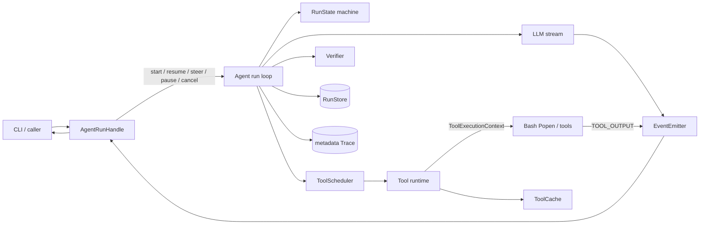

# Steerable, Observable Runtime

Status: implemented in this fork and covered by deterministic offline tests. It is
not a production sandbox and has not been exercised against a live provider in
this repository.

This document describes the runtime behind the CLI's `Steer >` prompt:
streaming progress, mid-run instructions, pause/resume/cancel, live Bash output,
safe read-only caching, and the persistence/recovery rules that keep those
features from changing the meaning of a run.

## 1. Architecture



Two execution modes share the same loop:

- `Agent.chat()` / `Agent.run()` are synchronous compatibility APIs.
- `Agent.start()` returns an `AgentRunHandle`; the run executes in one worker
  thread while the caller consumes events and sends control messages.

Only one active run is allowed per `Agent` instance. `AgentBusyError` is raised
instead of silently interleaving two mutable conversations.

## 2. Events and delivery

`AgentEvent` carries a monotonically increasing `sequence`, `run_id`,
`event_type`, phase, timestamp, a model-readable `message`, and redacted
`public_data`. Every event is delivered to the configured `EventSink`; the
handle also owns a bounded queue for callers that poll `handle.events()`.

Lifecycle ordering guaranteed by the runtime:

```text
TOOL_STARTED < TOOL_OUTPUT* < TOOL_FINISHED | TOOL_FAILED
```

`TOOL_OUTPUT` includes `tool_call_id`, `tool_name`, `round`, `channel`
(`stdout` or `stderr`), and a text chunk. It never includes the command line.
Parallel tool calls are separated by `tool_call_id`; their output is not
interleaved into one anonymous stream.

Terminal events (`RUN_FINISHED`, `RUN_FAILED`, `RUN_CANCELLED`) are emitted once,
after pending tool replies have been resolved. A slow event consumer applies
backpressure to the worker; lifecycle events are not silently dropped. A sink
exception is fail-open for the run and is counted as a delivery failure by the
steering eval.

## 3. Steering

`handle.steer(text, mode)` submits a `SteeringInstruction` to the run's
`ControlInbox` while holding the emitter lock, then immediately emits
`STEERING_RECEIVED`. The receipt contains the instruction id, mode, receive
sequence, and `ack_ms`. Receipt is not application: the run may still be inside
a model call, a tool call, or a permission wait.

`STEERING_APPLIED` is emitted only at a safe point. It contains the instruction
id, mode, safe point, round, `apply_ms`, and the number of tool calls skipped by
a redirect.

| Mode | Semantics | Safe-point behavior |
|---|---|---|
| `APPEND` | Add a requirement/constraint without discarding current work | Applied after the current assistant/tool batch is closed; the next model turn sees the instruction |
| `REDIRECT` | Replace the current direction | Outstanding, not-yet-started tool calls receive `BLOCKED`/`STEERING_REDIRECT` replies; the instruction is injected as a user message; the run enters `REPLANNING` |

A redirect never pretends that an already-started effect did not happen. If a
write completed before the redirect was applied, the file remains modified and
the run reports that fact. The runtime can stop launching new work; it cannot
roll back an external side effect.

Tool/message pairing is preserved: every model `tool_call` gets exactly one
tool reply, including calls skipped by a redirect. This is enforced by the
scheduler's interrupted path and by `_finish_pending_tool_calls`.

## 4. Pause, resume, and cancel

- `handle.pause()` sets a pause request and wakes the worker. At the next
  `_pause_checkpoint` the run transitions to `PAUSED`, emits `RUN_PAUSED`, and
  waits on a `threading.Condition`. It does not busy-poll.
- `handle.resume()` releases the condition and emits `RUN_RESUMED`.
- `handle.cancel()` requests cancellation. The model/tool checkpoints stop
  launching new work; a running Bash process receives terminate, then a bounded
  grace period, then a process-tree kill. The result records `CANCELLED`
  separately from a timeout or a non-zero exit.
- Cancellation while paused is honored without starting a model call or a tool.
- A persisted `PAUSED` state is recovered as `PAUSED` by default. Automatic
  recovery does not turn a pause into execution. `Agent.resume_run(...,
  resume_paused=True)` is the explicit "continue now" API.

## 5. Persistence and crash recovery

`RunStore` is SQLite with schema version 1. The steering control log is an
additive table (`CREATE TABLE IF NOT EXISTS`) so existing databases remain
readable; it has no foreign key so a receipt can be written before the run row
is finalized.

`steering_controls` stores:

```text
run_id, instruction_id, mode, status,
received_sequence, applied_sequence,
received_at, applied_at,
safe_point, skipped_tool_count,
needs_action_reason, run_status, updated_at
```

It deliberately does **not** store the instruction text. Normal conversation
messages may still contain user text, subject to the existing message
sanitizer; the control log is metadata-only.

Recovery rules:

1. An `applied` instruction is never replayed.
2. A `received` instruction without an `applied` receipt is not replayed,
   because its text is not in the control log. The run is marked
   `NEEDS_ACTION` with `RECOVERY_REQUIRES_ACTION` and a human-readable reason;
   no model call is made.
3. A sentinel `PAUSED` state remains paused unless the caller explicitly asks
   to resume.
4. `finish_run` stamps every control row with the run's terminal status; a row
   still in `received` at that point becomes `needs_action` with an explicit
   reason instead of disappearing.

This is intentionally conservative: silently dropping an unapplied instruction,
or replaying one whose scope is unknown, would be worse than asking the operator
to resubmit it.

## 6. Bash streaming and backpressure

`BashTool.execute_with_context` uses `subprocess.Popen` with stdout and stderr
pipes. Reader threads decode incrementally and publish `TOOL_OUTPUT` while the
process is still running. The old `BashTool.execute(command, timeout=...) -> str`
contract remains for callers that do not use a context.

- stdout and stderr are captured separately, then combined in the final
  model-readable text (`[stderr]`, `[exit code: N]` are retained).
- The final text keeps a head and tail when output exceeds 15,000 characters.
- `ToolExecutionContext` exposes the run id, tool-call id, remaining timeout,
  cancellation probe, and an output emitter.
- On Windows the process is created in a new process group and terminated with
  `taskkill /T /F` after a grace period. POSIX uses `killpg` with SIGTERM, then
  SIGKILL.
- Output relay is best-effort under pressure: a bounded queue and a slow-consumer
  drop policy prevent reader-thread deadlock. The final captured text is still
  complete up to the configured capture cap.

## 7. Safe read-only cache

`ToolCache` only accepts a result when all of these are true:

- the tool declares `cacheable=True`;
- `side_effect` is `none` or `read`;
- `idempotent=True`;
- the call succeeded;
- the result does not require live external data.

The cache key is a SHA-256 over tool name, tool version, canonical arguments,
absolute cwd, and workspace revision. `BashTool.cacheable=False`; `MCPTool`
defaults to false and is only marked cacheable after explicit trusted read-only
metadata.

Invalidation happens before executing any `write` or `external` tool, at the
start of every run, and through `Agent.invalidate_tool_cache()`. The cache is
in-process and per `Agent`; it is not shared across processes or restarts. It
does not detect a file changed by another editor during a run.

A hit emits a redacted `CACHE_HIT` event and is still counted as a tool call for
budget, trace, and no-progress accounting. The model receives the same
`ToolResult` shape as a real execution, with the current `call_id` and evidence
rebound.

## 8. Repeat-exploration governance

`RunBudgetController.observe_tool` already computed an action fingerprint from
tool name, canonical arguments, and a content-safe result summary. It now also
returns a `NoProgressObservation` when the same observation repeats without a
state/evidence change.

The agent injects one `[exploration_reminder]` user message before the next
model round. It asks the model to summarize existing evidence, name what is
missing, and replan with `glob`, `grep`, or `read_file` instead of repeating
`sed`/`cat`/`grep`. The reminder is metadata-only in Trace; it does not contain
the tool output.

The budget's existing `NO_PROGRESS` exit remains the hard stop when the
configured threshold is reached.

## 9. Data boundaries

| Channel | Contains | Does not contain |
|---|---|---|
| UI event (`AgentEvent`) | ordering, tool ids/names, redacted status, streamed assistant text and tool-output chunks | full command line, file contents in metadata, secrets |
| Metadata Trace | event type, hashes, counts, durations, state/outcome | prompts, commands, tool stdout/stderr, file contents, steering text |
| RunStore | state snapshots, messages (sanitized), tool receipts, control-log metadata, evidence | steering text in the control log; raw tool arguments in persisted messages are redacted |

Tool-output chunks are user-visible by design; they are never appended to the
metadata Trace.

## 10. Deterministic evaluation

The steering suite lives in `evals/cases/steerable_runtime.json` and is driven
by `evals/run_steering_eval.py`. It uses a scripted fake LLM, real `Agent`
threads, real `RunStore`, real tools, and real control channels. It does not
call a provider.

```bash
python evals/run_steering_eval.py
```

It writes `evals/results/steering_eval.json` and `steering_eval.md`. The last
checked-in run had 18 scenarios and these observed values:

| Metric | Observed |
|---|---:|
| event_delivery_success_rate | 1.0 |
| event_order_violation_count | 0 |
| steering_ack_p50 / p95 | 0.036 ms / 0.075 ms |
| steering_apply_p50 / p95 | 0.773 ms / 201.274 ms |
| cancelled_before_side_effect_rate | 1.0 |
| orphan_tool_message_count | 0 |
| duplicate_tool_execution_rate | 0.0 |
| time_to_first_progress_p50 / p95 | 0.002 ms / 11.977 ms |
| run_completion_rate | 1.0 |
| deadlock_count | 0 |
| sensitive_payload_leak_count | 0 |
| cache_hits | 1 |

The apply p95 is dominated by the deliberately slow serial write used to test a
safe point; it is not framework dispatch overhead. These are single-run
observations on one Windows machine, not a latency SLA or a statistical claim.

Hard gates (all passed in the checked-in run):

```text
orphan_tool_message_count == 0
deadlock_count == 0
sensitive_payload_leak_count == 0
event_order_violation_count == 0
```

## 11. Offline demo

```bash
python examples/steerable_agent_demo.py
```

The script blocks the first model call, prints live model/tool events, sends a
`REDIRECT` ("analyze the backend only"), lets the runtime skip the initial
frontend/backend batch, replans a backend-only read, and runs verification. It
needs no API key.

Representative transcript (timings vary by machine):

```text
[00.06] run started
[00.06] Steer > analyze the backend only; skip the frontend
[00.06] model thinking
[00.06] steering received, waiting for safe point
[00.06] model response ready
[00.06] tool planned
[00.06] tool stopped read_file
[00.06] tool stopped read_file
[00.06] steering applied at safe point
[00.06] replanning
...
== Run summary ==
status             : verified
verification       : passed
steering ack       : 0.062 ms
steering apply     : 0.773 ms
skipped tool calls : 2
tools started      : 1
sequence monotonic : True
terminal last      : True
```

The two stopped calls are the initial frontend/backend reads; the replanned
batch performs exactly one backend read.

## 12. Limits

- No live-provider run was performed; model behavior in this document is
  scripted.
- The event queue is in-process. A crashed process loses queued UI events; only
  durable state and tool receipts are recovered.
- Tool-output delivery is best-effort under sustained backpressure. The final
  captured text is bounded, and high-rate output can drop observation chunks.
- A started external effect cannot be rolled back. Redirect/cancel stop future
  work; they do not undo a completed write or command.
- The cache is not a distributed cache, does not watch the filesystem, and is
  invalidated wholesale at run start and on write/external tools.
- `MCPTool` must opt in through trusted read-only metadata; the runtime will not
  guess that an arbitrary MCP server is side-effect-free.
- The POSIX process-tree branch is implemented but was not executed on this
  Windows host.
- Steering control rows are metadata-only; an unapplied instruction requires
  operator confirmation rather than automatic text replay.

## 13. Resume material

### 中文简历描述

1. 为 Python Coding Agent 设计并实现可流式观察、运行中可干预的 Runtime：以单调 sequence 事件流、`AgentRunHandle` 和线程安全 `ControlInbox` 支撑 APPEND/REDIRECT、暂停/继续/取消，并用真实事件序列测试验证工具调用与回复始终配对。
2. 将 Bash 工具从一次性 `subprocess.run` 改造为 `Popen` 增量管道，支持 stdout/stderr 实时事件、Unicode、背压、超时和进程树取消；在 Windows 上通过 `taskkill /T /F` 将取消延迟从约 10 秒降到 0.4 秒以内。
3. 为 Agent 增加 SQLite steering 控制日志、PAUSED 默认保持和崩溃恢复策略，确保已应用指令不重放、未应用指令显式进入 `NEEDS_ACTION`；同时实现只读工具缓存、无进展重规划提醒和 18 个确定性离线评测场景。

### English resume bullets

1. Built a steerable Python coding-agent runtime with monotonic event streams, an `AgentRunHandle`, and a thread-safe control inbox supporting append/redirect steering, pause/resume, and cancellation while preserving tool-call/reply pairing.
2. Replaced one-shot Bash execution with incremental `Popen` streaming, live stdout/stderr events, backpressure, timeouts, and process-tree termination; cut Windows cancellation latency from roughly 10 s to under 0.4 s in the offline scenario.
3. Added durable SQLite steering receipts, conservative crash recovery, a read-only tool cache with write invalidation, no-progress replanning, and an 18-scenario deterministic offline evaluation suite with hard safety gates.

### 面试问题与回答要点

1. **为什么 `steering_received` 不等于 `steering_applied`？**
   接收只表示控制消息进入了 inbox；模型调用、工具执行和权限等待都不能被安全打断。只有到消息边界或工具批次边界才应用，避免半条 assistant/tool 消息和重复副作用。

2. **REDIRECT 如何避免启动已经取消的工具？**
   调度器在启动每个调用前检查取消/redirect；未启动的 call 写入配对的 `BLOCKED`/`STEERING_REDIRECT` tool reply，再进入 `REPLANNING`。已启动调用不会被伪装成未执行。

3. **为什么 PAUSED 恢复后默认不继续？**
   暂停是操作者的意图，不是崩溃噪声。自动恢复若直接执行，可能在无人观察时产生副作用；因此 `prepare_resume` 保持 PAUSED，只有显式 `resume_paused=True` 才继续。

4. **缓存如何避免返回写之前的旧文件？**
   缓存键包含工具版本、规范化参数、cwd 和 workspace revision；任何 write/external 工具执行前清空并递增 revision，Bash 永不缓存，run 开始也清空。宁可 miss，不返回 stale。

5. **如何证明事件顺序和消息配对没有回归？**
   用真实 `Agent.start` 和脚本模型跑 18 个场景，按 sequence 检查生命周期顺序、tool_call/tool reply 一一对应、终态唯一，并把四项硬门槛（orphan、deadlock、泄漏、乱序）设为 0；指标来自实际运行结果，不手填。

### 2 分钟项目介绍稿

这个项目是在上游 CoreCoder 之上做的可靠、可观察、可干预 Agent Runtime。上游已经有 Agent Loop、工具、权限、MCP 和 Session；我主要补齐运行时治理。

第一块是流式可观察：所有模型、工具、验证和运行状态都变成带单调 sequence 的类型化事件，CLI 可以实时显示“模型正在准备工具调用”、工具开始/结束和 Bash 的 stdout/stderr。

第二块是运行中干预：用户可以在模型思考或工具执行时输入补充指令。APPEND 在安全点追加要求；REDIRECT 会阻止尚未启动的工具、补齐配对的 tool reply、重新规划。暂停使用 Condition 等待而不是忙轮询，取消会终止 Bash 进程树。

第三块是正确性：steering 的接收和应用分别持久化到 SQLite；已应用的不重放，未应用的不会静默丢失，而是进入 `NEEDS_ACTION`；PAUSED 恢复默认保持暂停。Bash 输出不写 metadata Trace，控制日志不存指令正文。

最后是评测：18 个确定性离线场景覆盖流式、APPEND/REDIRECT、写前写后、串行/并行、暂停取消、权限、崩溃恢复、sink 异常、敏感输入、背压和缓存。最近一次运行四项硬门槛全部为 0，事件投递率 1.0，缓存场景只真实执行一次。整个演示不需要 API Key。
